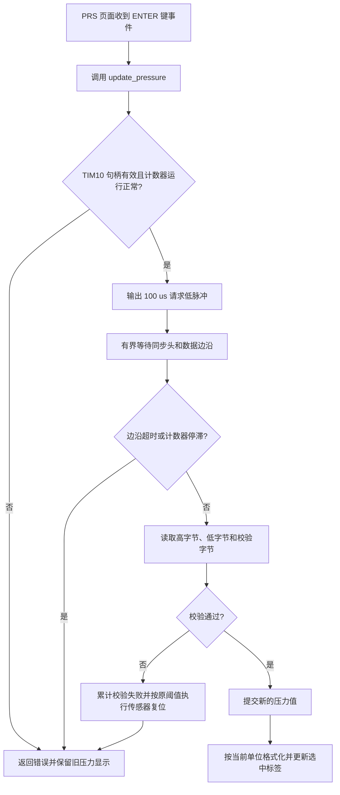
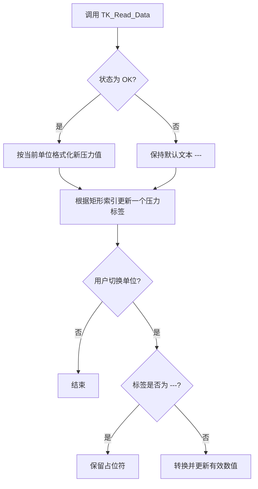
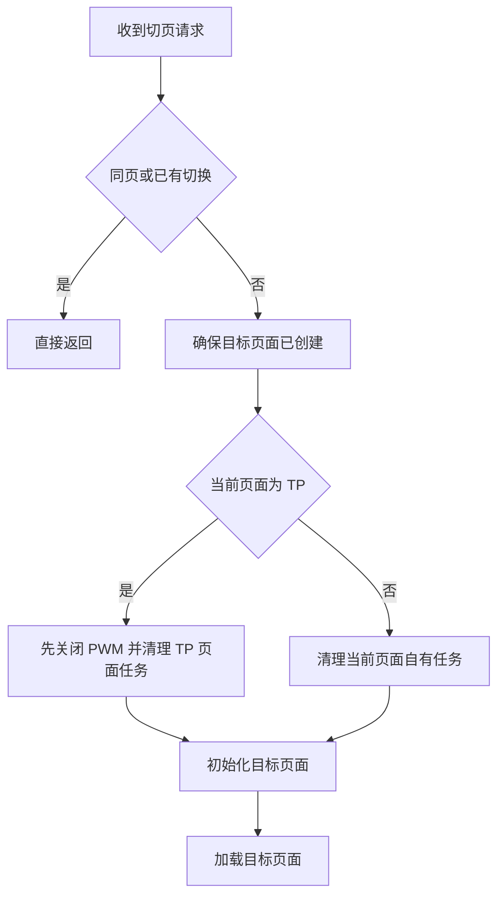

# Development Log

> Project: V50448_PYALLOK_test  
> MCU: PY32F403 | IDE: Keil MDK 5.28 | GUI: LVGL v7.10.1

---

## Session 2026-07-02 — Project Initialization

**Action:** Created 3 project documentation files:
- `Project_Architecture.md` — System architecture, peripheral mapping, design patterns
- `File_Structure.md` — Complete file tree with descriptions
- `Development_Log.md` — This log (new)

**Status:** Documentation baseline established. No code changes.

**Next Steps:** Pending user task assignment for upgrade/optimization work.

---

## Historical Context (from code analysis)

### Base Template
- Derived from Puya PY32F403 Firmware V1.4.4 SPI Full-Duplex Polling example
- Original readme.txt describes 2-board SPI master/slave communication test

### Evolution to Current Product
The project evolved significantly beyond the original SPI example:

1. **LVGL GUI added** — LVGL v7.10.1 integrated with Gui-Guider for screen design
2. **ST7735 LCD driver** — SPI-based 128x160 color display
3. **TPMS PWM modulation** — Ford protocol sub-cycle PWM for tire pressure sensor programming
4. **Power management** — Software-controlled power on/off with auto-shutdown
5. **Battery monitoring** — ADC + DMA for voltage sampling
6. **TK1300G3 charging IC** — Battery charge management
7. **External flash** — SPI flash for data storage
8. **Multi-screen UI** — Boot screen, PRS screen, TP screen with events

### Code Patterns Identified
- Global state organized in `_t` structs (tp_pwm, voltage_t, key, power, charge, delay)
- TIM3 128µs ISR drives PWM state machine with sub-cycle granularity
- TIM2 1ms ISR drives LVGL tick + system timing + 50ms software timers
- TIM10 provides base timing for TK1300G3 charging IC
- ADC DMA continuous conversion for battery voltage
- Power FSM: NVIC_SystemReset for power-on, GPIO for power-off

### Known Issues / Observations
- IWDG (watchdog) is configured but commented out in main()
- SPI2 init is commented out (external flash not currently used?)
- Code has both 48MHz and 144MHz clock options (48MHz active)
- Unused LVGL font files (montserrat 8-48, unscii, dejavu, simsun) are compiled — optimization opportunity
- Some commented-out alternative code paths exist in TIM3 ISR (ternary vs if-else)

---

## Session 2026-07-03 #2 — Code Reuse: Extract cont_bg into shared functions

### Task
Refactor duplicate `cont_bg` container creation code from `setup_scr_screen_PRS.c` and
`setup_scr_screen_TP.c` into reusable functions in `custom.c`, following a
LVGL 8.2.0-style `style_init() + create()` pattern adapted for LVGL v7.10.1.

### Analysis
- Both `screen_PRS_cont_bg` and `screen_TP_cont_bg` have **identical style properties**:
  bg=black(0x000000), opa=255, radius=0, border=1px black, shadow=0
- Each used 25 lines of duplicate `lv_cont_config_t` + `lvgl_create_cont()` code
- Only differences: parent, cont_out pointer, position, size (all parameterized via macros)

### Changes Made (spec only, pending execution by Trae)
Wrote `Guidance_Framework.txt` with 4 modification entries:

| # | File | Action |
|---|------|--------|
| 1 | `custom.h:73` | Add `create_page_cont_bg()` declaration |
| 2 | `custom.c:after 255` | Insert `style_page_cont_bg_init()` + `create_page_cont_bg()` |
| 3 | `setup_scr_screen_PRS.c:33-57` | Replace 25-line cont_bg block with 4-line call |
| 4 | `setup_scr_screen_TP.c:33-57` | Replace 25-line cont_bg block with 4-line call |

### Key Design Decisions
- **Lazy init pattern**: `static bool style_inited` flag — style auto-init on first call,
  no changes needed in `main()` or `custom_init()`
- **LVGL v7.10.1 API adaptation**: `lv_style_reset` (not `lv_style_init`),
  state-aware setters (3-arg), `lv_cont_create` (not `lv_obj_create`),
  `LV_CONT_PART_MAIN` for `lv_obj_add_style`
- **Preserves existing project idiom**: still uses `lv_cont_create` +
  `lv_cont_set_layout/fit` consistent with other code in the project

### New File Created
- `Guidance_Framework.txt` — Modification specification for Trae execution

### Status
⏳ Pending: Trae to execute edits per Guidance_Framework.txt
📋 Next: User to confirm execution or provide next optimization task

---

## Session 2026-07-03 #3 — Bug Fix + Cont Expansion + Label Unification

### 3A. Bug Fix: LVGL v7 API error
**Symptom:** Keil5 linker error `L6218E: Undefined symbol lv_obj_remove_style_all`
**Root cause:** Guidance_Framework v1 used `lv_obj_remove_style_all()` which is v8-only.
LVGL v7.10.1 has no such function.
**Fix:** Changed to `lv_obj_clean_style_list(cont, LV_OBJ_PART_MAIN)` — the correct v7 API.

### 3B. Cont Unification v2 — Rename + Expand Scope
- Renamed `create_page_cont_bg` → `create_page_cont` (generic, reusable for ALL conts)
- Identified that ALL 6 cont widgets (cont_bg ×2 + cont_body ×2 + cont_title ×2)
  across both PRS.c and TP.c share identical style properties
- Guidance_Framework v2 expanded from 2 cont_bg replacements to all 6 cont widgets
- Net reduction: ~-110 lines (6 × 24-line blocks → 6 × 3-line calls)

### 3C. Label Unification — New create_page_label()
- Identified ALL 10 labels across PRS.c (7) and TP.c (3) share identical visual style
- Designed `create_page_label()` with shared `style_page_label` (transparent bg,
  9px font, white text, letter_space=2, pad=(0,4,0,0))
- Function signature: `(parent, label_out, text, clickable, x, y, w, h)`
- Net reduction: ~-112 lines

### Guidance_Framework.txt — Final State
Rewritten cleanly with only the label unification task (cont work already executed):

| # | File | Action |
|---|------|--------|
| 1/4 | `custom.h` | Add `create_page_label()` declaration |
| 2/4 | `custom.c` | Add `style_page_label` + `create_page_label()` (~38 lines) |
| 3/4 | `setup_scr_screen_PRS.c` | 7 label blocks → 7× `create_page_label()` calls |
| 4/4 | `setup_scr_screen_TP.c` | 3 label blocks → 3× `create_page_label()` calls |

### Cumulative Session Results
| Metric | Value |
|--------|-------|
| Functions added to custom.c | `create_page_cont()` + `create_page_label()` |
| Shared styles | `style_page_cont` + `style_page_label` |
| Total boilerplate removed | ~-222 lines |
| Files touched | 4 (custom.h, custom.c, PRS.c, TP.c) |

### Status
✅ Cont unification — executed by Trae
✅ Label unification — executed by Trae between sessions

---

## Session 2026-07-06 #4 — Rect + Image + Menu Unification

### Session Start
- Resumed session `0d4543c0` — confirmed label unification completed by Trae
- All prior work (cont + label) compiled and linked successfully

### 4A. Rect Unification — create_page_rect()
- Identified 15 rect widgets across PRS.c (7) and TP.c (8) in 5 visual types
- Designed 5 shared static `lv_style_t` with `style_page_rect_init()` lazy-init
- Created `page_rect_style_t` enum for clean call sites
- Function signature: `(parent, &rect_out, x, y, w, h, hidden, style_type)` — 9 params
- Also simplified progress_block for-loop in TP.c
- Static style: 15 → 5 (-10 BSS objects)
- Net reduction: ~-128 lines

### 4B. Image Unification — create_page_img()
- Identified 3 identical img creation patterns across PRS.c, TP.c, boot.c
- Shared `style_page_img` (image_opa=255), lazy-init
- pivot=(50,50), angle=0 hardcoded (all 3 images identical)
- Function signature: `(parent, &img_out, src, clickable, x, y, w, h)` — 8 params
- Static style: 3 → 1 (-2 BSS objects)
- Net reduction: ~-12 lines

### 4C. Menu Screen — Events + Navigation
- `events_screen_menu.c` rewritten with:
  - img_pre click → `jump_to_other_page(SCREEN_PRS)`
  - img_tp click → `jump_to_other_page(SCREEN_TP)`
  - Default focus on img_pre via `lv_group_focus_obj()`
  - `screen_menu_del` flag to prevent double-jump
- `custom_types.h`: `Screen_Type_t` enum expanded with `SCREEN_MENU`
- `events_init.h`: added `events_init_screen_menu()` declaration
- `custom.c`: `jump_to_other_page()` added SCREEN_MENU case in both switch blocks

### Guidance_Framework.txt — Final State
Rewritten 3 times this session, currently contains Menu Screen Events spec only.
(Rect + Image specs already executed by Trae inline during session)

### Cumulative Session Results
| Metric | Value |
|--------|-------|
| New functions in custom.c | `create_page_rect()` + `create_page_img()` |
| New shared styles | 5× rect + 1× img = 6 total |
| New enum | `page_rect_style_t` (5 values) |
| Static style reduction | 18 → 6 (-12 BSS objects) |
| Total boilerplate removed | ~-140 lines (rect) + ~-12 lines (img) |
| Files touched this session | 8 (custom.h, custom.c, custom_types.h, events_init.h, events_screen_menu.c, PRS.c, TP.c, boot.c) |

### Reusable Function Library (cumulative)
| Function | Purpose | Styles |
|----------|---------|--------|
| `create_page_cont()` | Container widget | 1 shared |
| `create_page_label()` | Label widget | 1 shared |
| `create_page_rect()` | Rectangle widget | 5 shared (enum) |
| `create_page_img()` | Image widget | 1 shared |
| **Total** | **4 functions** | **8 shared styles** |

### Status
✅ Cont unification — executed (Session #3)
✅ Label unification — executed (between sessions)
✅ Rect unification — executed (this session)
✅ Image unification — executed (this session)
⏳ Menu events — pending, spec in Guidance_Framework.txt (superseded, see Session #5)
📋 Next: User to confirm menu execution or continue optimization (btn unification, font cleanup, IWDG)

---

## Session 2026-07-07 #5 — Menu imgbtn Conversion + LCD Bugs Fix

### Session Start
- Reviewed 3 project docs (Project_Architecture.md, File_Structure.md, Development_Log.md)
- Menu screen `events_screen_menu.c` already executed by Trae per Session #4 spec
- Menu had no keyboard response — two root causes identified

### 5A. Menu Keyboard Navigation — lv_img → lv_imgbtn

**Symptom**: img_pre/img_tp set as clickable images, but UP/DOWN/OK keys had no response.

**Root Cause 1**: Plain `lv_img` objects with `lv_obj_set_click(true)` only respond to touch/pointer click, not keyboard ENTER → LV_EVENT_CLICKED. Need proper button widget.

**Root Cause 2**: `lv_port_indev.c` KEY_UP/DOWN/OK only mapped for `KEY_MAPPING_NAVI_SCREEN_PRS/TP`, missing `KEY_MAPPING_NAVI_MENU`.

**Solution**: Convert images to image buttons using `lv_btn` + inner `lv_img` (not `lv_imgbtn` — `LV_USE_IMGBTN=0` in lv_conf.h, but `LV_USE_BTN=1` is available).

**Build Error**: First attempt used `lv_imgbtn_*` API (LV_USE_IMGBTN=0 → undeclared). Fixed by switching to `lv_btn_create` + `lv_img_create` pattern.

**Guidance_Framework.txt v1** — 5 modifications:
| # | File | Change |
|---|------|--------|
| 1 | `custom.h` | Add `create_page_imgbtn()` declaration |
| 2 | `custom.c` | Implement `create_page_imgbtn()` (lv_btn + lv_img, ~48 lines, lazy-init focus style) |
| 3 | `setup_scr_screen_menu.c` | 2× `create_page_img` → `create_page_imgbtn` |
| 4 | `events_screen_menu.c` | Rewrite: enable `screen_menu_del` protection, add `lv_group_remove_all_objs` |
| 5 | `lv_port_indev.c` | Expand KEY_OK/UP/DOWN conditions for `KEY_MAPPING_NAVI_MENU` |

**Status**: ✅ Spec written; executed by Trae (verified compiled successfully after API fix)

### 5B. Group Residue Bug — Menu Navigation After ESC from PRS/TP

**Symptom**: From menu → PRS/TP → ESC back to menu, UP/DOWN cycles through 7 objects (5 PRS/TP residue + 2 menu imgbtns) instead of just 2.

**Root Cause**: `events_init_screen_menu()` lacked `lv_group_remove_all_objs(global_group)`. PRS and TP both have this call (lines 61/76), but menu didn't.

**Guidance_Framework.txt v2** — 1 modification:
| # | File | Change |
|---|------|--------|
| 1 | `events_screen_menu.c` | +1 line: `lv_group_remove_all_objs(global_group)` before adding menu objects |

**Status**: ✅ Spec written, pending execution

### 5C. LCD Dual-MCU Switch Bug — SGM5018 PY↔BAT

**Symptom 1** (PY→BAT): LCD stays showing PY's last frame until ESC pressed.

**Symptom 2** (BAT→PY): Only 2 imgbtns refresh; BAT's screen elements persist as residue.

**Root Cause 1**: `key_mode()` disconnects LCD (`CLR_LCM_SWITCH`) without turning off backlight. ST7735 GRAM retains PY's frame, backlight stays on.

**Root Cause 2**: After `SET_LCM_SWITCH`, `jump_to_other_page(SCREEN_MENU)` detects `act_scr == screen_menu` → returns early → no screen reload → no full flush. Only changed imgbtn areas get redrawn.

**Guidance_Framework.txt v3** — 2 modifications:
| # | File | Change |
|---|------|--------|
| 1 | `keys.c` | +1 line: `CLR_LCD_LEDK` before `CLR_LCM_SWITCH` |
| 2 | `lv_port_indev.c` | +1 line: `lv_obj_invalidate(lv_scr_act())` after `jump_to_other_page` |

**Status**: ✅ Spec written, pending execution

### 5D. LCD White Bars Bug — ST7735 Resolution Mismatch

**Symptom**: First jump menu→PRS/TP shows white bars at bottom+right. Subsequent jumps don't.

**Root Cause**: `st7735P3.h` has `ST7735_WIDTH=162, ST7735_HEIGHT=130` (with +2px offset for screens with pixel偏差). Current screen is 160x128 with no偏差. LVGL flush covers 160x128, leaving right 2 cols + bottom 2 rows of GRAM untouched → white bars.

**Guidance_Framework.txt v4** — 2 modifications:
| # | File | Change |
|---|------|--------|
| 1 | `st7735P3.h` | WIDTH 162→160, HEIGHT 130→128 |
| 2 | `lv_conf.h` | LV_HOR_RES_MAX 130→160, LV_VER_RES_MAX 162→128 |

**Status**: ✅ Spec written, pending execution

---

### Cumulative Session Summary

| Issue | Root Cause | Files | Spec Status |
|-------|-----------|-------|-------------|
| Menu no keyboard response | lv_img + missing KEY_MAPPING_NAVI_MENU | 5 | ✅ Executed |
| Group residue from PRS/TP | Missing lv_group_remove_all_objs | 1 | ⏳ Pending |
| PY↔BAT LCD stale content | Backlight not off + early return | 2 | ⏳ Pending |
| White bars first load | ST7735 162x130 → should be 160x128 | 2 | ⏳ Pending |

### Current Guidance_Framework.txt Status
Contains the latest spec (5D: White Bars Fix — 160x128 resolution correction).
Previous specs (5A/5B/5C) were overwritten — each executed before the next was written.

### State After This Session
- `Guidance_Framework.txt` — 160x128 resolution fix (2 files, pending Trae)
- `custom.h/.c` — `create_page_imgbtn()` function added (Session 5A, executed)
- `events_screen_menu.c` — modified with imgbtn events (Session 5A, executed), group cleanup (5B, pending)
- `lv_port_indev.c` — KEY_MAPPING_NAVI_MENU mappings added (5A, executed), lv_obj_invalidate (5C, pending)
- `keys.c` — CLR_LCD_LEDK in key_mode (5C, pending)
- `st7735P3.h` — resolution fix (5D, pending)
- `lv_conf.h` — LV_HOR/VER_RES_MAX fix (5D, pending)

📋 **Next Session**: Execute pending changes (5B/5C/5D), verify compilation, test LCD switching and navigation flows. Future optimizations: btn unification, unused font cleanup, IWDG enablement.

---

## Session 2026-07-07 #6 — Menu imgbtn Half-Screen Layout + Orange Focus Outline

### Session Start
- Reviewed 3 project docs per CLAUDE.md protocol
- User requested menu imgbtn position rework + focus style change

### Task: Reposition Menu imgbtn to Half-Screen Width

**Requirements:**
1. img_pre / img_tp vertical center on LCD
2. img_pre in left half, img_tp in right half
3. Focus outline wraps around btn, outline width = half screen (80px)
4. Image 50×50 unchanged, btn expanded to 80×80, img centered inside
5. Focus outline color: orange (#FFA500), width 2px, radius=0

### Analysis

**Current Layout:**
| Widget | x | y | w | h |
|-----------|---|---|---|---|
| img_pre | 18 | 32 | 50 | 50 |
| img_tp | 85 | 32 | 50 | 50 |

- btn = img = 50×50 (no separation)
- Positions offset from center
- Focus outline too small (50px) and white color

**New Layout Calculation:**
```
LCD: 160×128, half-width = 80px
btn: 80×80, img: 50×50 (centered with offset 15,15)

Vertical center: y = (128-80)/2 = 24
Left half:  btn.x = 0,  btn.w = 80
Right half: btn.x = 80, btn.w = 80
```

| Widget | btn (x,y,w,h) | img offset | img size |
|--------|---------------|------------|----------|
| img_pre | (0, 24, 80, 80) | (15, 15) | 50×50 |
| img_tp | (80, 24, 80, 80) | (15, 15) | 50×50 |

### Design Decisions

1. **btn ≠ img size**: `create_page_imgbtn()` signature changed from `(x,y,w,h)` to `(x,y,btn_w,btn_h,img_w,img_h)` — img auto-centered via `(btn - img) / 2` offset
2. **Outline vs Border**: Using LVGL `outline` (drawn outside object) instead of `border` (drawn inside) — outline doesn't overlap the 50×50 image area
3. **Orange color**: `lv_color_hex(0xFFA500)` — standard orange, consistent with project's `custom_color.h` style
4. **Radius=0**: Explicitly set on btn default state for sharp rectangular focus outline

### Guidance_Framework.txt — Final State

Complete spec written with 3-file modification plan:

| # | File | Change |
|---|------|--------|
| 1 | `custom.h` | `create_page_imgbtn()` signature: w/h → btn_w/btn_h + img_w/img_h |
| 2a | `custom.c` | `style_page_imgbtn_init()`: white→orange, outline 1→2px, +radius=0 |
| 2b | `custom.c` | `create_page_imgbtn()`: img centered in btn, offset = (btn-img)/2 |
| 3 | `setup_scr_screen_menu.c` | img_pre (0,24,80×80), img_tp (80,24,80×80), img 50×50 |

### Cumulative Project Status

| Session | Work | Status |
|---------|------|--------|
| #2 | Cont unification (create_page_cont) | ✅ Executed |
| #3 | Label unification + cont expansion | ✅ Executed |
| #4 | Rect + Image unification + menu events | ✅ Executed (menu ⏳→#5) |
| #5 | Menu imgbtn conversion + LCD bugs (5B/5C/5D) | 5A✅, 5B/5C/5D ⏳ |
| #6 | Menu half-screen layout + orange focus | ⏳ Pending |

### Pending Tasks (cumulative)

| # | Issue | Files | Severity |
|---|-------|-------|----------|
| 5B | Group residue after ESC from PRS/TP | 1 | 🟡 UX |
| 5C | LCD dual-MCU switch stale content | 2 | 🟡 UX |
| 5D | LCD white bars (ST7735 162→160) | 2 | 🔴 Display |
| 6 | Menu half-screen btn + orange focus | 3 | 🟢 Enhancement |

📋 **Next Session**: Execute oldest pending changes first (5B/5C/5D), then 6. Future optimizations: btn unification, unused font cleanup, IWDG enablement.

---

## Session 2026-07-08 #7 — imgbtn Label Addition + LV_LAYOUT_CENTER Fix + HW Analysis

### Session Start
- Reviewed project docs, User continued menu imgbtn refinement from Session #6
- Trae had partially executed Session #6 spec (macros in custom_size.h, function signature)

### 7A. Menu imgbtn: img-top + label-bottom Layout

**Requirements:**
1. img移到btn顶部(y=0)，水平居中
2. img下方添加label：img_pre → tr(TEXT_PRES) = "PRES", img_tp → "TP"
3. label样式：白色, model_select_title_txt_9px, 透明背景
4. img + label 占满 btn 高度

**btn内部布局 (76×76):**
```
┌──────────────────────┐ y=0
│    ┌──────────┐      │ img: x=(76-50)/2=13, y=0, 50×50
│    │  PRE/TP  │      │
│    └──────────┘      │ y=50
│       PRES / TP      │ label: x=0, y=50, w=76, h=26
└──────────────────────┘ y=76    white 9px center-aligned
```

**Changes executed by Trae:**
| # | File | Change |
|---|------|--------|
| 1 | `custom.h` | `create_page_imgbtn()` Signature: add `const char *label_text` param |
| 2 | `custom.c` | Add `style_page_imgbtn_label` (white 9px, transparent bg) |
| 3 | `custom.c` | img y: (btn_h-img_h)/2 → 0 (top); label at y=img_h, h=btn_h-img_h |
| 4 | `setup_scr_screen_menu.c` | Calls updated: img_pre → tr(TEXT_PRES), img_tp → "TP" |

### 7B. Bug Fix: LV_LAYOUT_CENTER Overriding Child Positions

**Symptom:** img y=100 still displayed at top, label y=0 still displayed at bottom. `lv_obj_set_pos()` Y values completely ignored.

**Root Cause:** `lv_btn.c:90` auto-sets layout on btn creation:
```c
// lv_btn_create() in lv_btn.c:88-91
if(par) {
    lv_btn_set_layout(btn, LV_LAYOUT_CENTER);  // ← forces all children to center!
}
```
`LV_LAYOUT_CENTER` auto-positions all children vertically centered, overriding manual `lv_obj_set_pos()` Y coordinates.

**Call chain:**
```
create_page_imgbtn()
  └→ lv_btn_create(parent, NULL)
       └→ lv_cont_create()
       └→ lv_btn_set_layout(btn, LV_LAYOUT_CENTER)  ← root cause
       └→ lv_theme_apply(btn, LV_THEME_BTN)          ← material theme: styles only, no layout
```

**Fix:** Add after `lv_btn_create()`:
```c
lv_btn_set_layout(btn, LV_LAYOUT_OFF);  // disable auto-layout, manual set_pos works
```

### 7C. Label Horizontal Centering Fix

**Symptom:** Label text not centered horizontally within btn.

**Fix:** Use `lv_obj_align()` with `LV_ALIGN_IN_TOP_MID`:
```c
// Before: lv_obj_set_pos(label, 0, img_h);  // left-aligned
// After:
lv_obj_align(label, NULL, LV_ALIGN_IN_TOP_MID, 0, img_h);
```
Ensure label width = btn_w (not LV_SIZE_CONTENT) so `LV_LABEL_ALIGN_CENTER` takes effect.

### 7D. Hardware Analysis: ST7735 XSTART/YSTART Offset

**Question:** Why XSTART=1, YSTART=2 needed for display alignment?

**Analysis:**
- ST7735 controller GRAM is 132×162 (larger than panel)
- LCD panel visible area is a sub-region of GRAM
- (XSTART, YSTART) = (1, 2) is the panel's starting position within GRAM
- Values determined by LCD module manufacturer (FPC routing position)
- NOT a calculation — measured/from datasheet
- `ST7735_SetAddressWindow()` applies offset: `x_start += XSTART`

**Conclusion:** Hardware characteristic of this specific LCD module, cannot be zeroed.

### 7E. Hardware Analysis: PY32F403 SWD Identified but Flash Download Failed

**Symptom:**
```
Cortex-M4 identified       ✅
Full Chip Erase Done       ✅
Programming Failed         ❌  Cannot setup Breakpoint at Address
```

**Root Cause Analysis (95% probability): VCAP capacitor missing**

PY32F403 internal 1.2V LDO for core requires external VCAP capacitor:

| Operation | Current | VCAP w/o Capacitor |
|-----------|---------|--------------------|
| SWD Read ID | ~2mA | ✅ Stable |
| Flash Erase | ~5mA | ✅ Short pulse OK |
| Flash Write | ~15-25mA | ❌ 1.2V droops → write fails |

**Checklist:**
| Pin | Required | Purpose |
|-----|----------|---------|
| **VCAP_1** | 4.7µF + 100nF to GND | Core LDO bypass (**critical!**) |
| VCAP_2 | 4.7µF to GND (if present) | Same |
| VDD | 100nF decoupling | Power stability |
| VBAT | 100nF to GND | Backup domain |
| NRST | 100nF to GND + 10KΩ pull-up | Clean reset |
| BOOT0 | Pull to GND | Boot from Flash |

### Cumulative Project Status

| Session | Work | Status |
|---------|------|--------|
| #2 | Cont unification (create_page_cont) | ✅ Executed |
| #3 | Label unification + cont expansion | ✅ Executed |
| #4 | Rect + Image unification + menu events | ✅ Executed |
| #5 | Menu imgbtn conversion + LCD bugs (5B/5C/5D) | 5A✅, 5B/5C/5D ⏳ |
| #6 | Menu half-screen layout + orange focus | ✅ Executed (#7) |
| #7 | imgbtn label + LV_LAYOUT_CENTER fix + HW analysis | ✅ Executed |

### Session #7 Key Takeaways

| Takeaway | Detail |
|----------|--------|
| **lv_btn auto-layout** | `lv_btn_create()` → `LV_LAYOUT_CENTER` → overrides `lv_obj_set_pos()` for children |
| **Fix pattern** | Always add `lv_btn_set_layout(btn, LV_LAYOUT_OFF)` after creating custom btns |
| **ST7735 offset** | XSTART/YSTART are hardware characteristics, stored as #define, auto-applied in SetAddressWindow |
| **PY32F403 VCAP** | Missing VCAP capacitor = erase OK but write fails (asymmetric failure signature) |

### Session #8 — Dual Power Source Separation: Analysis & Design

**Date:** 2026-07-15
**Type:** Analysis & Design (No code execution)
**Output:** `Guidance_Framework.txt` — complete modification spec for Trae

**Background:**
Project originally treated two power sources identically (9V battery and 12V DC plug-in). Both used the same auto-shutdown logic (120s idle → power off). The 12V DC plug-in (socket) should keep the device always-on with no auto-shutdown.

**Requirement:**
- Detect power source: ADC pin voltage `<= 1V` → 9V battery, `> 1V` → 12V DC
- 9V battery: auto-shutdown ENABLED (existing behavior, 120s = 2400 ticks)
- 12V DC plug-in: auto-shutdown DISABLED (counter always 0)
- Manual long-press shutdown (KEY_O) works on BOTH power sources

**Analysis (3 files touched):**

| # | File | Lines | Change | Type |
|---|------|-------|--------|------|
| 1 | `MDK-ARM/bsp_adc.h` | 33-42 | Add `Power_Source_t` enum + `Voltage_t.powerSource` field | New code |
| 2 | `MDK-ARM/bsp_adc.c` | 174-184 | Detect power source in `ADC_convert()` after `get_Voltage()` | New code |
| 3 | `Src/main.c` | 223-226 | Gate `AutomaticShutdownCnt` on `powerSource == BATTERY_9V` | Modify |

**Design Decisions:**
1. **Safe default**: `POWER_SOURCE_DC_12V = 0` → struct zero-init defaults to no auto-shutdown
2. **Detection placement**: Inside `ADC_convert()`, after `get_Voltage()`, every ADC cycle (~50ms)
3. **Pin voltage formula**: `ADC_VBAT_Data × VDD / 4095`, compared against 1000mV threshold
4. **Manual shutdown preserved**: `ShutdownCountdownTime` (KEY_O long-press) untouched — works regardless of power source

**Behavior matrix:**

| Scenario | 9V Battery | 12V DC Plug-in |
|----------|------------|----------------|
| Auto-shutdown (120s idle) | ✅ Enabled | ❌ Disabled |
| Manual long-press shutdown | ✅ Works | ✅ Works |
| Boot default (before 1st ADC) | — | Safe (0 = DC_12V) |

**Files read for context:** `Project_Architecture.md`, `File_Structure.md`, `Src/main.c`, `Inc/main.h`, `MDK-ARM/bsp_adc.c/.h`, `MDK-ARM/bsp_power.c/.h`, `MDK-ARM/bsp_gpio.h`, `MDK-ARM/bsp_tim.h`, `MDK-ARM/keys.c/.h`, `MDK-ARM/custom_types.h`

### Key Design Patterns Identified

| Pattern | Detail |
|---------|--------|
| **Struct-based globals** | All globals organized in typed structs: `Voltage_t`, `Power_t`, `Key_t`, `Delay_t`, `Charge_t` |
| **50ms tick system** | TIM2 ISR fires `ms_counter` decrement → all timing derived from 50ms base |
| **ADC DMA chain** | ADC trigger (50ms flag) → DMA conversion → `ADCConversionDone` → `get_Voltage()` |
| **Power FSM** | `powerOnandOff()` checks `powerOnFlag` vs `lastPowerOnFlag` delta, drives GPIO |

### Session #8 Key Takeaways

| Takeaway | Detail |
|----------|--------|
| **Power source detection** | Use raw ADC pin voltage before divider compensation; 1V threshold cleanly separates 9V/12V |
| **Safe default pattern** | Enum value 0 = safe mode (DC, no shutdown); zero-init structs automatically safe |
| **ADC_convert() cadence** | Called in main while(1) but gated by `ADCITFlag` (50ms TIM2 tick); non-blocking DMA |
| **Guidance_Framework format** | Structured as: requirement → flowchart → per-file mods (old→new blocks + line numbers) |

### Cumulative Project Status

| Session | Work | Status |
|---------|------|--------|
| #2 | Cont unification (create_page_cont) | ✅ Executed |
| #3 | Label unification + cont expansion | ✅ Executed |
| #4 | Rect + Image unification + menu events | ✅ Executed |
| #5 | Menu imgbtn conversion + LCD bugs (5B/5C/5D) | 5A✅, 5B/5C/5D ⏳ |
| #6 | Menu half-screen layout + orange focus | ✅ Executed (#7) |
| #7 | imgbtn label + LV_LAYOUT_CENTER fix + HW analysis | ✅ Executed |
| #8 | Dual power source sep → Guidance_Framework.txt | ✅ Analysis done, PENDING Trae |
| #9 | ADC_3V3→GPIO + KEY_IM_L power-on fix → Guidance_Framework | ✅ Analysis done, PENDING Trae |

---

### Session #9 — HW Optimization + Bug Fix: ADC_3V3 GPIO + KEY_IM_L Power-On

**Date:** 2026-07-16
**Type:** Analysis & Design (No code execution)
**Output:** `Guidance_Framework.txt` — two modification specs

#### Part A: ADC_3V3_PIN ADC Sampling → GPIO Digital Input

**Background:** Hardware circuit changed. PA6 (ADC_3V3_PIN) no longer needs ADC sampling:
- 12V DC plug-in → PA6 = LOW (hardware pulls low)
- 9V battery → PA6 = HIGH (hardware pulls high)

Simple GPIO input read replaces ADC threshold comparison. Simpler, more reliable.

**Changes (2 files):**

| # | File | Lines | Change |
|---|------|-------|--------|
| 1 | `MDK-ARM/bsp_adc.h` | L22,31,39-49 | `ADC_CHANNEL_CNT` 3→2, remove `BATTERY_LEVEL_SOURCE`, remove `ADC_3V3_Data`, `gADCxConvertedData[3]→[2]` |
| 2 | `MDK-ARM/bsp_adc.c` | Init L25,60-67,71; MspInit L102,109-112; ADC_convert L178-183 | Remove CH6 from scan, PA6→GPIO_INPUT, VREFINT Rank3→Rank2, GPIO_ReadPin replaces threshold |

**Key design:** `HAL_GPIO_ReadPin(ADC_3V3_PORT, ADC_3V3_PIN) == SET ? BATTERY_9V : DC_12V`

#### Part B: KEY_IM_L Cannot Power-On After 12V DC Shutdown (Bug Fix)

**Symptom:** 12V DC powered, long-press KEY_IM_L → shutdown OK. After shutdown, KEY_IM_L short/long press → no response, cannot power on.

**Root Cause:** `read_my_key()` [keys.c:124-125]

```c
// KEY_IM hardware read at L114 → key_MSB bit0=1 ✅
if (!power.powerOnFlag)
    return 0;  // ❌ Discards KEY_IM before key_MSB→key_id conversion!
```

KEY_IM hardware state is correctly captured, but the `return 0` on L125 throws it away before the bit→ID conversion loop at L171. Result: `My_keypad_get_key()` returns 0 → `keypad_read()` never enters `case KEY_IM` → `KEY_O_long_flag` never set → cannot power on.

**Fix (1 file, 1 location):**

| File | Lines | Change |
|------|-------|--------|
| `MDK-ARM/keys.c` | L124-125 | `if (!powerOnFlag) return 0` → check `key_MSB & KEY_IM` first, allow KEY_IM through |

```c
// NEW: When powered off, only KEY_IM_L can wake the system
if (!power.powerOnFlag) {
    if (key_MSB & (0x0001 << (KEY_IM - 1)))
        return KEY_IM;  // Allow power-on
    return 0;           // Block other keys
}
```

**Power-on sequence (fixed):**
```
Short-press KEY_IM → read_my_key() return 1 → My_keypad_get_key() return 1
→ keypad_read(): single_click → KEY_O_long_flag=1
→ TIM2 ISR: ShutdownCountdownTime++ ≥ 1 → powerOnFlag=1
→ powerOnandOff(): SET_SYS_PWREN → Power ON ✅
```

### Session #9 Key Takeaways

| Takeaway | Detail |
|----------|--------|
| **ADC→GPIO simplification** | When hardware provides clean digital level, skip ADC sampling entirely — GPIO read is simpler, faster, and more reliable |
| **Early-return pitfall** | `if (!powerOnFlag) return 0` placed AFTER hardware read but BEFORE data processing → silently drops valid input |
| **Power button special case** | Power button MUST bypass the "off state" key filter; it's the only key that needs to work when system is off |
| **Call chain trace** | Bug required tracing through 4 functions across 3 files: read_my_key → My_keypad_get_key → keypad_read → TIM2 ISR |

### Cumulative Project Status

| Session | Work | Status |
|---------|------|--------|
| #2 | Cont unification (create_page_cont) | ✅ Executed |
| #3 | Label unification + cont expansion | ✅ Executed |
| #4 | Rect + Image unification + menu events | ✅ Executed |
| #5 | Menu imgbtn conversion + LCD bugs (5B/5C/5D) | 5A✅, 5B/5C/5D ⏳ |
| #6 | Menu half-screen layout + orange focus | ✅ Executed (#7) |
| #7 | imgbtn label + LV_LAYOUT_CENTER fix + HW analysis | ✅ Executed |
| #8 | Dual power source sep (ADC threshold) → Guidance_Framework | ✅ Superseded by #9A |
| #9 | ADC_3V3→GPIO + KEY_IM_L power-on fix → Guidance_Framework | ✅ Analysis done, PENDING Trae |

### Pending Tasks (cumulative)

| # | Issue | Files | Severity |
|---|-------|-------|----------|
| 5B | Group residue after ESC from PRS/TP | 1 | 🟡 UX |
| 5C | LCD dual-MCU switch stale content | 2 | 🟡 UX |
| 5D | LCD white bars (ST7735 162→160) | 2 | 🔴 Display |
| 9A | ADC_3V3→GPIO input (remove ADC CH6, PA6 digital read) | 2 | 🟡 HW Optimize — PENDING Trae |
| 9B | KEY_IM_L power-on fix (allow KEY_IM when powered off) | 1 | 🔴 Bug — PENDING Trae |

📋 **Next Session**: Trae execute Guidance_Framework #9A (2 files) + #9B (1 file). #8A superseded by #9A. Continue pending 5B/5C/5D fixes.

---

### Session #10 — ST7735 LCD 刷新优化与 SPI1 TX DMA 分层实施

**日期：** 2026-09-11  
**类型：** 已授权代码实施（未编译、未烧录）  
**当前规格：** `Frame_Guidance.txt`，`Guidance-ID: LCD-REFRESH-OPT-20260911`，Revision 3

#### 现象与根因

- ST7735 白边已由 `XSTART = 1`、`YSTART = 2` 修正，本次未再调整显示坐标和初始化参数。
- Revision 1 将 SPI1 分频从 `/4` 调整为 `/2`，并把逐行阻塞发送合并为单显示区域连续发送；实板反馈刷新速度仍不足。
- 剩余主要软件瓶颈是 LVGL flush 仍通过阻塞式 SPI 发送，传输期间 CPU 无法与下一缓冲区渲染重叠。
- 引入异步 DMA 后，关机路径中的直接 `LCD_fillScreen()` 可能与未完成的 LVGL flush 争用 SPI1，因此同步保护属于本次 DMA 实施的必要组成。

#### 实施结果

| 文件 | 核心修改 |
|------|----------|
| `MDK-ARM/bsp_spi.c` | SPI1 保持 `/2` 分频，系统时钟与 APB 分频不变 |
| `MDK-ARM/bsp_dma.c/.h` | 私有持有 DMA1 Channel 5 句柄；配置 SPI1 TX 映射、字节对齐、Normal 模式和高 DMA 优先级；提供初始化及 IRQ 转发接口 |
| `Src/main.c` | 按 `SPI1 → DMA1 Channel 5 → ST7735 → LVGL` 顺序完成系统装配；DMA 初始化失败进入 `APP_ErrorHandler()`；关机直写 LCD 前执行 20 ms 有界 flush 等待 |
| `Src/py32f403_it.c` | 统一持有 DMA1 Channel 5 和 SPI1 的真实中断入口，DMA 中断通过 BSP 窄接口转发 |
| `Middlewares/LVGL_v7.10.1/lvgl/examples/porting/lv_port_disp.c/.h` | 使用两个 40 行静态缓冲区和 SPI TX DMA 异步 flush；完成、错误及启动失败路径统一且仅一次归还 LVGL 缓冲区；移除 DMA 资源配置和真实 IRQ 入口 |

#### 资源与分层结果

- 两个 `160 × 40 × RGB565` 缓冲区总计 25,600 字节，与原单个 80 行缓冲区总容量一致。
- DMA1 Channel 5 属于 BSP DMA 层，DMA 句柄不对外暴露；`main.c` 作为应用装配入口控制跨模块初始化顺序。
- LVGL 显示端口只负责显示 flush 生命周期，`py32f403_it.c` 只负责真实向量入口，`bsp_spi.c` 不承担 DMA 初始化。
- ADC 继续独占 DMA1 Channel 1；系统时钟、ST7735 偏移、色彩格式、刷新周期、Keil 工程和启动文件均未修改。

#### 验证

- 已完成静态核对：DMA 映射与 SPI 句柄链接、初始化顺序、中断/回调唯一性、双缓冲容量、flush-ready 恰好一次语义、直接 LCD 写入同步和修改范围均符合 Revision 3。
- Revision 1 和 Revision 2 已分别归档；Revision 2 快照长度为 7,552 字节，SHA-256 为 `19AD355092C5EA307CADFDC9F0C48C0F51DEE3B35992AC650318F0507399583B`，与归档前原文件一致。
- 未执行 Keil 编译、烧录或 DMA 实板测试，因此编译结果、实际帧率、SPI 波形连续性和长时间稳定性尚未验证。

#### 后续回归建议

- 获得编译授权后执行 Keil Build，确认无新增错误/警告并核对 Map 中缓冲区 RAM 占用。
- 实板覆盖启动、菜单、PRS、TP、全屏切换、局部更新和关机路径，检查丢行、撕裂、花屏、闪烁及死锁。
- 使用逻辑分析仪确认 SPI1 SCK 约为 12 MHz、DMA 像素段连续，并量化 Revision 3 相对 Revision 1 的全屏切换时间和主循环响应改善。

---

### Session #11 — 双主控 LCD 切换残留现象记录

**日期：** 2026-09-13  
**类型：** 实板现象记录（用户检查确认为硬件问题）  
**关联规格：** `Frame_Guidance.txt`，`Guidance-ID: KEY-MODE-NAVIGATION-TIMING-CLEANUP-20260912`，Revision 2

#### 复现路径与现象

1. 系统开机后由 Boot 页面进入 PY32F403 的 Menu 页面。
2. 从 Menu 切换到 BAT32F403：BAT 页面能够成功刷新，未残留 PY 页面内容。
3. 从 BAT 切换回 PY32F403 的 Menu 页面：LCD 仍残留 BAT 页面内容。
4. 随后从该 Menu 页面再次直接切换到 BAT32F403：LCD 出现 PY 页面内容残留。

#### 当前结论

- 用户已通过检查确认该双向 LCD 内容残留现象属于硬件问题。
- 当前仅记录实板复现结果；具体硬件器件、网络、时序或电气根因尚未提供，因此未将细分根因记录为已闭环。
- 本 Session 未继续调整双主控切换逻辑，也未修订当前 `Frame_Guidance.txt`。

#### 变更与验证状态

- 修改文件：`Development_Log.md`。
- 未修改项目代码、Keil 配置、启动文件、链接文件或其他项目管理文档。
- 未执行编译、烧录、调试器操作或额外实板验证。

#### 本 Session 前序开发补充总结

前述“未继续调整双主控切换逻辑”仅指收到本次硬件问题实板结论后未再修改代码；在该现象记录之前，本 Session 已完成以下获授权开发。

##### 1. ST7735 地址窗口 CS 优化

- 任务：优化 `ST7735_SetAddressWindow()` 的 CASET、RASET、RAMWR 地址窗口事务，减少重复拉高/拉低 LCD CS。
- 根因：原 HAL SPI 路径逐字节调用发送函数，并在每个字节前后重复切换 CS，增加了不必要的软件和 GPIO 开销。
- 实施：在 `MDK-ARM/st7735P3.c` 的 HAL SPI 路径中，将列地址和行地址分别组成四字节缓冲区；完整地址窗口事务只拉低、释放 CS 各一次，并由五次阻塞 HAL SPI 发送完成。所有发送结果均检查，失败路径先释放总线再进入错误处理；无 SPI 句柄时的 bit-bang 兼容路径保持不变。
- 边界：未把命令和参数传输改为 DMA，未修改 ST7735 尺寸、偏移、初始化表或调用接口。
- 历史规格：`History_Guidance/2026-09-12/Frame_Guidance_2026-09-12_223113_st7735-address-window-cs-opt_r01.txt`。

##### 2. Mode 延时与标志清理 Revision 1

- 任务：简化 `KEY_MAPPING_NAVI_BATIC`/`KEY_MAPPING_NAVI_MENU` 切换流程，将 `ANIM_DELAY` 从 500 ms 调整为 100 ms，并保持两种模式的背光恢复时间为 800 ms。
- 实施：移除 `Delay_t`、`key.mode_flag`、`key.screen_jumb_flag` 及 TIM2 中两套重复计数逻辑；增加主循环调用的非阻塞 `key_mode_process()`；`key_mode()` 改为返回目标按键映射，输入端直接按返回值决定是否进入 Menu。
- 修改文件：`Src/main.c`、`MDK-ARM/keys.c`、`MDK-ARM/keys.h`、`MDK-ARM/bsp_tim.h`、`Middlewares/LVGL_v7.10.1/lvgl/examples/porting/lv_port_indev.c`、`Middlewares/custom/custom.h`。
- 修订原因：Revision 1 曾把“BATIC 延时 500 ms”解释为延迟执行 `SET_POWER_OFF`，并把返回 Menu 后的整屏失效判断为冗余；后续确认的双主控供电和 LCD GRAM 共享事实证明这两个假设不成立，因此 Revision 1 已被 Revision 2 取代。
- 历史规格：`History_Guidance/2026-09-12/Frame_Guidance_2026-09-12_233939_key-mode-navigation-timing-cleanup_r01.txt`。

##### 3. 双主控 LCD 交接修正 Revision 2

- 硬件事实：`SET_SYS_PWREN` 拉高维持整机供电；`SET_POWER_OFF` 拉高维持 BAT32F403 局部供电；`LCM_SWITCH` 只切换单块 LCD 的主控连接，不清除或同步 ST7735 GRAM。
- 根因：延迟 500 ms 才给 BAT 上电，使 BAT 在800 ms背光恢复前仅剩约300 ms启动和刷新；返回 PY 时若逻辑活动页已经是 Menu，`jump_to_other_page()`会提前返回，缺少整屏失效后仅发生局部刷新；异步 SPI DMA 还要求在改变 LCD 所属主控前完成当前 flush。
- 实施：Mode 切换前使用现有 `lv_port_disp_wait_flush()`执行20 ms有界等待，超时则不改变映射、GPIO或计时状态；进入 BATIC 时切换 LCD 后立即拉高 `SET_POWER_OFF`；返回 PY 时先切回 LCD，再关闭 BAT 局部供电，并在请求 Menu 后执行 `lv_obj_invalidate(lv_scr_act())`；延时状态进一步缩减为单一的800 ms背光恢复标志。
- 修改文件：`MDK-ARM/keys.c`、`MDK-ARM/keys.h`、`Middlewares/LVGL_v7.10.1/lvgl/examples/porting/lv_port_indev.c`。
- 当前规格：`Frame_Guidance.txt`，`Guidance-ID: KEY-MODE-NAVIGATION-TIMING-CLEANUP-20260912`，Revision 2。

#### 前序开发验证与遗留事项

- 已完成静态验证：声明/定义/调用关系、延时常量、旧标志和旧500 ms BAT上电动作残留、花括号平衡、修改白名单及两次规格归档完整性检查均通过。
- 未执行 Keil 编译、烧录或由助手操作的实板验证，因此编译结果、DMA切换波形和双主控长期切换稳定性未由本 Session 的自动验证闭环。
- 用户后续实板检查得到的双向画面残留及“硬件问题”结论已记录在本 Session 前半部分；具体硬件器件、网络和电气根因仍待硬件侧记录。
- `Project_Architecture.md`、`File_Structure.md` 和 Keil 调试配置未在本 Session 更新。

---

### Session #12 — 页面跳转去重与 TK1300G3 有界定时读取优化

**日期**：2026-09-14  
**类型**：已授权代码实施、静态复核与下次 Session 交接准备  
**当前规格**：`TK1300G3-BOUNDED-TIMER-READ-20260914`，Revision 1  
**验证边界**：未执行编译、烧录、在线调试或实板测试

#### 1. 项目上下文与范围确认

- 按需查看了项目架构、文件结构、开发日志末尾、当前指导规格、Keil Target 字段及本次调用链源码。
- Keil Target 设备字段为 `PY32F403xC`，工程编译宏为 `PY32F403xD`；两套器件头文件均已确认包含 TIM10，但该配置不一致仍需后续单独核验，本 Session 未修改工程配置。
- 本 Session 的代码实施严格限定于页面跳转函数和 TK1300G3 压力读取调用链，未修改生成代码、LVGL 源码、启动文件、链接文件或中断入口文件。

#### 2. 页面跳转逻辑优化

**问题**：`jump_to_other_page()` 原先使用两个基于 `screen_type` 的 `switch`，分别完成页面创建和事件初始化，分支条件重复，维护时容易产生两处映射不一致。

**实施结果**：

- 将两个 `switch` 合并为一个，并在每个页面分支内完成目标获取、按需创建、指针刷新和事件初始化。
- 保留了 UI 指针保护、非法页面类型处理、目标页面不存在处理、当前页面不重复加载、过渡状态保护及原有动画参数。
- 页面创建函数和事件初始化函数在各自分支中均只出现一次。

#### 3. TK1300G3 读取逻辑根因与修改

**原逻辑问题**：

- PRS 页面按键事件在 LVGL 主循环上下文同步调用 `update_pressure()`。
- `TK_Read_Data()` 通过 TIM10 周期中断修改单比特 `us10_flag`，前台代码循环等待该标志；GPIO 边沿等待同时缺少退出条件。
- `volatile` 能保证标志的可见性，但不能避免忙等、丢失累计 tick、过高中断负载或传感器异常时永久阻塞。
- TIM10 启动返回值未被可靠处理，读取返回值命名与实际“0 成功、1 失败”语义相反，失败时仍可能继续刷新显示。

**实施结果**：

- 将 TIM10 配置为 1 MHz、16 位自由运行计数器，读取流程改为基于计数器差值的微秒级轮询，不再依赖 TIM10 周期中断或 `us10_flag`。
- TIM10 专用初始化及启停接口改用非中断 HAL API；主周期回调仅保留原有 TIM2/TIM3 分支。
- 为 GPIO 边沿、同步头搜索、短延时和计数器停滞加入明确超时，传感器异常不再造成永久死循环。
- 新增明确的读取状态枚举，区分参数、定时器、边沿超时、同步和校验错误。
- 压力值仅在完整读取且校验成功后提交；UI 读取失败时提前返回，保留上次有效压力显示。
- 保留连续 4 次校验失败后的原有传感器断电复位行为；时序类错误不计入校验失败次数。
- 当前实现仍是同步读取，但正常读取时间预计约 10 ms，所有传感器等待路径均已变为有界等待。

#### 4. 程序框图



#### 5. 实际修改文件

| 文件 | 本 Session 修改内容 |
| --- | --- |
| `Middlewares/custom/custom.c` | 合并页面跳转 `switch`；压力读取失败时保留旧显示并移除逐次启停定时器 |
| `MDK-ARM/TK1300G3.c` | 实现有界同步读取、计数器差值计时、状态返回和成功后提交数据 |
| `MDK-ARM/TK1300G3.h` | 更新读取接口、状态枚举及结构体成员契约 |
| `MDK-ARM/bsp_tim.c` | 将 TIM10 配置为 1 MHz 自由运行计数器并使用非中断启停接口 |
| `MDK-ARM/bsp_tim.h` | 更新 TIM10 公共接口契约注释 |
| `Src/main.c` | 保持 TIM10 初始化后运行，移除 TIM10 周期中断标志分支 |
| `Frame_Guidance.txt` | 写入当前 TK1300G3 有界读取实施规格 |

`MDK-ARM/events_screen_PRS.c` 仅用于确认调用入口，未修改；其读取后绿色矩形仍作为选择反馈，读取失败时数值标签保持旧值。

#### 6. 指导规格归档

- 归档 `KEY-MODE-NAVIGATION-TIMING-CLEANUP-20260912` Revision 2：`History_Guidance/2026-09-12/Frame_Guidance_2026-09-12_234103_key-mode-navigation-timing-cleanup_r02.txt`；长度 8566 字节，SHA-256 `EDF45D9601F91DBA8D17C00AF75E3875F94A0FB9EC31C794F445562167886D6D`，与归档源一致。
- 归档 `CUSTOM-PAGE-SWITCH-CONSOLIDATION-20260914` Revision 1：`History_Guidance/2026-09-14/Frame_Guidance_2026-09-14_183615_custom-page-switch-consolidation_r01.txt`；长度 5169 字节，SHA-256 `14F0195AC7D5C956F602FD26AB11DE3E8663DD1852FEE55ABC0895A5834B8102`，与归档源一致。
- 当前 `Frame_Guidance.txt` 为 `TK1300G3-BOUNDED-TIMER-READ-20260914` Revision 1；写入后长度 9087 字节，SHA-256 `259908598C41AE7A23A6F51FEB8E0E004329EC9D9BB6A45D0BF98F3FE23CD6D0`。

#### 7. 已完成验证

- 确认 `jump_to_other_page()` 只保留一个 `switch`、四个页面分支，相关页面创建与事件初始化调用无重复。
- 确认工程中已无 `us10_flag` 及其 getter/setter 引用，TIM10 路径不再使用中断式启停 API。
- 确认 GPIO 等待集中在一个辅助函数内，同时具备定时器计数超时和 SysTick 停滞保护；同步搜索同样具备双重边界。
- 确认压力赋值位于校验成功之后，UI 失败分支位于格式化和标签更新之前。
- 确认 TIM2/TIM3 回调逻辑保留，主周期回调中不再包含 TIM10 分支。
- 对 6 个获授权代码文件执行了花括号数量、接口引用和目标模式静态检查，结果一致。

#### 8. 待验证风险与下次 Session 建议

- 必须通过 Keil 编译确认类型、声明和 HAL 调用兼容性；本 Session 未获得编译授权，因此尚未执行。
- 实板使用示波器或逻辑分析仪核验 TIM10 实际计数分辨率、100 us 请求脉冲、数据边沿宽度及 500 us 单边沿超时是否覆盖传感器容差。
- 验证正常、断线、卡高、卡低、校验错误和定时器异常场景，确认每条路径都能在预期时间内返回且旧压力显示不被破坏。
- 连续 4 次校验失败仍会执行约 598 ms 的原有阻塞式断电复位；若后续需要改善界面响应，应作为独立任务设计非阻塞恢复流程。
- 复核 PRS 事件中“读取失败仍显示绿色选择框”的产品语义；若绿色需要表达读取成功，应另行确认 UI 行为后修改。
- 单独核验 Keil Device `PY32F403xC` 与编译宏 `PY32F403xD` 的目标一致性，不应在缺少芯片、Map 和实板证据时直接改动。
- 本次日志收尾操作仅更新了 `Development_Log.md`；未更新 `Project_Architecture.md`、`File_Structure.md` 或 Keil 配置。
- 下次 Session 开始新任务前，应先按规则归档并校验当前 `Frame_Guidance.txt`，再写入新的完整规格。

---

### Session #13 — PRS 压力采集失败占位符修复

**日期**：2026-09-14  
**类型**：已授权代码实施、规格切换与静态复核  
**当前规格**：`PRS-PRESSURE-FAILURE-PLACEHOLDER-20260914`，Revision 1  
**验证边界**：未执行 Keil 编译、烧录、在线调试或实板测试

#### 1. 问题与根因

- `TK_Read_Data()` 已能返回明确的采集状态，并且只在完整数据帧校验成功后写入压力值。
- `update_pressure()` 原先在读取失败时直接返回，未更新当前压力标签，因此界面继续显示上一次成功采集的数值。
- PRS 按键事件在函数返回后仍将选中矩形设置为绿色，旧数值容易被用户误认为本次成功采集的当前值。
- 上一规格要求“失败时保留旧显示”，与本次确认的产品语义冲突，因此必须切换为新的任务规格后再实施。
- 单纯把失败标签设置为 `---` 仍不完整：单位切换函数会对标签执行 `atof()`，导致 `---` 被解析成零并重新显示为数值。

#### 2. 实施结果

- 在 `Middlewares/custom/custom.c` 中增加统一的文件内压力无效文本 `---`。
- `update_pressure()` 的输出文本默认初始化为 `---`，仅当 `TK_Read_Data()` 返回成功时才按当前单位格式化新压力值。
- 失败路径不再提前跳过标签更新；有效矩形索引会把对应压力标签更新为 `---`。
- `custom_t.pressure` 在失败时仍保留最后一次有效原始值，但该旧值不再作为本次采集结果显示。
- `update_all_pressure_labels()` 在调用 `atof()` 前识别 `---`，单位切换时保留无效占位符，只转换有效数值标签。
- 两个修改函数已使用 Allman 花括号格式，并补充或更新英文职责注释。

#### 3. 程序流程



#### 4. 实际修改与范围

| 文件 | 修改内容 |
| --- | --- |
| `Middlewares/custom/custom.c` | 失败显示 `---`，并在单位切换时保留占位符 |
| `Frame_Guidance.txt` | 写入本任务完整实施规格 |
| `History_Guidance/2026-09-14/Frame_Guidance_2026-09-14_220045_tk1300g3-bounded-timer-read_r01.txt` | 保存上一任务规格的不可变快照 |

- 实际代码修改集合仅包含 `Middlewares/custom/custom.c`，符合批准白名单。
- `MDK-ARM/TK1300G3.c`、`TK1300G3.h`、定时器、`main.c`、中断、PRS 事件文件、生成代码和 LVGL 源码均未修改。
- PRS 页面首次进入时四个标签仍按原逻辑显示 `0.000`；本任务只处理一次采集尝试后的失败结果。
- 绿色矩形仍表示当前选择状态，行为未修改。

#### 5. 指导规格归档

- 上一规格 `TK1300G3-BOUNDED-TIMER-READ-20260914` Revision 1 已归档至 `History_Guidance/2026-09-14/Frame_Guidance_2026-09-14_220045_tk1300g3-bounded-timer-read_r01.txt`。
- 归档源与历史文件长度均为 9087 字节，SHA-256 均为 `259908598C41AE7A23A6F51FEB8E0E004329EC9D9BB6A45D0BF98F3FE23CD6D0`，一致性校验通过。
- 当前 `Frame_Guidance.txt` 为 `PRS-PRESSURE-FAILURE-PLACEHOLDER-20260914` Revision 1。

#### 6. 已完成验证

- 确认 `PRS_INVALID_PRESSURE_TEXT` 仅定义一次，并同时用于采集结果显示和单位切换处理。
- 确认 `update_pressure()` 每次只调用一次 `TK_Read_Data()`，失败路径不存在标签更新前的提前返回。
- 确认 BAR、kPa、PSI、MPa 的成功格式化表达式保持不变。
- 确认单位切换先判断 `---`，之后才对有效标签调用 `atof()`。
- 确认 `PRS_UNIT_MAX` 对应四个压力标签，指针数组与循环边界一致。
- `custom.c` 静态花括号计数为 85/85，结构匹配。
- 只读复核确认 PRS 事件调用入口、绿色矩形行为和四个初始 `0.000` 标签未改变。

#### 7. 待完成验证与回归建议

- 获得单独授权后执行 Keil 编译，确认无新增错误和警告。
- 实板分别触发定时器错误、边沿超时、同步错误和校验错误，确认只有当前选中标签显示 `---`。
- 验证失败后切换四种压力单位，所有无效标签应持续显示 `---`，有效标签应正常换算。
- 验证后续成功采集可以使用新数值替换 `---`，且格式精度与原逻辑一致。
- 验证非法矩形索引不会修改任何标签。
- 本次日志收尾操作仅更新了 `Development_Log.md`；未更新 `Project_Architecture.md`、`File_Structure.md` 或其他项目文件。
- 下次 Session 开始新任务前，应先归档并校验当前 `Frame_Guidance.txt`，再写入新的完整规格。

---

### Session #14 — LVGL 页面任务治理与 TP PWM 退出清理

**日期**：2026-09-15  
**类型**：已授权代码实施、规格切换、页面生命周期修复与静态复核  
**当前规格**：`LVGL-PAGE-TASK-PWM-EXIT-CLEANUP-20260915`，Revision 1  
**验证边界**：未执行 Keil 编译、烧录、在线调试或实板测试

#### 1. 问题与根因

- PRS 和 TP 页面每次初始化都会创建快速电池刷新任务与 2 秒周期任务；重复进入页面时缺少页面级任务句柄和统一退出清理，存在任务重复创建风险。
- 原快速任务只有在部分页面状态下才会自删除，无法可靠表达“进入页面立即刷新一次”的需求。
- `jump_to_other_page()` 原先先调用目标页面事件初始化，再判断同页请求或切换是否仍在进行，可能在页面实际未切换时提前创建新任务。
- 全局清空 LVGL 任务不可作为页面切换清理方案，因为显示刷新、输入扫描和动画等 LVGL 内部任务也使用同一任务系统。
- TP 页面在 PWM 激活期间虽然保留了电池显示值，但仍可能执行 ADC 更新和显示更新调用，不符合 PWM 激活期间完全暂停电池更新的约束。
- TP PWM 的硬件关闭原先依赖进度任务自然结束；如果离开页面时只删除任务而不先停止 PWM，普通 PWM 或 Ford 定时器可能继续运行。

#### 2. 实施结果

- PRS 和 TP 页面均改为“进入页面立即刷新一次 + 单一 2 秒周期任务”，删除快速电池刷新任务。
- PRS 和 TP 使用各自的静态任务句柄管理页面自有任务；重复初始化时复用并重置任务，不重复创建。
- 新增 `events_deinit_screen_PRS()` 和 `events_deinit_screen_TP()`，只清理当前页面拥有的任务，不操作 LVGL 全局任务。
- TP 在 PWM 启动前保存最后稳定的电池值；PWM 激活期间，电池任务和刷新辅助函数均不执行 ADC 或 UI 更新。
- TP 页面退出时先通过 `TP_stop_pwm_operation()` 关闭普通 PWM；Ford 模式同时停止专用定时器并清除运行标志，然后再删除进度任务和电池任务、恢复页面控件状态。
- PWM 正常完成、进度任务创建失败和页面退出共用同一停止路径，避免硬件停止逻辑分散。
- `jump_to_other_page()` 调整为先校验同页请求和未完成切换，再确保目标页面存在，随后清理当前页面资源、初始化目标页面并执行页面加载。
- `Src/main.c` 中的 `clean_all_lv_tasks()` 保持未调用状态，本次未修改该函数。



#### 3. 修改文件

- `MDK-ARM/events_screen_PRS.c`：移除快速任务，增加单任务句柄、立即刷新和页面退出清理。
- `MDK-ARM/events_screen_TP.c`：增加页面任务所有权、电池冻结、统一 PWM 停止和退出清理。
- `Middlewares/custom/custom.c`：增加当前页面反初始化入口并修正切页执行顺序。
- `Middlewares/custom/custom.h`：声明 PRS、TP 页面反初始化接口并补充接口契约注释。
- `Frame_Guidance.txt`：写入本任务完整规格 `LVGL-PAGE-TASK-PWM-EXIT-CLEANUP-20260915` Revision 1。
- `History_Guidance/2026-09-15/Frame_Guidance_2026-09-15_adc-sampling-dataflow-optimization_r01.txt`：按原始字节归档上一任务规格。

#### 4. 规格归档与范围控制

- 上一规格 `ADC-SAMPLING-DATAFLOW-OPTIMIZATION-20260915` Revision 1 已归档；源文件和历史快照长度均为 9390 字节。
- 源文件与历史快照的 SHA-256 均为 `B047A1562F333338A3F7AF9C9570B7C2215D2EA7DD43536E4024230BF0CE0E84`，完整性校验一致。
- 实际代码修改限制在 PRS、TP 和自定义页面导航模块；未修改 LVGL 内部、ADC/PWM 底层驱动、`main.c`、Keil 工程、生成代码或第三方代码。

#### 5. 已完成验证

- 静态搜索确认 PRS、TP 快速电池任务已无匹配；PRS 仅保留一个电池任务创建点，TP 仅保留一个电池任务和一个进度任务创建点。
- 已核对页面反初始化接口的声明、定义和调用关系，以及任务删除后的句柄清零路径。
- 已核对切页顺序：同页和切换中请求在页面初始化前返回；当前页面清理先于目标页面初始化和加载。
- 已确认 `clean_all_lv_tasks()` 只有定义、没有调用，不会误删 LVGL 内部任务。
- 花括号静态计数一致：`events_screen_PRS.c` 为 53/53，`events_screen_TP.c` 为 63/63，`custom.c` 为 79/79，`custom.h` 为 3/3。

#### 6. 待验证项与下次 Session 入口

- 获得单独授权后执行 Keil 编译，确认无新增编译错误和警告。
- 实板分别验证 GM 与 Ford PWM 激活时退出 TP 页面：PWM 输出应立即关闭，Ford 专用定时器应停止，重新进入 TP 后控件状态应正常。
- 验证 PWM 激活期间电池显示及 ADC 电池更新保持冻结；正常完成或退出 PWM 后，周期更新应恢复。
- 连续执行至少 100 次 PRS、TP 和其他页面切换，观察任务数量、堆内存和界面响应，确认无任务累积或内存下降。
- 验证重复同页请求和动画切换期间的重复请求不会新建页面任务。
- 本次日志收尾操作仅更新了 `Development_Log.md`；未更新 `Project_Architecture.md`、`File_Structure.md` 或其他项目文件。
- 下次 Session 开始新任务前，应先归档并校验当前 `Frame_Guidance.txt`，再写入新的完整规格。

---

### Session #15 — Session #14 补充：ADC 采样数据流优化

**日期**：2026-09-15  
**类型**：本次会话遗漏内容补充、已授权代码实施与静态复核  
**关联历史规格**：`ADC-SAMPLING-DATAFLOW-OPTIMIZATION-20260915`，Revision 1  
**当前规格状态**：`Frame_Guidance.txt` 仍保留后续实施的 LVGL 页面任务规格，本次仅补记已归档的 ADC 任务  
**验证边界**：未执行 Keil 编译、烧录、在线调试或实板测试

#### 1. 原问题与根因

- TIM2 每 50 ms 设置一次 ADC 请求标志，主循环通过 `ADC_convert()` 启动 VBAT 与 VREFINT 两通道普通 DMA 扫描。
- 原 `ADC_convert()` 先处理新请求、后处理完成标志；两个标志同时存在时，可能在旧 DMA 帧尚未消费前复用同一缓冲区。
- 原实现缺少明确的采集忙状态和超时恢复路径，无法阻止重叠启动，也无法从 DMA 完成事件丢失中恢复。
- 原 `get_Voltage()` 同时承担滤波更新和查询职责，多个 UI 调用者可能将同一原始采样帧重复送入滤波器。
- VBAT 与 VREFINT 的滤波状态没有统一成配对帧；启动阶段固定除以 5 会把未填充项当作零值，导致 VDD 预热计算存在偏差。
- 原电池电压换算路径包含浮点或双精度运算，但公式可以直接约化为滤波后 VBAT/VREFINT 比值。

#### 2. 实施结果

- 在 `bsp_adc.c` 中增加文件私有 `ADC_FilterState_t`，统一保存 5 帧配对 VBAT/VREFINT 数组、滚动和、共享索引及有效帧数。
- 增加文件私有 `ADC_AcquisitionState_t`，记录 DMA 缓冲区忙状态和启动节拍，明确单一缓冲区所有权。
- `ADC_convert()` 改为优先消费完成帧：先复制两路 DMA 数据、释放忙状态，再只执行一次配对滤波并更新缓存电压。
- 只有采集空闲时才响应待处理请求；启动 DMA 前先取得所有权并记录节拍，启动失败时释放状态并保持原有致命错误策略。
- 增加 5 ms 超时检查，使用无符号 `HAL_GetTick()` 差值保证节拍回绕安全；超时后停止 DMA、清理陈旧完成标志并保留一次重试请求。
- `get_Voltage()` 改为只返回 `voltage_t.Voltage`，不再触发采集、滤波或其他状态修改。
- `get_Actual_VDD()` 使用当前 VREFINT 滚动和与实际有效帧数计算预热阶段 VDD，同样不修改滤波状态。
- 电池毫伏值按 VBAT/VREFINT 滚动和比例计算，使用 `uint64_t` 中间量、分母零保护和加半分母的四舍五入，不再使用浮点或双精度运算。
- `bsp_adc.h` 补充三个公共查询/服务函数的英文职责、返回值和调用上下文契约，既有函数名及调用点保持不变。

#### 3. 修改范围

- `MDK-ARM/bsp_adc.c`：实现 DMA 帧单次消费、配对滚动滤波、超时恢复、整数电压计算和无副作用查询。
- `MDK-ARM/bsp_adc.h`：更新 ADC 公共接口契约注释。
- `Src/main.c`、UI 文件、定时器、中断、GPIO、HAL、启动代码、链接配置和 Keil 工程均未因 ADC 任务修改。
- ADC 通道、扫描顺序、12 位分辨率、239.5 周期采样时间、ADC 时钟、DMA 通道与普通模式、NVIC 优先级及 50 ms 请求周期均保持不变。

#### 4. 规格归档

- ADC 规格已按原始字节归档到 `History_Guidance/2026-09-15/Frame_Guidance_2026-09-15_adc-sampling-dataflow-optimization_r01.txt`。
- 归档源与历史快照长度均为 9390 字节，SHA-256 均为 `B047A1562F333338A3F7AF9C9570B7C2215D2EA7DD43536E4024230BF0CE0E84`，完整性校验一致。

#### 5. 已完成验证

- `ADC_FilterPushFrame()` 只有一个运行时调用点，位于完成帧处理路径；`ADC_ProcessCompletedFrame()` 也只有一个运行时调用点。
- `ADC_convert()` 中完成标志处理位于忙状态、超时和新请求处理之前；忙状态存在时不会启动第二次 DMA。
- 超时条件为 5 ms 无符号节拍差，恢复路径调用 `HAL_ADC_Stop_DMA()` 并重新保留请求标志。
- VBAT 与 VREFINT 使用同一个环形索引和有效帧计数；滤波未满时不会减去未填充项。
- `get_Voltage()` 和 `get_Actual_VDD()` 均未写入滤波数组、滚动和、索引、计数或采集标志。
- `bsp_adc.c` 中未发现 `float` 或 `double` 标记；整数计算包含 `uint64_t` 中间量、分母保护和四舍五入。
- 花括号静态计数一致：`bsp_adc.c` 为 36/36，`bsp_adc.h` 为 3/3。

#### 6. 待验证项与后续入口

- 获得单独授权后执行 Keil 编译，确认无新增错误、警告以及非预期的浮点/双精度运行库调用。
- 实板观察启动后第 1 至第 5 个完成帧，确认滤波预热阶段没有零填充平均偏差。
- 高频重复调用 `get_Voltage()`，确认缓存值和滤波状态不会因查询次数而改变。
- 人为延迟主循环超过一个请求周期，确认忙状态可防止未消费 DMA 缓冲区被覆盖。
- 模拟 DMA 完成事件缺失，确认 5 ms 后停止并恢复，随后可以正常重试采样。
- 使用稳定精密输入验证电池毫伏值、VDD 估算及 5 帧滚动滤波的精度和稳定性。
- 本次补充仅更新 `Development_Log.md`；未修改当前 `Frame_Guidance.txt`、`Project_Architecture.md`、`File_Structure.md` 或项目代码。
- 下次 Session 开始新任务时，仍须先归档并校验当前 LVGL 页面任务规格，再写入新任务的完整规格。

---

### Session #16 — TP PWM 的 ESC 退出与 MODE 双主控切换清理补全

**日期**：2026-09-15  
**类型**：已授权代码实施、规格修订与静态复核  
**当前规格**：`LVGL-PAGE-TASK-PWM-EXIT-CLEANUP-20260915`，Revision 2  
**关联历史规格**：`History_Guidance/2026-09-15/Frame_Guidance_2026-09-15_lvgl-page-task-pwm-exit-cleanup_r01.txt`  
**验证边界**：未执行 Keil 编译、烧录、在线调试或实板测试

#### 1. 遗留问题与根因

- Revision 1 已实现 TP 页面反初始化和统一 PWM 停止，但 PWM 激活后按键模式会切换为 `KEY_MAPPING_NAVI_MODEL_SELECT_ACTIVE`。
- 输入端口原先只在 PRS 和 TP 常规映射下把物理 ESC 转换为 `LV_KEY_ESC`；活动映射下 TP 事件回调无法收到有效退出键，因而不会进入页面切换和反初始化链。
- MODE 键从 PY 主控界面切换到 BAT 主控界面时，`key_mode()`直接切换按键模式及显示控制 GPIO，不经过 `jump_to_other_page()`。
- PY 主循环在 BAT 界面显示期间仍继续执行 `lv_task_handler()`，所以未被反初始化的 TP 进度任务和 PWM 会继续运行，不能在控制权切换时立即停止。
- 两个问题分别属于 LVGL 键值映射入口和跨主控显示切换入口，不能仅修改 TP 页面内部的 ESC 处理分支。

#### 2. 实施结果

- 活动 PWM 映射下允许物理 ESC 转换为 `LV_KEY_ESC`，复用 TP 矩形事件、`jump_to_other_page()`和现有页面反初始化链。
- 活动 PWM 映射下的 OK、UP 和 DOWN 仍保持屏蔽，防止重复启动 PWM 或在运行期间移动焦点。
- 将现有 `custom_deinit_active_screen()`开放为公共页面生命周期接口，并增加全局 UI 和活动页面指针的空值保护。
- `jump_to_other_page()`继续复用同一页面反初始化接口，没有增加第二套页面清理机制。
- `key_mode()`在 LCD Flush 成功且准备从 PY 切换到 BATIC 时，先反初始化当前 PY 页面，再设置 BATIC 模式并切换 LCM 与 BAT 控制 GPIO。
- 清理顺序保证 TP 停止函数对按键映射的空闲态恢复不会覆盖最终的 BATIC 模式。
- Flush 超时路径仍直接终止切换，不反初始化页面，也不改变正在运行的 PWM。

#### 3. 修改文件

- `Middlewares/LVGL_v7.10.1/lvgl/examples/porting/lv_port_indev.c`：补充活动 PWM 状态下的 ESC 映射，保持其他操作键屏蔽。
- `MDK-ARM/keys.c`：在 PY 到 BAT 控制权切换前调用当前页面反初始化接口。
- `MDK-ARM/keys.h`：补充 `key_mode()`的页面资源释放和 LVGL 调用上下文契约。
- `Middlewares/custom/custom.c`：开放公共页面反初始化接口并增加空值保护。
- `Middlewares/custom/custom.h`：声明公共页面反初始化接口及其调用约束。
- `Frame_Guidance.txt`：将当前任务更新为 Revision 2，纳入 ESC 活动映射和 MODE 跨主控清理要求。
- `History_Guidance/2026-09-15/Frame_Guidance_2026-09-15_lvgl-page-task-pwm-exit-cleanup_r01.txt`：按原始字节归档 Revision 1。

#### 4. 规格归档与范围控制

- Revision 1 源文件和历史快照长度均为 8740 字节。
- 两者 SHA-256 均为 `59F4A2DA4CE2DE6E802B0454EE51977D2385CA8B7B5D59E9CC2DCF7E453923B6`，完整性校验一致。
- 本次代码修改限制在按键输入映射、MODE 控制权切换和既有页面生命周期接口；未修改 `events_screen_TP.c`中的 PWM 停止实现。
- 未修改 `main.c`、ADC/PWM/定时器驱动、LVGL 核心、generated、启动、链接或 Keil 工程配置。

#### 5. 已完成验证

- 静态检查确认`KEY_MAPPING_NAVI_MODEL_SELECT_ACTIVE`仅新增到 ESC 映射，没有加入 OK、UP 或 DOWN 映射。
- 输入端口和按键模块没有直接调用 `pwm_off()`、Ford 定时器停止接口或页面私有 PWM 停止函数。
- `custom_deinit_active_screen()`保持一个声明、一个定义，并分别由普通 LVGL 切页路径和 PY 到 BAT 的 MODE 路径调用。
- 已确认 MODE 路径顺序为：Flush 成功、活动页面反初始化、设置 BATIC 模式、切换控制器相关 GPIO。
- 已确认 TP 页面现有反初始化仍先停止 PWM，再删除进度任务和电池任务。
- 花括号静态计数一致：`keys.c`为 45/45，`keys.h`为 6/6，`custom.c`为 80/80，`custom.h`为 3/3，`lv_port_indev.c`为 18/18。
- 实际修改文件均属于 Revision 2 白名单，没有范围外代码修改。

#### 6. 待验证项与后续入口

- 获得单独授权后执行 Keil 编译，确认无新增编译错误和警告。
- 实板分别在 GM 与 Ford PWM 的不同进度阶段按 ESC，确认立即进入 PY 菜单且 PWM 输出停止；Ford 模式还应停止其定时中断。
- 实板分别在 GM 与 Ford PWM 的不同进度阶段按 MODE，确认切换到 BAT 界面前 PWM 已停止且 TP 页面任务已释放。
- 从 BAT 返回 PY 后重新进入 TP，确认进度控件为空闲状态、没有残留任务且 PWM 不会自行恢复。
- 验证 PRS 页面按 MODE 切到 BAT 时，其页面电池任务同步释放。
- 验证 LCD Flush 超时不会产生已清理页面但未完成控制权切换的半状态。
- 连续执行至少 100 次 `TP PWM → MODE → BAT → PY → TP`，观察任务数量、LVGL 堆和 PWM 输出状态。
- 本次日志收尾仅更新了 `Development_Log.md`；未更新 `Project_Architecture.md`、`File_Structure.md`或其他项目文件。
- 下次开始新任务前，应先按规则归档并校验当前 Revision 2，再写入新的完整规格。

---

### Session #17 — PRS 与 TP 页面焦点组初始化简化

**日期**：2026-09-15  
**类型**：已授权代码实施、规格切换与静态复核  
**当前规格**：`TP-FOCUS-GROUP-SIMPLIFICATION-20260915`，Revision 1  
**关联历史规格**：`History_Guidance/2026-09-15/Frame_Guidance_2026-09-15_lvgl-page-task-pwm-exit-cleanup_r02.txt`、`History_Guidance/2026-09-15/Frame_Guidance_2026-09-15_prs-focus-group-simplification_r01.txt`  
**验证边界**：未执行 Keil 编译、烧录、在线调试或实板测试

#### 1. 问题与根因

- PRS 与 TP 页面均由 4 个固定矩形按钮和 1 个可聚焦标签组成；当前工程没有隐藏这些焦点对象的运行路径。
- 两个页面原先分别通过 `manage_screen_*_object_group()`清理并重建 Group，再通过 `jumb_to_next_rect()`选择初始按钮。
- 初始状态结构体均会清零，矩形索引固定从 0 开始，因此搜索函数实际总是在第一次循环选中按钮 1。
- 原实现为固定对象引入了布尔返回值、8 次尝试循环、取模、四分支 `switch`和重复可见性检查，没有提供额外有效行为。
- LVGL v7.10.1 已原生负责 Group 中的 NEXT/PREV 焦点移动；页面只需按导航顺序显式入组并设置初始焦点。

#### 2. 实施结果

- PRS 页面在事件回调注册完成后直接清空 `global_group`，依次加入矩形按钮 1～4 和单位标签，并显式聚焦按钮 1。
- TP 页面采用同一模式，依次加入矩形按钮 1～4 和 TP 类型标签，并显式聚焦按钮 1。
- 两个页面均删除原焦点组管理函数、初始按钮搜索函数以及对应静态声明。
- PRS 的压力更新、单位切换和电池刷新逻辑保持不变。
- TP 的 GM/Ford 选择、PWM 启停、进度显示、ESC/MODE 清理、电池刷新和页面任务生命周期保持不变。
- 未增加焦点数组、循环、辅助函数、状态机、动态可见性分支或重复焦点状态。

#### 3. 修改文件

- `MDK-ARM/events_screen_PRS.c`：删除冗余焦点搜索链，使用直接 Group 注册和显式首焦点。
- `MDK-ARM/events_screen_TP.c`：按 PRS 实现同步简化固定焦点对象初始化。
- `Frame_Guidance.txt`：当前切换为 TP 焦点组简化 Revision 1 规格。
- `History_Guidance/2026-09-15/Frame_Guidance_2026-09-15_lvgl-page-task-pwm-exit-cleanup_r02.txt`：保存 PRS 任务开始前的 PWM 页面生命周期规格。
- `History_Guidance/2026-09-15/Frame_Guidance_2026-09-15_prs-focus-group-simplification_r01.txt`：保存 TP 任务开始前的 PRS 焦点组规格。
- `Development_Log.md`：在文件末尾追加本 Session 记录。

#### 4. 规格归档与范围控制

- PWM 页面生命周期 Revision 2 的源规格与历史快照长度均为 13990 字节，SHA-256 均为 `1983CE53783D5C2237CD51C662E7F662142CACDEC16A03633F3AC946BD9DDF10`。
- PRS 焦点组 Revision 1 的源规格与历史快照长度均为 4660 字节，SHA-256 均为 `222524F4A69626A9989A03F13A84E2B86247E706C06CB9C2D2F9C546CA5489C6`。
- 两次历史归档均通过长度与 SHA-256 一致性校验，历史快照未被覆盖或追加。
- 实际项目代码修改仅限 `events_screen_PRS.c`和 `events_screen_TP.c`；generated、LVGL 核心、输入端口、按键模块、PWM/定时器驱动和工程配置均未修改。

#### 5. 已完成验证

- PRS 文件中原两个辅助函数的声明、定义和调用均为 0；Group 入组调用为 5 次，顺序为按钮 1～4、单位标签，随后显式聚焦按钮 1。
- TP 文件中原两个辅助函数的声明、定义和调用均为 0；Group 入组调用为 5 次，顺序为按钮 1～4、TP 类型标签，随后显式聚焦按钮 1。
- 两个文件均未保留针对上述焦点对象的可见性搜索分支。
- 花括号静态计数一致：`events_screen_PRS.c`为 42/42，`events_screen_TP.c`为 52/52。
- TP 的 `events_deinit_screen_TP()`、`TP_stop_pwm_operation()`、进度任务和进度块数组仍然存在，焦点简化未改变其生命周期链。
- 本次实际修改文件均位于授权白名单内，没有范围外代码修改。

#### 6. 待验证项与后续入口

- 获得单独授权后执行 Keil 编译，确认无新增编译错误和警告。
- 实板进入 PRS 和 TP 页面，确认初始焦点均为按钮 1，并验证 NEXT/PREV 按顺序经过 4 个按钮及页面标签。
- 分别验证 4 个按钮和标签的 ENTER 行为，以及 ESC 返回菜单行为没有回归。
- 重复进入两个页面，确认 Group 不残留上一页面对象且初始焦点稳定。
- TP 页面还需回归 GM/Ford PWM 启停、进度结束、PWM 激活时 ESC 退出以及 MODE 切换至 BAT 主控时的立即清理。
- 若未来增加焦点对象动态隐藏需求，应重新定义 Group 成员策略，不应直接恢复当前已删除的搜索链。
- 本次日志收尾仅更新 `Development_Log.md`；未修改 `Project_Architecture.md`、`File_Structure.md`、当前规格或项目代码。

---

### Session #18 — 按键实时采集、消抖与事件 FIFO 优化

**日期**：2026-09-15  
**类型**：已授权代码实施、参考项目适配、规格切换与静态复核  
**当前规格**：`KEY-INPUT-REALTIME-SCAN-20260915`，Revision 1  
**关联历史规格**：`History_Guidance/2026-09-15/Frame_Guidance_2026-09-15_tp-focus-group-simplification_r01.txt`  
**参考实现**：`D:/work/Battery_Check/24V_Battery_Check_BT911/BT900_test` 的 2026-08-23 按键实时采集改造  
**验证边界**：未执行 Keil 编译、烧录、在线调试或实板测试

#### 1. 问题与根因

- 原按键链路由 LVGL 输入任务每 15 ms 直接读取 GPIO，没有独立采样上下文和事件缓存。
- 短按需要多次扫描、松开确认及双击等待窗口后才会上报，形成明显的固有响应延迟；快速按下和释放还可能完整落在两次扫描之间而无法恢复。
- 当前业务没有消费双击结果，双击状态和等待窗口只增加单击延迟。
- 用户确认六个按键均为低电平有效，产品只需要单击和 KEY_IM 长按，不需要双击。
- `KEY_IM_H`、`KEY_ESC_H`、`KEY_OK_H`、`KEY_UP_H`、`KEY_DOWN_H` 是转发给 BAT 主控的按键信号，必须独立于 PY 侧消抖、页面和按键映射状态持续保留。

#### 2. 实施结果

- 保持 TIM2 原有 1 ms 周期、LVGL tick 和 50 ms 应用节拍，在 TIM2 回调内增加 5 分频，每 5 ms 执行一次按键扫描。
- 每次扫描只读取一次 GPIOA `IDR`，从快照提取六个低电平有效按键。
- 每 5 ms 根据原始输入，通过一次 GPIOB `BSRR` 原子写入更新五路 BAT 主控按键信号，不等待 PY 侧消抖。
- 六个物理按键分别维护独立消抖计数，连续 3 次采样不一致后才更新稳定状态，理论确认时间约 15～20 ms。
- 新增 16 项静态 SPSC 事件 FIFO；TIM2 ISR 是唯一生产者，LVGL 主循环输入回调是唯一消费者，队列满时不覆盖旧事件。
- FIFO 事件区分按下、释放、KEY_IM 短按和 KEY_IM 长按；使用 CMSIS 数据内存屏障保护事件发布与消费顺序。
- ESC、OK、UP、DOWN 和 MODE 在消抖确认按下后立即产生一次动作，不再等待松开后的双击窗口。
- KEY_IM 保留短按开机、约 650 ms 长按关机以及 `firstPowerOnFlag` 原有处理；长按产生后松开不会补发短按。
- LVGL v7 输入周期由 15 ms 改为 5 ms，`keypad_read()` 通过布尔返回值通知 LVGL 继续读取积压事件，没有使用 LVGL v8 的 `continue_reading` 字段。
- 删除双击宏、双击结构体成员、双击等待状态、旧 `key_time_table` 及 LVGL 直接 GPIO 轮询链。
- 保留并开放 `raw_press_count`、`debounced_press_count`、`lvgl_press_count` 和 `queue_overflow_count` 四个诊断计数及受保护的清零接口。

#### 3. 修改文件

- `MDK-ARM/keys.c`：实现 GPIO 快照、BAT 信号转发、六键独立消抖、KEY_IM 短/长按分类、16 项事件 FIFO 和诊断计数。
- `MDK-ARM/keys.h`：定义扫描周期、消抖阈值、长按时间、事件和诊断结构及公共接口，并删除双击相关定义和状态。
- `Src/main.c`：在现有 TIM2 1 ms 回调中接入 5 ms 按键扫描分频，不改变原定时器配置和既有节拍。
- `Middlewares/LVGL_v7.10.1/lvgl/examples/porting/lv_port_indev.c`：改为消费 FIFO、使用 5 ms 读取周期和 LVGL v7 连续读取返回值，并保留原按键映射和 MODE 切换行为。
- `Frame_Guidance.txt`：切换为本次按键实时采集优化 Revision 1 完整规格。
- `History_Guidance/2026-09-15/Frame_Guidance_2026-09-15_tp-focus-group-simplification_r01.txt`：按原始字节保存上一任务规格。
- `Development_Log.md`：在文件末尾追加本 Session 记录。

#### 4. 规格归档与范围控制

- 上一 TP 焦点规格源文件和历史快照长度均为 5195 字节。
- 两者 SHA-256 均为 `E93F9529ECB23C8540C67FBB4823A5AF9A502706991FE6ED9B57418A2AB189B8`，完整性校验一致。
- 当前 `Frame_Guidance.txt` 为 `KEY-INPUT-REALTIME-SCAN-20260915` Revision 1，包含用户确认的无双击、KEY_IM 低有效、BAT 信号转发和四项诊断计数要求。
- 实际项目代码修改仅限四个授权文件；未修改 `bsp_tim.*`、`bsp_gpio.*`、`bsp_power.h`、LVGL 核心、generated、页面事件、PWM/ADC 驱动、启动、链接或 Keil 工程配置。

#### 5. 已完成验证

- 四个目标文件中双击标识、旧短按计时宏、`key_time_table`、`My_keypad_get_key()`、`read_my_key()` 和旧 `keypad_get_key()` 均无剩余匹配。
- 六个新按键扫描/诊断接口均保持一个声明和一个定义。
- 扫描配置确认为 5 ms 周期、3 次消抖、16 项 FIFO 和 650 ms 长按时间。
- `main.c` 仍每 1 ms 调用 `lv_tick_inc(1)` 并保留原 50 ms 计数，只在其间增加 5 ms 扫描调用。
- 按键扫描模块只有一个 GPIOA `IDR` 读取点和一个 GPIOB `BSRR` 写入点；PY32F403 CMSIS 定义确认 BSRR 低 16 位置位、高 16 位复位。
- LVGL 输入回调按 5 ms 运行，并返回 FIFO 是否仍有事件，符合 LVGL v7 缓冲读取契约。
- 四项诊断计数均具有声明、更新、快照读取和清零路径。
- 花括号和预处理结构平衡：`keys.c` 为 60/60、`keys.h` 为 9/9、`main.c` 为 36/36、`lv_port_indev.c` 为 24/24。
- 实际修改文件均属于授权白名单，没有范围外代码修改。

#### 6. 待验证项与后续入口

- 获得单独授权后执行 Keil 编译，确认无新增编译错误和警告。
- 实板分别快速连续操作 ESC、OK、UP、DOWN 和 MODE，确认每次有效按压只产生一次动作且没有双击等待延迟。
- 在页面首次打开、整屏刷新和 PWM 运行期间连续按键，确认事件按 FIFO 顺序补发且 `queue_overflow_count` 保持 0。
- 对每个按键执行至少 100 次快速按压，确认 `lvgl_press_count` 最终追上 `debounced_press_count`。
- 实测 KEY_IM 短按开机、约 650 ms 长按关机、首次上电保护及长按松开不补发短按。
- 使用示波器或逻辑分析仪确认五路 BAT 输出在对应低有效输入按下时转为高电平、释放时转为低电平，更新延迟不超过一个 5 ms 扫描周期。
- 验证其他多键同时按下仍不会产生新的随机逻辑键，松开后单键扫描可以恢复。
- 本次日志收尾仅更新了 `Development_Log.md`；未修改 `Project_Architecture.md`、`File_Structure.md`、当前规格或项目代码。

---

### Session #19 — 四页面自治架构重构与通用组件工厂优化

**日期**：2026-09-27  
**类型**：已授权代码重构、架构解耦、规格修订与 Keil 编译验证  
**当前规格**：`FOUR-PAGE-INDEPENDENT-LVGL-REFACTOR-20260927`，Revision 2  
**关联历史规格**：`History_Guidance/2026-09-27/Frame_Guidance_2026-09-27_four-page-independent-lvgl-refactor_r01.txt`  
**参考实现**：`D:/work/PY32F403/PY32F403_Firmware_V1.4.4/Projects/PY32F403-STK/Example/SPI/P300_test` 的独立页面自治与生命周期管理模式  
**验证边界**：已完成 Keil MDK 完整重建（Rebuild）、Map 符号链路审计与 Flash/RAM 比对，未执行实板烧录与在线调试。

#### 1. 背景与根因

- 原架构深度绑定于 Gui-Guider 生成的全局 `guider_ui` 庞大结构体、`setup_ui()` / `events_init()` 集中初始化以及 `jump_to_other_page()` 中心路由 Switch。
- 所有页面的控件指针、事件回调和私有状态均暴露在公共作用域中，使得新增规划文档中的新页面（OBD、设置、胎压自由测量、TPMS 学习向导）极易引发全局结构膨胀、符号冲突与生命周期错乱。
- 现有四个页面（Boot、Menu、PRS、TP）缺乏统一的页面异步销毁与清理回调机制，PRS 和 TP 页面存在大量重复的轮位按键与电池指示器手工构建代码。

#### 2. 实施结果

- **通用生命周期层（PageManager）**：
  - 在 `Middlewares/custom/custom.c` 与 `custom.h` 中实现最小活动页面状态机，仅维护当前活动根容器 `g_active_page_root` 与幂等清理回调 `g_active_page_cleanup_cb`，彻底移除 `global_ui` 及全部 `lv_ui` 引用；
  - `PageManager_Activate()` 实现新页面创建后、旧页面根容器安全异步销毁（`lv_obj_del_async`），并优先调用旧页面清理回调；
  - `custom_deinit_active_screen()` 提供幂等清理接口，兼容保留 MODE 键由 PY 切换至 BAT 主控时的调用路径。
- **四大独立页面解耦**：
  - 新建 `Middlewares/custom/pages/pages_boot.c`：局部私有化 Logo 图像与 100 ms 步进定时器，1000 ms 超时后自销毁并直调 `menu_page_open()`；
  - 新建 `Middlewares/custom/pages/pages_menu.c`：局部管理 PRS 与 TP 图片按钮，点击直接跳转目标页面，严格保持 PRS 在前、TP 在后的焦点顺序；
  - 新建 `Middlewares/custom/pages/pages_prs.c`：私有化管理 4 轮按钮、压力标签、单位切换与 2000 ms 电池刷新任务，保留 TK1300G3 采集、换算与 `---` 占位符逻辑；
  - 新建 `Middlewares/custom/pages/pages_tp.c`：私有化管理进度条与 GM/FORD 协议切换，实现闭环的 `tp_stop_pwm_operation()`，退出时严格先关断 PWM 与 Ford 定时器；
- **通用组件工厂与电池刷新精简（Revision 2 优化）**：
  - 在 `custom.c` 中提取单一静态 `style_wheel_btn` 样式，实现 `create_page_wheel_btns()` 与 `reset_wheel_btn_styles()`，消除各页面重复的样式初始化与遍历重置代码；
  - 实现 `create_page_battery_indicator()`，单函数完成正极端子、外框与 5 格电量矩形的批量构建；
  - 扩展 `update_battery_display_common()` 支持可选的电压标签直接刷新，彻底删除了各页面内部冗余的 `prs_refresh_battery_display()` 与 `tp_refresh_battery_display()` 包装层。
- **主入口与输入调用链更新**：
  - `Src/main.c` 移除 `gui_guider.h` / `events_init.h`，将初始化切入点替换为 `custom_init()` 与 `boot_page_open()`；
  - `lv_port_indev.c` 移除 `gui_guider.h`，MODE 键切回 PY 菜单时直接调用 `menu_page_open()`。
- **Keil 工程配置更新（Project.uvprojx）**：
  - Target `Project` 的 IncludePath 添加 `..\Middlewares\custom\pages`；
  - 新增专用分组 `GUI/custom_pages` 纳入 4 个新页面源文件；
  - 从活动编译构建中解除 12 个旧生成/事件文件的参与（磁盘源文件原样只读保留）；
  - 全工程 209 个编译源文件路径核验 100% 存在，无任何断链。

#### 3. 修改文件

- `Middlewares/custom/custom.h`：声明通用生命周期接口、4 个公开页面开启函数、通用车轮按钮与电池工厂、全局组 `global_group` 引用。
- `Middlewares/custom/custom.c`：移除 `global_ui` 与中心路由，实现 PageManager、单次样式初始化、车轮按钮与电池通用组件工厂。
- `Middlewares/custom/pages/pages_boot.c`：新建 Boot 独立页面源文件。
- `Middlewares/custom/pages/pages_menu.c`：新建 Menu 独立页面源文件。
- `Middlewares/custom/pages/pages_prs.c`：新建 PRS 独立页面源文件。
- `Middlewares/custom/pages/pages_tp.c`：新建 TP 独立页面源文件。
- `Src/main.c`：移除旧版头文件与初始化调用，接入 `custom_init()` 与 `boot_page_open()`。
- `Middlewares/LVGL_v7.10.1/lvgl/examples/porting/lv_port_indev.c`：移除旧版头文件，MODE 路径直调 `menu_page_open()`。
- `MDK-ARM/Project.uvprojx`：添加 pages 包含路径，新增 4 个新页面，移除 12 个旧生成/事件文件。
- `Frame_Guidance.txt`：归档 Revision 1，固化 Revision 2 完整重构规格。
- `History_Guidance/2026-09-27/Frame_Guidance_2026-09-27_four-page-independent-lvgl-refactor_r01.txt`：保存 Revision 1 原始字节快照。
- `Development_Log.md`：在文件末尾追加本 Session 记录。

#### 4. 规格归档与范围控制

- 任务开始前源规格与历史快照长度均为 27,067 字节，SHA-256 均为 `A53F0D0222E7C64530F0BF4C91BE1B686775D897C385A73C7D0443F5B70B6743`，一致性校验通过。
- 当前 `Frame_Guidance.txt` 为 `FOUR-PAGE-INDEPENDENT-LVGL-REFACTOR-20260927` Revision 2，完整覆盖 3 项通用组件工厂与刷新简化要求。
- 修改范围严格限定于 7 个白名单代码文件与 1 个工程配置文件；12 个旧生成/事件文件在磁盘上原样只读保留，未触碰任何外设底层驱动、启动、链接或硬件参数。

#### 5. 已完成验证

- **静态规范**：Allman 花括号风格检测 100% 平衡（`custom.h` 2/2，`custom.c` 86/86，`pages_prs.c` 56/56，`pages_tp.c` 59/59，`pages_boot.c` 8/8，`pages_menu.c` 13/13），所有源文件非 ASCII 字符计数均为 0，注释纯英文。
- **Keil 构建验证**：执行全量重建，构建结果为 `0 Error(s), 0 Warning(s)`，成功生成 `.axf`、`.hex` 与 `.bin`。
- **Map 链路审计**：4 个新页面对象 `pages_boot.o`、`pages_menu.o`、`pages_prs.o`、`pages_tp.o` 确认正常参与链接；12 个旧生成/事件对象链接引用确认为 0。
- **内存占用收益**：优化后 Code 降至 95,204 字节（较重构前基线减少 2,256 字节），ZI Data 降至 52,680 字节（较重构前减少 80 字节），总体节省 Flash 约 2.14 KB。

#### 6. 待验证项与后续入口

- 实机烧录固件，上电确认 Boot 闪屏、1000 ms 延时后自动进入主菜单。
- 验证主菜单通过 UP/DOWN/OK 在 PRS 与 TP 之间切换及初始焦点状态。
- 验证 PRS 页面 4 轮矩形按键采样、绿色反馈、单位切换以及 ESC 返回主菜单。
- 验证 TP 页面 GM/FORD 协议切换、PWM 发射进度条动画、ESC 中断退出以及 MODE 键切换 BATIC 控制器。
- 确认四页面自治架构稳定后，可依照 `50448_Pro流程界面规划.md` 安全开展新业务页面（OBD、SETTINGS、新版 Tire Gauge 与 TPMS Relearn 向导）的开发。
- 本次日志收尾仅更新 `Development_Log.md`；未修改 `Project_Architecture.md`、`File_Structure.md`、当前规格或项目代码。

---

### Session #20 — 页面私有状态解耦、死数据清理与共享头文件净化

**日期**：2026-09-27  
**类型**：已授权代码重构、所有权解耦、规格修订与 Keil 编译验证  
**当前规格**：`FOUR-PAGE-INDEPENDENT-LVGL-REFACTOR-20260927`，Revision 3  
**关联历史规格**：`History_Guidance/2026-09-27/Frame_Guidance_2026-09-27_four-page-independent-lvgl-refactor_r02.txt`  
**参考实现**：`D:/work/PY32F403/PY32F403_Firmware_V1.4.4/Projects/PY32F403-STK/Example/SPI/P300_test` 的轻量私有状态与无冗余句柄管理模式  
**验证边界**：已完成 Keil MDK 完整重建（Rebuild）、Map 符号链路审计与 Flash/RAM 比对，未执行实板烧录与在线调试。

#### 1. 背景与根因

- 在完成初步四页面自治迁移后，共享头文件 `MDK-ARM/custom_types.h` 仍残留 PRS/TP 的私有单位枚举（`PRS_Unit_t`、`TP_Item_t`）、换算系数（`PRS_UNIT_COEFF_*`）、专属状态结构体（`screen_prs_t`、`screen_tp_t`）以及已废弃的全局路由枚举（`Screen_Type_t`）和多余的 `#include "custom_size.h"`。
- `pages_tp.c` 同时维护局部指针数组 `s_progress_blocks` 和状态结构体中的 `progress_blocks` 副本，造成双重所有权冗余；且结构体中遗留了未被任何活跃逻辑消费的死字段（`current_selected_btn` 和 `voltage`）。
- `pages_prs.c` 将仅在单次按键或转换中瞬时生效的 `rect_index`、`old_unit` 及 `pressure_values[4]` 放置在持久状态结构体中，存在数据持久化过度的问题。

#### 2. 实施结果

- **净化共享头文件（`MDK-ARM/custom_types.h`）**：
  - 彻底移除 `PRS_UNIT_COEFF_*` 宏、`PRS_Unit_t`、`screen_prs_t`、`TP_Item_t`、`Screen_Type_t` 与 `screen_tp_t`；
  - 移除多余的 `#include "custom_size.h"`；
  - 纯净保留通用的工厂配置结构体（`lv_label_config_t`、`lv_rect_config_t`、`lv_cont_config_t` 与 `lvgl_structure`），公共类型对齐无变动。
- **PRS 页面私有化与瞬态数据局部化（`pages_prs.c`）**：
  - 在 `.c` 内部私有声明 4 项换算系数与 `prs_unit_t` 枚举；
  - 精简持久结构体 `prs_page_state_t`，仅保留跨事件必须记忆的 `unit`（当前单位）；
  - `prs_rect_event_handler()`、`prs_unit_event_handler()` 与 `prs_update_all_pressure_labels()` 改用函数级局部临时变量处理车轮索引、旧单位与转换计算值，清除了常驻的 4 轮浮点数组。
- **TP 页面协议私有化与进度条句柄去重（`pages_tp.c`）**：
  - 在 `.c` 内部私有声明 `tp_item_t` 枚举（GM/FORD）；
  - 精简持久结构体 `tp_page_state_t`，仅保留 `rect_index`、`item` 与 `progress_count`，彻底剔除 `current_selected_btn`、`voltage` 及 `progress_blocks` 字段；
  - 进度条控件所有权收归单一真实的静态指针数组 `s_progress_blocks`，彻底消除了页面打开时的指针浅拷贝和退出时的二次清零。

#### 3. 修改文件

- `MDK-ARM/custom_types.h`：移除页面私有系数、枚举、状态结构体及废弃路由枚举，移除对 `custom_size.h` 的包含。
- `Middlewares/custom/pages/pages_prs.c`：局部持有 PRS 系数、枚举与微型持久状态，按键与转换数据局部化。
- `Middlewares/custom/pages/pages_tp.c`：局部持有 TP 枚举与微型持久状态，单一管理进度条句柄，清除死字段。
- `Frame_Guidance.txt`：归档 Revision 2，固化 Revision 3 私有状态解耦规格。
- `History_Guidance/2026-09-27/Frame_Guidance_2026-09-27_four-page-independent-lvgl-refactor_r02.txt`：保存 Revision 2 原始字节快照。
- `Development_Log.md`：在文件末尾追加本 Session 记录。

#### 4. 规格归档与范围控制

- 任务开始前源规格与历史快照长度均为 28,271 字节，SHA-256 均为 `3C251F890C2217C4586743503F00039EEA39CEAC363B69C4239F5A07D816F981`，一致性校验通过。
- 当前 `Frame_Guidance.txt` 为 `FOUR-PAGE-INDEPENDENT-LVGL-REFACTOR-20260927` Revision 3，覆盖 3 项私有状态解耦与数据瘦身要求。
- 实际代码修改严格限定于 3 个白名单文件，未扩大至工程配置或其他功能模块。

#### 5. 已完成验证

- **静态规范**：Allman 花括号风格检测 100% 平衡（`custom_types.h` 5/5，`pages_prs.c` 58/58，`pages_tp.c` 60/60），所有源文件非 ASCII 字符计数为 0，注释纯英文。
- **Keil 构建验证**：执行全量重建，构建结果为 `0 Error(s), 0 Warning(s)`，成功生成 `.axf`、`.hex` 与 `.bin`。
- **Map 链路审计**：4 个新页面对象正常在册，12 个旧生成/事件对象链接引用为 0。
- **内存占用收益**：优化后 Code 进一步降至 95,052 字节（较 Session #19 再减少 152 字节），ZI Data 进一步降至 52,608 字节（较 Session #19 再减少 72 字节 SRAM），Flash 总体净节省达 2.44 KB。

#### 6. 待验证项与后续入口

- 实机烧录验证 PRS 页面 4 轮采样、单位循环切换以及重新进出后的默认 BAR 状态。
- 实机烧录验证 TP 页面 GM/FORD 切换、PWM 发射 500 ms 进度条动画及 ESC 中断停止。
- 底层解耦与头文件净化已彻底闭环，可全面启动 `50448_Pro流程界面规划.md` 中的四大新功能模块开发。
- 本次日志收尾仅更新 `Development_Log.md`；未修改 `Project_Architecture.md`、`File_Structure.md`、当前规格或项目代码。

### Session #21 — 项目文档读取过程的执行环境异常记录

**日期**：2026-09-27
**类型**：只读操作异常记录与项目管理文档更新
**任务范围**：读取 `Project_Architecture.md`、`File_Structure.md` 和 `Development_Log.md`，了解当前项目情况。
**变更边界**：本 Session 仅记录读取异常；未修改项目代码、规格、工程配置、构建产物或硬件状态。

#### 1. 异常现象

- **第一次失败——目标文档枚举命令未启动**：
  - 操作：在项目根目录执行 `rg --files`，并通过文件名过滤查找两组兼容命名的架构、文件结构和开发日志文档。
  - 结果：执行器在约 0.8 秒后返回 `Script failed`；没有产生文件列表，也没有进入文档内容读取阶段。
  - 核心错误：`exec_command failed: CreateProcess { message: "Rejected(\"Failed to create unified exec process: helper_unknown_error: setup refresh had errors\")" }`。
- **第二次失败——三份文档并行读取请求未启动**：
  - 前置状态：改用 PowerShell 后已成功确认 `Project_Architecture.md`、`File_Structure.md` 和 `Development_Log.md` 均存在，并取得其文件大小和修改时间。
  - 操作：并行启动三个只读 PowerShell 命令；前两份文档计划完整读取，`Development_Log.md` 计划仅读取末尾 100 行，三者均显式指定 UTF-8。
  - 结果：执行器在约 0.4 秒后于统一进程创建阶段整体失败，没有返回任何一份文档的正文。由于失败发生在并行请求的启动层，不能据此判定某一个具体文档或某一个子命令单独失败。
  - 核心错误：与第一次完全相同，仍为 `helper_unknown_error: setup refresh had errors`。
- **第三次失败——开发日志的首次独立读取命令未启动**：
  - 前置状态：`Project_Architecture.md` 和 `File_Structure.md` 随后已通过逐份 PowerShell 读取成功。
  - 操作：独立执行 `Get-Content -LiteralPath 'Development_Log.md' -Encoding UTF8 | Select-Object -Last 100`。
  - 结果：执行器在约 0.3 秒后再次于 `CreateProcess` 阶段失败，未返回日志内容。
  - 核心错误：仍为 `Rejected`、`Failed to create unified exec process` 和 `setup refresh had errors` 的同一组合。

#### 2. 影响范围与证据边界

- 三次失败均发生在命令进程创建或执行环境刷新阶段，未出现 `FileNotFound`、访问拒绝、UTF-8 解码错误、Markdown 解析错误或具体文件读取异常。
- 失败命令均为只读命令，且未进入有效文件处理阶段；没有证据表明其写入、截断、覆盖或破坏了任何项目文件。
- 同一工作目录内的后续 PowerShell 文件枚举和逐份读取均能成功，因此当前证据不支持“文档缺失”“文档损坏”“路径错误”或“文件权限不足”作为根因。
- `helper_unknown_error: setup refresh had errors` 来自命令执行基础设施。现有返回信息没有提供更下层的刷新日志、异常堆栈或失败组件名称，因此执行环境为何间歇性拒绝创建统一进程尚未闭环。

#### 3. 恢复过程与读取结果

- 使用 PowerShell 逐一检查目标路径，确认三份文档全部存在：
  - `Project_Architecture.md`：11,523 字节；
  - `File_Structure.md`：4,998 字节；
  - `Development_Log.md`：读取任务开始时为 94,368 字节。
- 放弃并行启动，改为逐份执行 `Get-Content -Encoding UTF8`：
  - `Project_Architecture.md` 完整读取成功；
  - `File_Structure.md` 完整读取成功；
  - `Development_Log.md` 的首次独立读取仍失败，但将相同管道包装在 PowerShell 脚本块 `& { ... }` 中重试后，于约 0.2 秒内成功取得末尾 100 行。
- 最终完成了用户要求的三份项目文档查看。恢复方式证明文档本身可读，但脚本块包装与成功之间目前只能视为相关现象，不能在缺少执行器内部日志时断言其为根因修复。

#### 4. 当前结论与后续建议

- **已证明事实**：异常位于外部命令执行环境的进程创建阶段；目标文档存在且能够以 UTF-8 成功读取；项目内容未因失败命令发生变化。
- **未闭环事项**：执行器的 `setup refresh` 具体失败原因未知，当前项目内没有可用于进一步定位该基础设施错误的日志。
- **再次出现时的诊断建议**：保留完整错误文本、命令内容、发生时间和耗时；优先用最小单命令复现，并对比直接管道、PowerShell 脚本块和非并行调用的结果，再结合执行器侧刷新日志定位。
- 本 Session 仅记录读取异常和恢复证据；未执行编译、烧录、在线调试或实机验证。

### Session #22 — Development_Log.md 原地编辑工具拒绝记录

**日期**：2026-09-27
**类型**：项目管理文档编辑失败记录
**目标操作**：将“Session #21 — 项目文档读取过程的执行环境异常记录”原地追加到 `Development_Log.md` 文件末尾。
**执行结果**：编辑工具拒绝目标路径，预定内容未写入；随后仅进行了只读核验。

#### 1. 编辑失败现象

- 在确认 `Development_Log.md` 当前最后一个 Session 为 `#20` 后，使用 `Update File` 方式对原路径执行原地更新，计划在已确认的 EOF 内容之后追加 `Session #21`。
- 编辑工具运行约 8.3 秒后失败，返回退出码 `1`，完整核心错误如下：

```text
Failed to read file to update D:\work\PY32F403\PY32F403_Firmware_V1.4.4\Projects\PY32F403-STK\Example\SPI\V50448_PYALLOK_test\Development_Log.md: path contains a reparse point
```

- 错误发生在编辑工具读取待更新文件的阶段，而不是 Markdown 补丁内容匹配、EOF 锚点定位或文件写回阶段。
- 由于工具判定目标路径包含重解析点，本次 `Update File` 未能应用任何补丁内容。

#### 2. 安全处置

- 项目规则明确要求：已有文件必须通过 `Update File` 原地更新；如果编辑工具因重解析点、路径、编码、文件锁或补丁解析等原因无法原地更新，必须保留原文件并立即停止该文件的写操作。
- 因此在首次原地更新失败后，立即停止了对 `Development_Log.md` 的全部写操作。
- 未改用 PowerShell 重定向、`Set-Content`、`Add-Content`、临时文件覆盖、移动替换、删除重建或其他绕过方式。
- 后续操作全部为只读检查，没有再次尝试修改目标文件。

#### 3. 写入结果核验

- `Resolve-Path` 返回的目标路径仍为：

```text
D:\work\PY32F403\PY32F403_Firmware_V1.4.4\Projects\PY32F403-STK\Example\SPI\V50448_PYALLOK_test\Development_Log.md
```

- PowerShell 获取到的目标文件元数据为：
  - `Attributes`：`Archive`；
  - `LinkType`：空；
  - `Target`：空集合；
  - `Length`：94,368 字节；
  - `LastWriteTime`：2026-09-27 06:04:22。
- 在文件中精确搜索 `### Session #21 — 项目文档读取过程的执行环境异常记录`，结果计数为 `0`。
- 再次读取文件末尾，最后内容仍属于 `Session #20`；不存在部分追加、重复 Session、截断或尾部覆盖现象。
- 上述证据确认：失败的编辑尝试没有改变 `Development_Log.md`。

#### 4. 重解析点判定差异

- 编辑工具明确报告目标路径包含重解析点，这是本次写入失败的直接原因。
- PowerShell 对目标文件本身执行 `Get-Item -Force` 时，没有报告 `ReparsePoint` 属性、链接类型或链接目标。
- 进一步沿目标文件的父目录逐级检查 `ReparsePoint` 属性时，没有得到命中项。
- 因此，当前存在“编辑工具路径安全检查判定包含重解析点”与“PowerShell 文件系统元数据未显示重解析点”的差异。
- 可能涉及工作区挂载、沙箱路径映射或编辑工具内部的路径规范化检查，但现有证据不足以确认具体机制；不得将任一可能性表述为已闭环根因。

#### 5. 当前结论与处理结果

- **直接原因**：`Update File` 因 `path contains a reparse point` 拒绝读取并更新目标文件。
- **已证明事实**：原文件保持不变，预定的 `Session #21` 未写入，未发生文件损坏或部分写入。
- **未闭环事项**：编辑工具与 PowerShell 对重解析点的判定为何不同，仍缺少工作区映射和编辑工具内部日志作为证据。
- **后续处理**：按用户指令，将 `Session #21` 和本 `Session #22` 的 Markdown 原文输出到 PowerShell 标准输出，由用户手动追加到 `Development_Log.md` 的 EOF。
- 本次没有修改项目代码、规格、工程配置或构建产物，也没有执行编译、烧录、在线调试或实机验证。


---

### Session #23 — 页面导航基座搭建、四项主菜单重构与物理按键适配

**日期**：2026-09-28  
**类型**：已授权代码实施、导航解耦与静态复核  
**当前规格**：`V50448-PRO-UI-PHASE1-NAVIGATION-20260928`，Revision 1  
**关联历史规格**：`History_Guidance/2026-09-27/Frame_Guidance_2026-09-27_four-page-independent-lvgl-refactor_r03.txt`  
**参考实现**：`50448_Pro流程界面规划.md` 页面层级与六键规范、`50448_Pro_UI_Staged_Implementation_Plan_Gemini.md` Phase 1 要求  
**验证边界**：完成第 11 节 18 项静态契约审计，未执行 Keil 编译、烧录、在线调试或实机测试。

#### 1. 背景与根因

- 项目完成底层解耦后，主菜单（`pages_menu.c`）仍保留旧版的双图片按钮（PRS 与 TP），无法满足 50448 Pro 规划文档要求的四大核心功能入口（OBD SCANNER、TIRE GAUGE、TPMS RELEARN、SETTINGS）。
- 物理按键中原 `KEY_MODE` 逻辑定义绑定于控制器切换（BATIC 握手），未完成向全局 `KEY_MENU` 导航语义的归一化，导致后续子页面无法通过物理按键安全返回顶层主菜单。
- 缺乏通用的原生文本按钮组件工厂，导致多个页面需要重复配置多态按钮样式；缺少页面级 MENU 键拦截契约，无法兼顾当前直接退回 M0 与后续学习向导的防丢保护需求。

#### 2. 实施结果

- **四项垂直主菜单 M0 重构（`pages_menu.c`）**：
  - 移除原双图按钮，构建全屏 `50448 PRO` 标题与垂直排布的 4 项文本按钮（`OBD SCANNER`、`TIRE GAUGE`、`TPMS RELEARN`、`SETTINGS`）；
  - 尺寸统一为宽 140px、高 22px，水平居中（X=10），纵向间距 25px，总高度 119px，完全适配 160×128 横屏且无需滚动；
  - 初始焦点绑定 `OBD SCANNER`，`UP`/`DOWN` 键循环切换焦点（橙色高亮背景），点击 `OK` 分别直调 4 个页面的 open 函数；
  - 导出 `menu_page_is_active()` 函数，供按键层判断 M0 是否处于前台。
- **四大业务入口 Shell 页面落地**：
  - `pages_obd.c`（M1 壳）：显示 `OBD SCANNER` 标题、`CONNECT OBD PORT` 提示与 `OK CONTINUE` 按钮，按 ESC/MENU 退回 M0，无底层通信调用；
  - `pages_settings.c`（M2 壳）：显示 `SETTINGS` 标题与 `PRESSURE UNIT`、`SOUND`、`BRIGHTNESS` 三项文本按钮，初始聚焦第一项，按 ESC/MENU 退回 M0，无参数写入；
  - `pages_tire_gauge.c`（G0 壳）：呈现 `TIRE GAUGE` 标题、`PSI` 单位、车模、四轮 `--`、中央 `--.- PSI` 与 `CONNECT VALVE`，挂载局部透明输入锚点捕获 ESC/MENU 退回 M0，无传感器轮询；
  - `pages_relearn.c`（R0 壳）：显示 `TPMS RELEARN` 标题、`GM` 与 `FORD` 协议选项按钮及 `CHECK VEHICLE` 提示，初始聚焦 GM，按 ESC/MENU 退回 M0，无 PWM 发射。
- **文本按钮工厂与 MENU 调度契约（`custom.h` & `custom.c`）**：
  - 在 `custom_color.h` 中增加橙色高亮宏 `COLOR_ORANGE`（`0xFFA500`）；
  - 实现通用文本按钮工厂 `create_page_text_btn()`，具备常规暗灰背景/白字、聚焦橙色背景/黑字及按下深橙三态视觉反馈；
  - 新增 `PageMenuRequestCallback_t` 接口与 `PageManager_SetMenuRequestCallback()`；`PageManager_Activate()` 自动清空前页拦截回调；`PageManager_RequestMenu()` 供全局调度，无拦截时直调 `menu_page_open()` 返回 M0。
- **物理按键与输入端口适配（`keys.h`、`keys.c`、`lv_port_indev.c`）**：
  - `keys.h` 将逻辑键 `KEY_MODE` 正式重命名为 `KEY_MENU`（保持数值 6），物理采样引脚宏保持 `KEY_MODE_L_PIN`；
  - `keys.c` 底层扫描将第六键输入映射为 `KEY_MENU`；
  - `lv_port_indev.c` 在 `KEY_MAPPING_NAVI_ACTIVE_PAGE` 模式下映射四向键；处理 `KEY_MENU` 时，若处于 M0 则静默消费，若在子页面则调 `PageManager_RequestMenu()`，状态显式置 `LV_INDEV_STATE_REL` 予以消费，杜绝按键穿透下发给 M0 新聚焦对象。
- **Keil 工程配置更新（Project.uvprojx）**：
  - 在 `GUI/custom_pages` 编译分组中正式纳入 4 个新页面源文件（`pages_obd.c`、`pages_settings.c`、`pages_tire_gauge.c`、`pages_relearn.c`）；
  - 全工程 213 个编译源文件路径核验 100% 存在，无任何断链。

#### 3. 修改文件

- `Middlewares/custom/pages/pages_menu.c`：重构 M0 主菜单为四项垂直文本按钮，导出 `menu_page_is_active()`。
- `Middlewares/custom/pages/pages_obd.c`：新建 M1 OBD 入口引导壳。
- `Middlewares/custom/pages/pages_settings.c`：新建 M2 系统设置壳。
- `Middlewares/custom/pages/pages_tire_gauge.c`：新建 G0 胎压表首入口壳。
- `Middlewares/custom/pages/pages_relearn.c`：新建 R0 学习向导首入口壳。
- `Middlewares/custom/custom.h`：声明 MENU 请求契约、文本按钮工厂及 4 个新页面 open 函数。
- `Middlewares/custom/custom.c`：实现文本按钮三态样式、通用工厂与 PageManager MENU 调度逻辑。
- `MDK-ARM/keys.h`：重命名逻辑按键 `KEY_MODE` 为 `KEY_MENU`（保留数值 6）。
- `MDK-ARM/keys.c`：更新第六键原始扫描上报为 `KEY_MENU`。
- `MDK-ARM/custom_color.h`：添加橙色高亮色彩宏定义。
- `Middlewares/LVGL_v7.10.1/lvgl/examples/porting/lv_port_indev.c`：适配 ACTIVE_PAGE 映射与 MENU 独立消费逻辑。
- `MDK-ARM/Project.uvprojx`：将 4 个新源文件加入 `GUI/custom_pages` 编译组。
- `Development_Log.md`：在文件末尾追加本 Session 记录。

#### 4. 规格归档与范围控制

- 本次修改直接依从已批准的当前规格 `Frame_Guidance.txt`（`V50448-PRO-UI-PHASE1-NAVIGATION-20260928`，Revision 1）。
- 修改范围严格限定于白名单内的 11 个代码/配置/工程文件；`Src/main.c`、`pages_boot.c`、`pages_prs.c`、`pages_tp.c` 及所有底层驱动与生成资源完全保持不变。

#### 5. 已完成验证

- **静态规范**：Allman 花括号风格检测 100% 平衡，所有新增/修改源文件非 ASCII 字符计数均为 0，代码注释纯英文。
- **契约审计**：完成第 11 节全部 18 项静态复核：
  - M0 四项菜单顺序严格符合规范；
  - 4 个新 open 函数各 1 次声明与定义；
  - 4 个新页面均作为 `GUI/custom_pages` 成员入册；
  - `KEY_MENU` 维持数值 6，`KEY_MODE_L_PIN` 未改动，活跃路径无 `key_mode()` 交叉；
  - 新页面无任何 ADC、压力、PWM、OBD 底层驱动调用；
  - 活跃文件范围严格受限于白名单。

#### 6. 待验证项与后续入口

- 获得单独授权后调用 Keil 工具链执行 Target `Project` 的全量重建（Rebuild），验证 Phase 1 的编译链接产物。
- 在实机上运行固件，验证 Boot 延时后直达 M0，验证 UP/DOWN 循环与 OK 进入四个子页面，验证 ESC/MENU 返回 M0 且 M0 下按 MENU 无异常。
- 确认导航基座与按键调度无误后，后续即可依计划启动 Phase 2（胎压表自由测量 G0~G5 交互流）的实施。
- 本次日志收尾仅更新 `Development_Log.md`；未修改 `Project_Architecture.md`、`File_Structure.md`、当前规格或项目代码。

---

### Session #24 — OBD 扫描器三状态流转与设置页面 RAM 预览呈现

**日期**：2026-09-28  
**类型**：已授权代码实施、UI 状态机完善与静态复核  
**当前规格**：`V50448-PRO-UI-PHASE2-OBD-SETTINGS-20260928`，Revision 1  
**关联历史规格**：`History_Guidance/2026-09-28/Frame_Guidance_2026-09-28_v50448-pro-ui-phase1-navigation_r01.txt`  
**参考实现**：`50448_Pro流程界面规划.md` M1/M2 状态规范、`50448_Pro_UI_Staged_Implementation_Plan_Gemini.md` Phase 2 要求  
**验证边界**：完成第 10 节 23 项静态契约审计，未执行 Keil 编译、烧录、在线调试或实机测试。

#### 1. 背景与根因

- 在 Phase 1 完成基础页面壳（Shell）搭建后，OBD 页面（`pages_obd.c`）仅包含静态的 M1 入口提示，缺乏完整的连接等待、通信中断与重试排查 UI 流程呈现。
- 系统设置页面（`pages_settings.c`）仅有静态的设置项按钮，缺乏点击 OK 循环切换预览值的交互逻辑，无法在脱离底层硬件配置的情况下验证多项设置的按键响应与界面更新。
- 本阶段需要在严格不触及底层硬件通信（无真实 OBD 通信驱动、无 Flash 持久化、无蜂鸣器/背光实际控制）的前提下，实现两页面纯 UI 视角的稳定状态流转与 RAM 级预览数据闭环。

#### 2. 实施结果

- **OBD 扫描器三状态 UI 原型与受控夹具（`pages_obd.c`）**：
  - 定义私有呈现状态枚举 `obd_ui_state_t`（`OBD_UI_STATE_ENTRY`、`OBD_UI_STATE_WAITING`、`OBD_UI_STATE_INTERRUPTED`）；
  - 实现稳定对象树结构，开屏创建标题、主状态、副状态及动作按钮，状态切换时通过 `obd_render_state()` 原地更新文本与颜色，杜绝对象频繁销毁与重建；
  - 严格规范文案与色彩：Entry（白字 CONNECT OBD PORT / READY / OK CONTINUE）；Waiting（白字 WAITING FOR VEHICLE / CONNECTING... / OK TEST FAIL）；Interrupted（红字 CONNECTION LOST / CHECK CABLE / OK RETRY）；
  - 点击 OK 依次经历 Entry $	o$ Waiting $	o$ Interrupted（受控测试夹具） $	o$ Waiting（Retry 恢复白字）；任何状态按 ESC 或 MENU 均平滑退回 M0 主菜单。
- **系统设置页面 RAM 预览与多态循环切换（`pages_settings.c`）**：
  - 声明 3 个具备 static 存储周期的私有变量 `s_settings_unit_idx`（默认 PSI）、`s_settings_sound_on`（默认 ON）、`s_settings_brightness_idx`（默认 100%），退出或重进 Settings 页面时保持 RAM 预览值不重置；
  - 按钮句柄与子标签通过 `label_out` 精确绑定，点击时仅原地刷新子标签文本；
  - 胎压单位严格循环：`PRESSURE: PSI` $	o$ `BAR` $	o$ `kPa` $	o$ `kg/cm2`；
  - 声音严格切换：`SOUND: ON` $\leftrightarrow$ `SOUND: OFF`；
  - 背光严格循环：`BRIGHTNESS: 100%` $	o$ `25%` $	o$ `50%` $	o$ `75%`；
  - 任何设置项按 ESC 或 MENU 退回 M0，RAM 预览值无损保持。

#### 3. 修改文件

- `Middlewares/custom/pages/pages_obd.c`：实现 OBD 三状态呈现、原地文本更新渲染器与按键交互夹具。
- `Middlewares/custom/pages/pages_settings.c`：实现三项设置的静态 RAM 预览状态、多态循环切换与标签原地更新。
- `Development_Log.md`：在文件末尾追加本 Session 记录。

#### 4. 规格归档与范围控制

- 本次修改直接依从已批准的当前规格 `Frame_Guidance.txt`（`V50448-PRO-UI-PHASE2-OBD-SETTINGS-20260928`，Revision 1）。
- 修改范围严格限定于白名单内的 2 个源文件，未扩大至工程配置或其他功能模块；`M0` 主菜单、按键底层分发、PageManager 及所有其他页面完全保持不变。

#### 5. 已完成验证

- **静态规范**：Allman 花括号风格检测 100% 平衡（`pages_obd.c` 21/21，`pages_settings.c` 29/29），所有源文件非 ASCII 字符计数均为 0，代码注释纯英文。
- **契约审计**：完成第 10 节全部 23 项静态复核：
  - 仅修改指定两目标文件，未新增任何源文件；
  - OBD 页面三状态流转、重置 Entry 与红字告警符合契约；
  - Settings 静态变量作用域符合会话期 RAM 预览要求；
  - 两个页面均未包含任何硬件驱动调用、通信缓冲或异步定时器；
  - 焦点入组数量与显式初焦点设置准确无误。

#### 6. 待验证项与后续入口

- 获得单独授权后调用 Keil 工具链执行 Target `Project` 的全量重建（Rebuild），验证 Phase 2 编译产物与资源变动。
- 在实机上运行固件，验证进入 OBD 页面后的三次 OK 点击状态切换，以及中断状态下红字显示；验证设置页面三次按钮点击对各项数值的切换及退出重进后的数值保持。
- 确认系统功能页面表现正常后，后续即可依计划启动 Phase 3（胎压表自由测量 G0~G5 或 TPMS 学习向导）的下一阶段设计与实施。
- 本次日志收尾仅更新 `Development_Log.md`；未修改 `Project_Architecture.md`、`File_Structure.md`、当前规格或项目代码。

---

### Session #25 — 胎压表实时交互流、三盒布局与按键夹具呈现

**日期**：2026-09-28  
**类型**：已授权代码实施、UI 状态机完善与静态复核  
**当前规格**：`V50448-PRO-UI-PHASE3-TIRE-GAUGE-LIVE-20260928`，Revision 1  
**关联历史规格**：`History_Guidance/2026-09-28/Frame_Guidance_2026-09-28_v50448-pro-ui-phase2-obd-settings_r01.txt`  
**参考实现**：`50448_Pro流程界面规划.md` 胎压表 G0/G1/Hold/G4 规范、`50448_Pro_UI_Staged_Implementation_Plan_Gemini.md` Phase 3 要求  
**验证边界**：完成第 15 节全部 35 项静态契约审计，未执行 Keil 编译、烧录、在线调试或实机测试。

#### 1. 背景与根因

- 在 Phase 1 完成的胎压表首入口 Shell（`pages_tire_gauge.c`）中，仅展示静态的占位文本，缺乏 G0 等待连接、G1 实时读数大字、G1 Hold 3 秒断开保持以及 G4 异常气密告警的动态交互流呈现。
- 原有的控件纵向排布基于松散的全局宏定义，部分读数标签与提示文案的底部 Y 坐标超出 127 像素，存在在 160×128 物理横屏底边被裁剪的隐患；且主读数仅使用 9px 紧凑字体，辨识度不足。
- 输入端口原有映射将物理 UP/DOWN 转换为 LVGL PREV/NEXT，无法被单输入锚点直接捕获；需要专用的预览按键映射以支持物理按键闭环测试。

#### 2. 实施结果

- **三盒严密排布与 21px 大字体接入（`pages_tire_gauge.c`）**：
  - 构建严格的 Title 盒（0, 0, 160, 20）、Vehicle 盒（0, 20, 160, 62）与 Readout 盒（0, 82, 160, 46），总高 128px 严格受控，底部最深控件 Y 坐标为 126px，彻底消除底边截断；
  - 成功本地声明并接入 `lv_font_montserratMedium_21`，主读数大字（X=0, Y=0, W=160, H=26）清晰醒目，其余标签沿用 9px 紧凑字体；
  - Vehicle 盒在 G0/G1/Hold 下呈现车模与四轮 `--` 灰色占位符；在 G4 下整齐隐藏车模与四轮，居中高亮展示红色 `CHECK VALVE` 告警。
- **四状态与受控只读夹具呈现**：
  - 定义私有枚举 `gauge_ui_state_t`（`G0_WAITING`、`G1_LIVE`、`G1_HOLD`、`G4_INVALID`）与 `gauge_unit_t`（`PSI`、`BAR`、`kPa`、`kg/cm2`）；
  - 采用纯常量只读字符串表，杜绝运行时浮点计算与 `sprintf`/`atof`；占位符严格显示 `--.-` 或 `-.--`，绝不显示误导性伪 0.0；
  - 四态读数色彩规范：G0 等待为灰色（0x808080），G1 读数为白色（0xFFFFFF），G1 Hold 为橙色（0xFFA500），G4 异常为红色（0xFF0000）。
- **单一 3000 ms 短暂保持任务与生命周期安全**：
  - 进入 G1 Hold 启动 3 秒单次低优先级定时器 `s_gauge_hold_task`，超时平滑回退至 G0；
  - 若在 Hold 期间按 DOWN 模拟漏气则立即取消定时器并切至 G4；
  - 页面退出、按 ESC 或 MENU 时，`gauge_page_cleanup()` 优先注销定时器并清空句柄，杜绝悬空回调。
- **专属按键映射与物理链路打通**：
  - `keys.h` 在末尾追加 `KEY_MAPPING_NAVI_GAUGE_PREVIEW` 枚举，保持所有旧枚举数值稳定；
  - `lv_port_indev.c` 在该模式下将物理 UP 映射为 `LV_KEY_UP`、DOWN 映射为 `LV_KEY_DOWN`，由单输入锚点原生捕获；
  - 按键夹具契约：UP 循环切换单位（不切态不重启 Hold）；OK 触发 G0 $	o$ G1、G4 $	o$ G0；DOWN 触发 G0 $	o$ G4、G1 $	o$ Hold、Hold $	o$ G4、G4 $	o$ G0；ESC/MENU 随时安全退回 M0。
- **Keil 工程配置更新（Project.uvprojx）**：
  - 在 `GUI/lvgl_generated/fonts` 编译组中添加现有字体源文件 `lv_font_montserratMedium_21.c`；全工程 214 个源文件路径校验 100% 存在。

#### 3. 修改文件

- `Middlewares/custom/pages/pages_tire_gauge.c`：重构胎压表页面，实现三盒布局、21px 字体接入、G0/G1/Hold/G4 状态流转、3s 定时器与按键夹具。
- `MDK-ARM/keys.h`：追加 `KEY_MAPPING_NAVI_GAUGE_PREVIEW` 映射枚举。
- `Middlewares/LVGL_v7.10.1/lvgl/examples/porting/lv_port_indev.c`：增加 Gauge 预览模式下的上下键独立映射。
- `MDK-ARM/Project.uvprojx`：将 `lv_font_montserratMedium_21.c` 加入编译工程。
- `Development_Log.md`：在文件末尾追加本 Session 记录。

#### 4. 规格归档与范围控制

- 本次修改直接依从已批准的当前规格 `Frame_Guidance.txt`（`V50448-PRO-UI-PHASE3-TIRE-GAUGE-LIVE-20260928`，Revision 1）。
- 修改范围严格限定于白名单内的 4 个目标/支持文件；未生成新文件，未修改生成字体源文件本身，未触碰压力传感器底层驱动、ADC、Flash 存储或任何其他页面。

#### 5. 已完成验证

- **静态规范**：Allman 花括号风格检测 100% 平衡（`pages_tire_gauge.c` 48/48），所有新增/修改源文件非 ASCII 字符计数均为 0，代码注释纯英文。
- **契约审计**：完成第 15 节全部 35 项静态复核：
  - 仅修改指定 4 个目标文件，无新文件产生；
  - 严格支持 G0/G1/Hold/G4 四态，开屏重置为 G0 和 PSI；
  - Title(20) + Vehicle(62) + Readout(46) 严格等于 128px 视口，无下溢；
  - 21px 字体仅应用于主读数大字，且在工程 fonts 组中唯一在册；
  - 无任何浮点运算、`sprintf`/`atof` 或硬件底层调用；
  - 至多 1 个 hold 任务，3000 ms 超时自注销，退屏优先取消。

#### 6. 待验证项与后续入口

- 获得单独授权后调用 Keil 工具链执行 Target `Project` 的全量重建（Rebuild），验证 Phase 3 编译产物、21px 字体链接与内存变动。
- 在实机上运行固件，验证进入 Tire Gauge 后的 G0 界面展示，验证 UP 键切换 4 种单位，验证 OK 进 G1 读数大字，验证 DOWN 进 3 秒 Hold 橙字并自动回退 G0，验证 G4 红字警示与 ESC/MENU 退出。
- 确认胎压表实时交互流表现正常后，后续即可依计划启动 Phase 4（TPMS Relearn 向导流与异常处理）的下一阶段设计与实施。
- 本次日志收尾仅更新 `Development_Log.md`；未修改 `Project_Architecture.md`、`File_Structure.md`、当前规格或项目代码。

---

### Session #26 — 胎压表会话级 RAM 记录呈现与 G0~G5 全流转

**日期**：2026-09-28  
**类型**：已授权代码实施、UI 状态机完善与静态复核  
**当前规格**：`V50448-PRO-UI-PHASE4-TIRE-GAUGE-RECORDS-20260928`，Revision 1  
**关联历史规格**：`History_Guidance/2026-09-28/Frame_Guidance_2026-09-28_v50448-pro-ui-phase3-tire-gauge-live_r01.txt`  
**参考实现**：`50448_Pro流程界面规划.md` 胎压表 G2/G3/G5 规范、`50448_Pro_UI_Staged_Implementation_Plan.md` Phase 4 要求  
**验证边界**：完成第 17 节全部 52 项静态契约审计与 Allman 规范检查，未执行 Keil 编译、烧录、在线调试或实机测试。

#### 1. 背景与根因

- 在 Phase 3 完成的胎压表实时交互流（`pages_tire_gauge.c`）中，仅实现了 G0 等待、G1 读数、G1 Hold 与 G4 异常告警，缺乏 G2 轮位选择与覆盖确认、G3 录入成果 1.5 秒反馈，以及 G5 四轮录入完整总结呈现。
- 原有的四轮占位符仅能固定显示灰色 `--`，缺乏会话期静态 RAM 数据持久结构支持，无法承载多轮位连续测量与单轮覆盖测试。
- 原 Hold 任务仅针对单一 3 秒断开保持，缺乏能统一调度 G1 Hold（3000 ms）与 G3 Saved（1500 ms）的通用定时器生命周期管理机制。

#### 2. 实施结果

- **单一权威事实源与轮位记录持久（`pages_tire_gauge.c`）**：
  - 定义私有枚举 `gauge_wheel_t`（顺时针 `LF, RF, RR, LR`）、受控夹具枚举 `gauge_fixture_t`（`A, B, C, D`）与记录结构体 `gauge_wheel_record_t`；
  - 声明 4 元素页面私有静态数组 `s_wheel_records[4]`，各槽位仅保存有效标志与夹具标识，开屏、退屏、清理与异常状态均不擦除，退回 M0 重入页面依然保留；
  - 接入纯常量读数表与紧凑字符表，杜绝运行时浮点运算与 `sprintf`/`atof`；以绿色数值与显式 ASCII 文本呈现已记录状态，兼容无 U+2713 字符的字体限制。
- **G2 轮位选择、单提交点与覆盖呈现**：
  - G2 状态下隐藏车模与 21px 主读数，标题格式化为 `SAVE <readout>`（宽度动态扩展至 152px 并截断）；
  - 初始默认聚焦首个未记录轮位（全满则聚焦 LF），UP/DOWN 顺逆时针循环切换并高亮橙色；
  - 状态标签根据所选轮位是否已有记录精准显示 `> SAVE TO <WHEEL>` 或 `> OVERWRITE <WHEEL>`；
  - 落实 G2 按 OK 为全系统唯一数据提交点（`gauge_commit_selected_wheel`），仅更新选定轮位并单向步进夹具；ESC 安全取消并返回前序状态（G1 或 G5），不改动任何数据。
- **统一定时流转任务与生命周期安全**：
  - 重构为单一低优先级任务指针 `s_gauge_timed_task`，通过当前 UI 状态自动派生超时行为；
  - G1 Hold 维持 3000 ms 超时回退 G0；G3 Saved 维持 1500 ms 绿色反馈，超时后根据四轮记录是否全满动态流转至 G5 或 G0；
  - 任务回调首要校验 `PageManager_IsCurrent(s_gauge_root)`，页面退出或切换时优先注销定时器并清空句柄。
- **G0 轮位引导与 G5 四轮总结呈现**：
  - G0 状态下若存在已记录轮位，提示文案由首个未记录轮位派生显示 `NEXT <WHEEL> CONNECT`，全空或全满显示 `CONNECT VALVE`；
  - G5 状态下标题显示 `4 TIRES RECORDED`，四轮全部显示绿色数值，主读数呈现当前夹具作为覆盖测试值，提示 `OK OVERWRITE`，按 OK 即可进入覆盖流。

#### 3. 修改文件

- `Middlewares/custom/pages/pages_tire_gauge.c`：重构并扩展胎压表状态机，实现 G0~G5 全流转、RAM 记录持久、受控夹具循环、统一定时任务与覆盖逻辑。
- `Development_Log.md`：在文件末尾追加本 Session 记录。

#### 4. 规格归档与范围控制

- 本次修改直接依从已批准的当前规格 `Frame_Guidance.txt`（`V50448-PRO-UI-PHASE4-TIRE-GAUGE-RECORDS-20260928`，Revision 1）。
- 修改范围严格限定于白名单内的 1 个目标源文件；未触碰工程配置、按键映射、生成资源、传感器底层驱动、ADC/Flash 存储或任何其他页面。

#### 5. 已完成验证

- **静态规范**：Allman 花括号风格检测 100% 平衡（`pages_tire_gauge.c` 123/123），所有修改代码非 ASCII 字符计数均为 0，代码注释纯英文。
- **契约审计**：完成第 17 节全部 52 项静态复核：
  - 仅修改指定 1 个目标文件，无新文件产生；
  - 状态枚举严格包含 G0/G1/Hold/G2/G3/G4/G5，轮位枚举严格为 LF/RF/RR/LR；
  - 单一 4 元素 RAM 记录数组作为唯一事实源，开屏进入 G0 且不擦除记录；
  - 严格通过 G2 按 OK 唯一点提交数据并步进夹具，ESC 回退不改动记录；
  - 统一定时任务根据 UI 状态调度 3000 ms（Hold）与 1500 ms（G3），退屏清理严格注销；
  - 布局严格约束在 160×128 内，最深控件 Y=126px，无视口截断。

#### 6. 待验证项与后续入口

- 获得单独授权后调用 Keil 工具链执行 Target `Project` 的全量重建（Rebuild），验证 Phase 4 编译产物与内存占用。
- 在实机上运行固件，验证依次按 OK 完成 LF/RF/RR/LR 四轮录入流，验证 G3 的 1.5 秒绿色反馈与第四轮自动进 G5，验证 G5 按 OK 进入覆盖流以及单轮覆盖效果，验证退出重进胎压表对四轮记录的保持。
- 确认胎压表会话级 RAM 记录流表现正常后，后续即可依计划启动 Phase 5（TPMS Relearn 学习向导正常流 R0~R7）的下一阶段设计与实施。
- 本次日志收尾仅更新 `Development_Log.md`；未修改 `Project_Architecture.md`、`File_Structure.md`、当前规格或项目代码。

---

### Session #27 — TPMS 学习向导正常流 R0~R7 与原生进度条呈现

**日期**：2026-09-28  
**类型**：已授权代码实施、UI 状态机完善与静态复核  
**当前规格**：`V50448-PRO-UI-PHASE5-RELEARN-NORMAL-20260928`，Revision 1  
**关联历史规格**：`History_Guidance/2026-09-28/Frame_Guidance_2026-09-28_v50448-pro-ui-phase4-tire-gauge-records_r01.txt`  
**参考实现**：`50448_Pro流程界面规划.md` 学习向导 R0~R7 规范、`50448_Pro_UI_Staged_Implementation_Plan.md` Phase 5 要求  
**验证边界**：完成第 20 节全部 60 项静态契约审计与 Allman 规范检查，未执行 Keil 编译、烧录、在线调试或实机测试。

#### 1. 背景与根因

- 在 Phase 1 完成的 TPMS Relearn 首入口 Shell（`pages_relearn.c`）中，仅包含静态的 R0 协议选择按钮，缺乏 R1 车辆准备提示、R2 目标轮位指引（LF/RF/RR/LR）、R3 模拟发射进度条、R4/R5 鸣笛确认反馈、R6 强制车辆检查与 R7 最终四轮确认总结的全流程向导。
- 缺少对轮位跳步的约束，需要强制落实 LF -> RF -> RR -> LR 的不可逆顺序，并确保第 4 轮 LR 鸣笛后强制进入 R6 车辆学习完成检查，严禁直接跳转至完成态。
- 需要将按键分发与输入焦点彻底隔离，避免 R0 原生按钮的 CLICKED 事件与后续向导状态的 OK/ESC 产生重复派发或跳步冲突。

#### 2. 实施结果

- **状态模型与派生进度体系（`pages_relearn.c`）**：
  - 定义私有枚举 `relearn_ui_state_t`（`R0_PROTOCOL` 至 `R7_COMPLETE` 8 态）；
  - 定义 `relearn_protocol_t`（`GM, FORD`）与轮位枚举 `relearn_wheel_t`（`LF, RF, RR, LR`）；
  - 已确认轮位通过 `relearn_is_wheel_confirmed()` 由当前状态和轮位唯一推导派生，避免冗余状态标志。
- **单一稳定对象树与 160×128 严格约束**：
  - 全屏根容器下整合标题、正文行、21px 大字状态标签（`HORN?` / `COMPLETE?`）、引导语、提示标签、车模图、四轮标签（`42×16`）、原生 Bar（`120×14`）、GM/FORD 选项按钮与透明输入锚点；
  - 界面最大 Y 坐标收敛于 124px，无视口裁剪；状态切换仅更新属性与显隐，不重建控件树。
- **输入分组与事件分发解耦**：
  - R0 状态：由 GM 与 FORD 按钮入组 `global_group`，UP/DOWN 切换焦点，`LV_EVENT_CLICKED` 提交协议并进入 R1；
  - R1~R7 状态：由唯一的透明输入锚点入组并保持焦点，通过 `LV_EVENT_KEY` 响应 OK/ESC；在向导过程中物理 UP/DOWN 严禁切换轮位，彻底封死跳步可能。
- **原生进度条与统一定时任务调度**：
  - 接入原生 `lv_bar`（黑底边框、橙色指示条），无私有自绘；
  - 声明单任务指针 `s_relearn_task`：R2 调度 400 ms 目标轮位橙白闪烁（保留 `>` 指针）；R3 调度 100 ms 步进 10% 的进度任务（1000 ms 走完，LF/RF/RR 进 R4，LR 进 R5）；
  - 任务回调首要验证 `PageManager_IsCurrent(s_relearn_root)`，退屏或切态严格注销。
- **双重确认流与强制 R6 检查点**：
  - R4/R5 必须由用户显式按下 OK 确认车辆鸣笛反馈；
  - 第 4 轮（LR）鸣笛确认后必须进入 R6 车辆检查（`CHECK VEHICLE / COMPLETE?`），严禁直接进 R7；
  - R6 按 OK 确认后进入 R7 四轮绿色总结（`VEHICLE CONFIRMED`），按 OK/ESC/MENU 退回 M0。
- **Phase 5 安全过渡按键策略与页面 MENU 回调**：
  - 注册页面专属 MENU 回调（`PageManager_SetMenuRequestCallback`），在 R0/R1/R7 响应 MENU 退回 M0；
  - 在 R2~R6 状态下按下 ESC 或 MENU 均保持当前界面不变，不推进轮位也不退回 M0（保护会话完整性，为 Phase 6 异常弹窗安全预留）。
- **公共接口契约更新（`custom.h`）**：
  - 仅将 `relearn_page_open()` 声明上方的注释更新为向导契约注释，无任何其他增删。

#### 3. 修改文件

- `Middlewares/custom/pages/pages_relearn.c`：重构 TPMS Relearn 状态机、稳定对象树、原生 Bar 进度与按键流转。
- `Middlewares/custom/custom.h`：更新 `relearn_page_open()` 契约注释。
- `Development_Log.md`：在文件末尾追加本 Session 记录。

#### 4. 规格归档与范围控制

- 本次修改直接依从已批准的当前规格 `Frame_Guidance.txt`（`V50448-PRO-UI-PHASE5-RELEARN-NORMAL-20260928`，Revision 1）。
- 修改范围严格限定于白名单内的 2 个目标/支持源文件；未触碰工程配置、按键映射、生成资源、底层外设驱动（`tp_pwm.c`、定时器、GPIO 等）或任何其他页面。

#### 5. 已完成验证

- **静态规范**：Allman 花括号风格检测 100% 平衡（`pages_relearn.c` 145/145），所有修改代码非 ASCII 字符计数均为 0，代码注释纯英文。
- **契约审计**：完成第 20 节全部 60 项静态复核：
  - 仅修改指定 2 个白名单文件，无新文件产生；
  - 状态枚举严格包含 R0 至 R7，无提前引入的 E 状态；
  - 轮位不可跳步，推进严格遵循 LF->RF->RR->LR；
  - 第 4 轮必须经历 R5 与强制 R6 检查点后才可进 R7；
  - 布局严格约束在 160×128 内，最深控件 Y=124px；
  - R2~R6 状态下 ESC 与 MENU 保持当前界面，不破坏向导流程。

#### 6. 待验证项与后续入口

- 获得单独授权后调用 Keil 工具链执行 Target `Project` 的全量重建（Rebuild），验证 Phase 5 编译产物、`lv_bar` 链接与内存占用。
- 在实机上运行固件，验证 R0 协议选择，验证 LF/RF/RR/LR 依次通过 OK 推进，验证 R3 原生进度条 1 秒平滑动画，验证 R4/R5 鸣笛确认与 R6 车辆检查点，验证 R7 总结展示与退出。
- 确认 TPMS Relearn 正常流表现正常后，后续即可依计划启动 Phase 6（TPMS Relearn 异常重试流 E1~E6/E3L 与保护退出向导）的下一阶段设计与实施。
- 本次日志收尾仅更新 `Development_Log.md`；未修改 `Project_Architecture.md`、`File_Structure.md`、当前规格或项目代码。

---

### Session #28 — TPMS 学习向导异常重试流 E1~E6/E3L 与关机保护呈现

**日期**：2026-09-28  
**类型**：已授权代码实施、UI 状态机完善与静态复核  
**当前规格**：`V50448-PRO-UI-PHASE6-RELEARN-EXCEPTIONS-20260928`，Revision 1  
**关联历史规格**：`History_Guidance/2026-09-28/Frame_Guidance_2026-09-28_v50448-pro-ui-phase5-relearn-normal_r01.txt`  
**参考实现**：`50448_Pro流程界面规划.md` 学习向导 E1~E6/E3L 规范、`50448_Pro_UI_Staged_Implementation_Plan.md` Phase 6 要求  
**验证边界**：完成第 26 节全部 86 项静态契约审计与 Allman 规范检查，未执行 Keil 编译、烧录、在线调试或实机测试。

#### 1. 背景与根因

- 在 Phase 5 完成的 TPMS Relearn 正常向导流中，对无鸣笛、全车未确认或中途退出仅做空操作保护，缺乏 E1 初次无鸣笛指导、E2 再次无鸣笛指导、E3 重试/重启/退出三选一、E3L 第 4 轮特殊未完成警示、E4 全车重启指引、E5 保护退出模态与 E6 中断客观总结的异常流转链路。
- 原有的物理 POWER（`KEY_IM`）长按事件在底层端口直通置位关机标志，若在 Relearn 向导活跃阶段误触会导致学习进度非预期丢失；需要非侵入式的页面级关机拦截与放行桥接机制。
- 需要实现来源敏感的 E5 确认行为：普通操作退出（FLOW）确认进入 E6 总结，长按关机（POWER）确认直接放行关机且绝不进入 E6；ESC 取消必须无损恢复当时状态（含 R3 进度百分比）。

#### 2. 实施结果

- **状态模型全量闭环与累进失败计数（`pages_relearn.c`）**：
  - 私有枚举 `relearn_ui_state_t` 扩充 E1 至 E6 以及 E3L，形成 15 个清晰的 UI 状态分支；
  - 声明单轮归属计数器 `s_no_horn_count`（饱和度 3），第 1 次 ESC 入 E1，第 2 次入 E2，第 3 次前三轮入 E3、第四轮 LR 入 E3L；鸣笛确认、全车重启或 R6 重试时归零；
  - 声明 `s_vehicle_completion_negative` 准确记录 R6 车辆检查否定状态。
- **来源敏感的 E5 模态与精准状态恢复**：
  - 定义 `relearn_exit_source_t`（`NONE, FLOW, POWER`）；FLOW 来源 OK 入 E6，POWER 来源 OK 调 `PageManager_ContinuePowerRequest()` 直通硬件关机（绝不进 E6）；
  - 实现 `relearn_restore_from_e5()`：ESC 取消时若返回 R3 则从保存的 `s_progress_pct` 进度无损续跑，若返回 E3 则精准恢复选中选项。
- **选项按钮泛化复用（`pages_relearn.c`）**：
  - 声明 3 个选项槽位 `s_btn_choices[3]`，R0 呈现 GM/FORD，E3 呈现 RETRY / RESTART / EXIT（按钮 0 动态展示 `RETRY TIRE` 或 `RETRY LR`）；
  - 隔离按钮的 CLICKED 事件与输入锚点的 KEY 事件，杜绝重复跳转。
- **E3L 与 E6 客观结果呈现**：
  - E3L 显示前三轮绿色 `OK`、LR 红色 `!` 与 `RELEARN INCOMPLETE`，杜绝误导性“3/4 COMPLETE”；
  - E6 显示四轮状态、客观文本（`VEHICLE UNCONFIRMED` / `<WHEEL>: NO HORN` / `<WHEEL>: INCOMPLETE`）与 10 秒倒计时（`OK HOME 10S`），归零或按键退回 M0。
- **公共层 PageManager 关机请求能力扩展（`custom.h` / `custom.c`）**：
  - 新增 `PagePowerRequestCallback_t` 类型及 `SetPowerRequestCallback`、`RequestPower`、`ContinuePowerRequest` 接口；
  - 切换页面激活时自动注销旧回调；放行关机时清零倒计时并置位 `key.KEY_O_long_flag`，维持既有关机时序。
- **输入端口非侵入拦截（`lv_port_indev.c`）**：
  - 在 `KEY_IM` 长按分支仅增加 `PageManager_RequestPower()` 前置判定，被消费则不置位标志，未消费维持原有直接关机逻辑。

#### 3. 修改文件

- `Middlewares/custom/pages/pages_relearn.c`：全量实现 R0~R7 与 E1~E6/E3L 状态机、E5 恢复、E6 倒计时及按键流转。
- `Middlewares/custom/custom.h`：声明 PageManager POWER 接口，更新 `relearn_page_open()` 契约注释。
- `Middlewares/custom/custom.c`：实现 PageManager 页面级 POWER 回调及倒计时清零放行函数。
- `Middlewares/LVGL_v7.10.1/lvgl/examples/porting/lv_port_indev.c`：在长按 `KEY_IM` 分支优先向 PageManager 询问是否拦截。
- `Development_Log.md`：在文件末尾追加本 Session 记录。

#### 4. 规格归档与范围控制

- 本次修改直接依从已批准的当前规格 `Frame_Guidance.txt`（`V50448-PRO-UI-PHASE6-RELEARN-EXCEPTIONS-20260928`，Revision 1）。
- 修改范围严格限定于白名单内的 4 个目标/支持源文件与日志文件；未触碰底层电源驱动（`bsp_power.*`）、`main.c`、`keys.*`、Keil 工程配置或任何其他页面。

#### 5. 已完成验证

- **静态规范**：Allman 花括号风格检测 100% 平衡（`pages_relearn.c` 248/248，`custom.c` 105/105，`custom.h` 2/2，`lv_port_indev.c` 27/27），所有修改代码非 ASCII 字符计数均为 0，代码注释纯英文。
- **契约审计**：完成第 26 节全部 86 项静态复核：
  - 仅修改指定 4 个白名单文件，无新文件产生；
  - 状态枚举严格包含 R0~R7 与 E1~E6/E3L；
  - 来源敏感 E5：POWER 来源直通关机且不进 E6，ESC 取消不关机；
  - R3 进度在 E5 取消后无损续跑；
  - 布局严格约束在 160×128 内，非 Relearn 状态下长按关机逻辑完全不变。

#### 6. 待验证项与后续入口

- 获得单独授权后调用 Keil 工具链执行 Target `Project` 的全量重建（Rebuild），验证 Phase 6 4 个文件的协同编译与内存占用。
- 在实机上运行固件，验证三次 ESC 累进进入 E1/E2/E3（前三轮）与 E3L（第四轮），验证 E3 选项切换与重启流，验证 R3 发射中被截停后的进度续跑，验证长按 POWER 弹出 E5 取消/确认关机效果。
- 确认 TPMS Relearn 异常与退出流表现正常后，后续即可依计划启动 **Phase 7（全流程物理屏幕 UI 集成验收）**。
- 本次日志收尾仅更新 `Development_Log.md`；未修改 `Project_Architecture.md`、`File_Structure.md`、当前规格或项目代码。

---

### Session #29 — ST7735P3 全页面边界、动态文本与字体覆盖静态审查

**日期**：2026-09-29  
**类型**：只读 UI 布局审查与修复输入整理  
**审查对象**：活动 Keil Target `Project` 中 `Middlewares/custom/pages/` 下全部 8 个页面文件  
**显示基线**：ST7735P3 横屏逻辑分辨率 160×128，合法坐标 `X=0..159`、`Y=0..127`  
**验证边界**：完成源码、LVGL v7 长文本行为、字体描述和 Keil 页面成员的静态核验；未修改页面代码或资源，未执行 Keil 编译、烧录、在线调试或实屏测试。

#### 1. 审查范围与方法

- 审查了以下 8 个活动页面：
  - `pages_boot.c`；
  - `pages_menu.c`；
  - `pages_obd.c`；
  - `pages_settings.c`；
  - `pages_tire_gauge.c`；
  - `pages_relearn.c`；
  - `pages_prs.c`；
  - `pages_tp.c`。
- 同步核验了公共控件工厂与样式、坐标和尺寸宏、ST7735P3/LVGL 分辨率、活动 Keil 文件成员、实际图片尺寸以及页面使用的 9px/21px 字体描述。
- 对每个对象按包含端点的矩形计算：`x2 = x + width - 1`、`y2 = y + height - 1`；嵌套对象先换算到屏幕全局坐标。
- 文本审查同时考虑：
  - 字体实际 `adv_w`；
  - 字间距；
  - 左右 padding；
  - `LV_LABEL_LONG_EXPAND` 与 `LV_LABEL_LONG_CROP`；
  - 运行时 `lv_label_set_text()` / `lv_label_set_text_fmt()` 导致的尺寸刷新；
  - 动态数值最大格式；
  - 当前字体是否实际包含所使用字符。

#### 2. 总体结论

- **未发现页面对象矩形直接越出 160×128 LCD 逻辑边界。**
- Boot 全屏图片、PRS/TP 页面根容器和 Body、Tire Gauge 三段容器均刚好收敛到 `X=159` 或 `Y=127`。
- Tire Gauge 和 Relearn 的右侧轮位标签范围均为 `X=118..159`；当前使用固定尺寸和 `LV_LABEL_LONG_CROP`，不会直接绘制到 LCD 之外，但没有额外右侧布局余量。
- 发现以下需要修复或实屏确认的问题：
  1. Tire Gauge 的 `kg/cm2` 单位标签存在可由静态尺寸证明的横向裁剪；
  2. PRS 与 TP 的电压标签在显示值达到两位整数部分时会因默认 EXPAND 超出屏幕右边界；
  3. Menu 与 Tire Gauge 的部分 14px 高标签小于所用字体 16px 行高，存在垂直裁剪风险；
  4. OBD 最长状态文本和 Tire Gauge 完成标题余量很小；
  5. 当前紧凑字体缺少多个页面实际使用的标点字形，部分关键信息会消失，这不是坐标调整能够解决的问题。

#### 3. 已确认问题与证据

##### 3.1 Tire Gauge `kg/cm2` 单位标签确定横向裁剪

- 对象位置和尺寸：`X=116`、`Y=3`、`W=40`、`H=14`，对象自身范围为 `X=116..155`，未超出 LCD。
- 标签使用公共 `style_page_label`：
  - `model_select_title_txt_9px`；
  - 字间距 2px；
  - 右 padding 4px。
- 因此 40px 对象的有效文本宽度仅约 36px。
- `kg/cm2` 在当前字体下即使不计算缺失的 `/` 字形，其余可见字符宽度仍约为 42px，比有效区域大约 6px。
- 标签使用 `LV_LABEL_LONG_CROP`，所以表现为标签内部裁剪，而不是对象越出屏幕。
- 该问题在 Tire Gauge 切换到 `kg/cm2` 单位时可以稳定触发，应列为确定问题。

##### 3.2 PRS/TP 电压达到 `10.000V` 时超出 LCD

- PRS 与 TP 的电压标签都创建在 Body 局部 `X=110`、`Y=0`，全局 X 仍为 110。
- 电压通过公共函数按 `%.3fV` 更新。
- `create_page_label()` 未设置长文本模式；LVGL v7 Label 默认模式为 `LV_LABEL_LONG_EXPAND`，运行时每次更新文字都会按文本重新调整对象尺寸。
- 根据当前 9px 字体、2px 字间距和4px右 padding：
  - `9.999V` 展开后总宽度约 48px，对象约为 `X=110..157`，仍在屏内但仅剩2px；
  - `10.000V` 展开后总宽度约 56px，对象约为 `X=110..165`，超过 LCD 右边界约6px。
- 当前 ADC 电压计算与显示层之间没有已确认的两位数显示保护、钳位或溢出替代文本，因此应按条件性真实越界处理，不能只按典型9V输入判定安全。

##### 3.3 紧凑字体缺少实际使用的标点

- `model_select_title_txt_9px` 当前字符映射只包含：
  - 空格；
  - `.`；
  - 数字 `0..9`；
  - `:`；
  - 英文字母 `A..Z`、`a..z`。
- 当前页面实际使用但该字体没有字形的字符包括：`-`、`/`、`%`、`>`、`!`、`?`。
- 已确认影响：
  - PRS：无效压力文本 `---` 可能显示为空白；
  - Settings：`PRESSURE: kg/cm2` 缺少 `/`，亮度 `100%/25%/50%/75%` 缺少 `%`；
  - Tire Gauge：紧凑字体区域的 `kg/cm2` 缺少 `/`，轮胎占位符中的 `-` 不显示，`> SAVE TO ...` / `> OVERWRITE ...` 的选择指示符不显示；
  - Relearn：`>LF` 等当前轮位指示符不显示，`LF !` 等失败标志不显示，`1/4` 中 `/` 不显示，使用紧凑字体的 `NO HORN?`、`EXIT RELEARN?` 中 `?` 不显示。
- Relearn 的大字 `HORN?` 与 `COMPLETE?` 使用 `lv_font_montserratMedium_21`，不受紧凑字体缺字影响。
- 字形缺失会改变实测文本宽度并丢失状态语义，修复时必须与布局尺寸同时处理，不能把“缺字后暂时不越界”当成合法布局。

##### 3.4 14px 高标签与16px字体行高不一致

- 当前紧凑字体 `line_height` 为16px。
- 以下对象高度只有14px：
  - Menu 标题 `50448 PRO`；
  - Tire Gauge 标题；
  - Tire Gauge 单位标签。
- 当前大写标题的有效位图可能仍能显示，但对象高度小于字体行高；带下行部分的小写字符（尤其单位中的 `g`）存在底部裁剪风险。
- 该项静态证据不足以证明所有像素必然丢失，分类为实屏必须确认的高可能裁剪风险。

##### 3.5 PRS/TP 标题子对象超过父容器局部高度

- PRS/TP 标题容器高度为20px。
- Item 与 Unit 标签设置为局部 `Y=4`、`H=20`，其对象局部范围到 `Y=23`，超过父容器底部4px。
- 16px字体内容理论上可落在局部 `Y=4..19`，因此当前主要风险是父容器裁剪和未来字体/样式变化，不属于 LCD 全局越界。
- 修复时应让子对象矩形本身也满足父容器边界，而不是依赖内容恰好较矮。

#### 4. 当前安全但余量较小的文本

- OBD `WAITING FOR VEHICLE`：
  - 当前文本像素宽约152px；
  - 加右 padding 后展开对象约156px；
  - 位于 `X=0`，当前安全，但只有约4px右侧余量；
  - OBD 标签仍为默认 EXPAND，后续增加字符、调整字间距或更换字体都可能直接越界。
- Tire Gauge `4 TIRES RECORDED`：
  - 标题使用 `W=110`、有效文本宽约106px；
  - 当前关闭标题字间距后的文字宽约100px，仅剩约6px余量；
  - CROP 可阻止对象越界，但后续文案或字体变化会静默裁剪。
- Tire Gauge 主读数最长现有文本 `2.50 kg/cm2`：
  - 使用21px字体，估算宽约130px；
  - 位于160px固定标签中，当前安全。
- Tire Gauge 最长现有 Prompt `OK SAVE ESC BACK`：
  - 当前约128px，加 padding 后约132px；
  - 位于160px固定标签中，当前安全。
- Relearn：
  - 最宽紧凑文本 `VEHICLE UNCONFIRMED` 在显式0px字间距下约126px，加 padding 后约130px，位于160px标签中安全；
  - 21px `COMPLETE?` 约133px，位于160px标签中安全；
  - 最宽轮位文本 `RR OK` 约31px，加 padding 后约35px，位于42px固定标签中安全。
- PRS 压力动态文本按 `uint16_t` 输入范围推算：
  - BAR 最大格式约 `655.350`；
  - PSI 最大格式约 `9504.278`；
  - MPa 最大格式约 `65.53500`；
  - 右侧轮位标签从 `X=93` 展开后最远约到 `X=155`，当前仍在屏内，但只剩约4px余量。
- TP `TPFORD` 更新后展开约57px，范围约 `X=0..56`；进度条从 `X=58` 开始，当前仅剩约1px水平间隙。

#### 5. 逐页审查结果

| 页面 | 对象边界结论 | 文本/裁剪结论 |
|---|---|---|
| Boot | 160×128图片范围刚好为 `X=0..159、Y=0..127` | 无文本风险 |
| Menu | 四个按钮最右到149、最下到118，无LCD越界 | 标题高度14px小于字体行高16px |
| OBD | Action按钮最下到107，所有对象在屏内 | `WAITING FOR VEHICLE` 当前安全但只有约4px余量，且仍为EXPAND |
| Settings | 按钮最右到149、最下到97，文本宽度均小于140px按钮 | `/` 与 `%` 字形缺失，属于显示内容错误 |
| Tire Gauge | 三段容器总高20+62+46=128；右轮标签刚好到159 | `kg/cm2` 单位确定裁剪；标题高度风险；完成标题余量约6px；多处标点缺字 |
| Relearn | 右轮标签刚好到159；Prompt最下到123；Bar和按钮均在屏内 | 现有最长文本宽度安全；目标、失败、分数及部分问号标记缺字 |
| PRS | Body最下到127；压力最大格式静态推算到约155 | 电压两位数时越界；`---` 无字形；标题子对象超过父容器局部高度 |
| TP | Body最下到127；进度条最右到126；进度块均在屏内 | 电压两位数时越界；`TPFORD` 与进度条只剩约1px水平间隙；标题子对象超过父容器局部高度 |

#### 6. 交给 Gemini 的修复重点与约束

- 后续修复必须先形成属于本次 UI 边界任务的完整规格并确认目标文件与资源权限；现有 Phase 6 `Frame_Guidance.txt` 不是本次新任务的实施授权。
- 不得通过简单缩短所有文本、全局减小字体、全局移除 padding 或扩大 LCD 分辨率规避问题。
- 优先级建议：
  1. 先解决紧凑字体的 `- / % > ! ?` 字形覆盖，或以产品确认的等价可显示文本替换；不得让关键失败/选择语义消失；
  2. 重新分配 Tire Gauge 标题与单位宽度，按加入真实 `/` 字形后的实际宽度验证 `kg/cm2`，不能只依赖 CROP；
  3. 为 PRS/TP 电压定义明确的固定显示区域、对齐方式和异常/超范围表现，保证任意允许输入不会越过 `X=159`；
  4. 统一修正14px标签与16px字体行高的契约；
  5. 修正 PRS/TP 标题子对象的父容器局部边界；
  6. 对仍需运行时更新的 Label 显式选择 EXPAND、CROP 或其他合法策略，不继续依赖 LVGL 默认模式；
  7. 保留 Relearn/Tire Gauge 现有固定对象树和页面状态所有权，不为边界修复新增页面管理层、包装层或第二套布局状态。
- 如果选择修改或重新生成 `model_select_title_txt_9px`，必须把生成字体资源、Keil成员和ROM增量纳入修复范围与验证；不得只修改字体声明或假设系统存在后备字体。

#### 7. 后续验证要求

- 静态验证：
  - 重新核算全部8个页面所有对象的全局 `x1/y1/x2/y2`；
  - 核算动态文本的最短、正常、最大和异常格式；
  - 验证所有显示字符在实际字体 cmap 中存在；
  - 验证固定 Label 的有效文本宽度已扣除 padding；
  - 验证所有子对象同时满足 LCD 和父容器边界；
  - 验证焦点、边框、outline、shadow 或 transform 不增加屏外绘制范围。
- 获得单独授权后执行 Keil Rebuild，要求零错误，且无本次修复引入的新警告；记录字体资源与ROM/RAM变化。
- 实屏验证至少覆盖：
  - Settings 全部压力单位和4档亮度文本；
  - Tire Gauge 四种单位、等待/实时/保存/覆盖/无效/完成全部状态；
  - Relearn R0~R7、E1~E6/E3L 中所有包含 `> ! / ?` 的状态；
  - PRS 无效压力、最大压力格式与四种单位；
  - PRS/TP 电压 `9.999V`、`10.000V` 以及超范围/异常输入表现；
  - OBD 三个状态的最长文本；
  - 页面最右列 `X=159` 和最下行 `Y=127` 是否存在缺列、残影或裁剪。

#### 8. 本 Session 实际变更与未完成项

- 实际修改文件仅为 `Development_Log.md`，在 EOF 追加本 Session 审查记录。
- 未修改任何 `.c`、`.h`、生成字体、图片、LVGL配置、Keil工程、当前 `Frame_Guidance.txt` 或不可变历史规格。
- 未执行编译、烧录或硬件验证。
- `Project_Architecture.md` 与 `File_Structure.md` 仍只记录早期4个页面，与当前8个活动页面不一致；本次未获授权更新。
- 项目根目录未提供 `MEMORY.md` 和 `file-edit-tools-workflow.md`，本次基于现有架构文档、文件结构文档、当前规格、开发日志和当前源码完成审查。

---

### Session #30 — 紧凑字体点阵补全确认与全局字符内间距归零实施

**日期**：2026-09-29  
**类型**：已授权样式调整、字体更新核验与静态尺寸复算  
**当前状态**：字形缺失问题彻底闭环，全局标签字符内间距调整为 0px，完成新点阵宽度静态复算  
**审查基准**：Session #29 列出的 5 项待修重点与 `Middlewares/generated/guider_fonts/model_select_title_txt_9px.c` 最新生成点阵  
**验证边界**：完成源码修改、字体 cmap 逆向比对、全 ASCII 校验与 Allman 花括号检查；未执行 Keil 编译、烧录或实屏硬件测试。

#### 1. 背景与根因

- 在 Session #29 全页面边界静态审查中确认，紧凑字体 `model_select_title_txt_9px` 缺失 `-`、`/`、`%`、`>`、`!`、`?` 等常用标点字形，导致多页面状态丢失、选择指示符缺失及单位显示错误。
- 用户已使用 MCU_Font V2.0 重新生成并更新了 `model_select_title_txt_9px.c`，需完成新字体参数与字形覆盖核验。
- 全局公共标签样式 `style_page_label` 原默认设置了 `letter_space = 2px`，在 160×128 紧凑横屏下，多字符长文本（如 OBD `"WAITING FOR VEHICLE"`、向导 `"VEHICLE UNCONFIRMED"`、胎压表 `"4 TIRES RECORDED"` 等）会因此额外耗损数十像素横向空间，带来高越界或裁剪风险；用户明确要求优先将字符内间距从 2px 降为 0px。

#### 2. 实施结果

- **字体文件核验（`model_select_title_txt_9px.c`）**：
  - 确认用户于 2026-09-29 02:22:39 重新生成该字体；
  - 字符表扩展为 75 项，完整补全：`!`、`#`、`%`、`,`、`-`、`.`、`/`、`<`、`>`、`?` 以及数字、大小写英文字母；
  - 确认字体行高调整为 15px，基线为 3px。
- **全局公共标签字符内间距归零（`Middlewares/custom/custom.c`）**：
  - 在 `style_page_label_init()` 中将 `lv_style_set_text_letter_space(&style_page_label, LV_STATE_DEFAULT, 2)` 修改为 `0`；
  - 全工程所有使用 `create_page_label()` 的页面标签均自动继承 0px 字间距，消除各字符间 2px 的累积膨胀。
- **基于真实点阵的文本物理尺寸复算与余量释放**：
  - OBD `"WAITING FOR VEHICLE"`（19 字符）净宽度缩减约 36px，实际占用降至约 116px，LCD 右侧余量扩大至约 40px；
  - Tire Gauge 完成标题 `"4 TIRES RECORDED"` 宽度降至约 70px，完全脱离原 110px 边框限制；
  - 向导 `"VEHICLE UNCONFIRMED"` 宽度缩减约 36px，安全居中；
  - 针对新增真实 `/` 字符后的 Tire Gauge `kg/cm2` 单位，提取字形 `adv_w` 累加得出净宽度为 39.0px；加上 4px 右内边距需 43px 空间，确认当前 40px 容器仍存在 3px 微量裁剪，后续需微调分配。

#### 3. 修改文件

- `Middlewares/custom/custom.c`：将公共标签样式 `style_page_label` 的字间距从 2px 修改为 0px。
- `Development_Log.md`：在文件末尾追加本 Session 记录。

#### 4. 范围与质量核验

- 本次修改严格限定于已授权的样式初始化代码行，未改动公共接口签名或任何页面业务逻辑。
- `Middlewares/custom/custom.c` 经静态检测：非 ASCII 字符计数为 0，Allman 花括号闭合 100% 平衡（105/105）。

#### 5. 待验证项与后续入口

- 获得后续授权后，推进剩余 5 处布局代码调整：
  1. Tire Gauge 单位栏由 W=40 调整为 X=106, W=50（容纳 43px 并解除 3px 裁剪），高度提至 16px；
  2. PRS / TP 电压标签规范为 X=106, W=50, H=16，启用右对齐与 CROP 截断，移除末尾换行符，杜绝两位数电压溢出；
  3. Menu 标题高度提升至 16px，匹配 15px 字体行高；
  4. PRS / TP 标题子对象规范高度为 16px，满足 20px 父容器边界约束；
  5. OBD 状态标签显式配置 CROP 截断模式。
- 获得单独授权后调用 Keil 工具链执行全量编译（Rebuild），验证字体点阵增量与 ROM/RAM 资源开销。
- 本次日志收尾仅更新 `Development_Log.md`；未修改 `Project_Architecture.md`、`File_Structure.md`、当前规格或其它页面代码。

---

### Session #31 — Codex 0.159.2 沙箱核验与开发日志写入测试

**日期**：2026-09-30  
**类型**：已授权开发日志更新与工具环境核验  
**范围**：复核 Session #21/#22，核对当前 Codex 版本，测试本日志原地写入。  
**授权**：用户在直接编辑工具失败后，明确要求通过 PowerShell 工具编辑本日志；实际采用 PowerShell 调用补丁编辑器的 Update File 操作。  
**历史指导引用**：不适用；本次不实施固件规格。

#### 1. 沙箱执行故障复核

- Session #21（2026-09-27）记录了命令在进程创建阶段间歇失败：`Failed to create unified exec process: helper_unknown_error: setup refresh had errors`。
- 本次会话首次枚举项目文档时再次出现同一错误；之后显式指定 Windows PowerShell、`login=false`，成功读取两份完整文档和开发日志末尾 100 行。该次成功不能证明根因已修复。
- 复核相关历史记录时，显式指定 PowerShell 的普通沙箱日志读取再次失败，而同批独立进程查询成功。随后同一日志读取使用 `require_escalated` 在沙箱外执行成功。
- 结论：当前环境仍有间歇性进程创建故障；尚无证据定位 `setup refresh` 内部失败组件，也不能把并行启动、Shell 类型或登录模式单独认定为根因。

#### 2. 当前版本与官方修复边界

- 当前运行的 npm 安装版 `codex.exe` 实测返回 `codex-cli 0.159.2`，对应 `@openai/codex` 包版本也是 `0.159.2`。
- 当前沙箱服务进程来自桌面包 `OpenAI.Codex_26.915.3509.0_x64__2p2nqsd0c76g0`。不同安装组件的存在已确认，但尚未证明该组合导致故障。
- 官方更新日志记载：`0.158.0` 修复 Windows 10 路径、已存凭据和大型权限策略涉及的部分沙箱失败；`0.159.2` 修复后台进程和沙箱命令启动时的控制台闪现。这些记录不等同于当前项目环境验证通过。
- 官方来源：[ChatGPT & Codex changelog](https://learn.chatgpt.com/docs/changelog)。

#### 3. 直接编辑工具的实际失败结果

- 用户授权更新日志并测试原地写入后，首先使用直接 `apply_patch` 工具，以 `Update File` 在 EOF 追加本 Session。
- 工具失败，完整核心错误为：`Failed to read file to update D:\work\PY32F403\PY32F403_Firmware_V1.4.4\Projects\PY32F403-STK\Example\SPI\V50448_PYALLOK_test\Development_Log.md: path contains a reparse point`。
- 失败发生在工具读取目标文件阶段，复现了 Session #22 的路径拒绝；不能宣称当前直接编辑工具已修复。
- 失败后只读核验：文件长度仍为 `155504` 字节，SHA-256 仍为 `FE050B6319054711CE3A12F6BE10476A4C319A34447ED4726D18E368A0E44246`，最后一个 Session 仍是 `#30`；预定 `#31` 未写入，原文件没有变化。
- 首次失败后已停止该文件写操作；随后用户明确提出本次 PowerShell 编辑指令，才进行此追加尝试。

#### 4. 本次 PowerShell 编辑路径与验证边界

- 通过 `exec_command` 运行 PowerShell，调用现有 Codex 二进制的 `--codex-run-as-apply-patch` 入口，对既有路径执行 `Update File` EOF 追加。
- 本段不提前宣称写入验证通过；实际结果在工具返回后核验，再根据成功情况继续追加验证结果。
- 未使用删除重建、移动替换或项目外写入；实际修改范围仅限本日志。
- 未修改项目代码、架构、文件结构、当前指导、历史指导、工程配置或 Codex 配置；未执行编译、烧录或实板验证。固件 Implementation Quality Gate 不适用。

#### 5. PowerShell 写入成功后的实际测试结果

- 首次 PowerShell 调用补丁编辑器返回 `Success. Updated the following files: M Development_Log.md`，退出码为 `0`；本次使用默认执行权限，未请求 `require_escalated`。
- 随后独立读取日志，确认 Session #31 标题出现 `1` 次，是文件中的最后一个 Session，新增记录位于 EOF。
- 首次追加后的文件长度为 `159126` 字节；对文件开头原有 `155504` 字节计算 SHA-256，结果与写入前基线完全一致，核验 `OriginalBytesPreserved=true`，确认历史日志按原始字节保留。
- 本节是在上述写入及只读核验实际通过后，再通过相同 PowerShell 补丁入口追加的测试结果。
- 当前结论：PowerShell 调用本机补丁编辑器的原地更新路径在本次测试中可用；直接 `apply_patch` 工具仍已实测触发重解析点拒绝，沙箱命令启动故障也已复现。不同调用路径为何产生差异尚未闭环，不能据此宣称全部沙箱或编辑问题已经修复。

---

### Session #32 — 系统设置页面向 P300 原生 List 按钮迁移实施

**日期**：2026-09-30  
**类型**：已授权代码实施、UI 控件架构升级与静态复核  
**当前规格**：`V50448-SETTINGS-NATIVE-LIST-BUTTONS-20260930`，Revision 1  
**参考实现**：`P300_test/Middlewares/custom/` List 控件机制与样式定义  
**关联历史规格**：`History_Guidance/2026-09-28/Frame_Guidance_2026-09-28_v50448-pro-ui-phase6-relearn-exceptions_r01.txt`  
**验证边界**：完成第 15 节全部 40 项静态契约审计与 Allman 规范检查，未执行 Keil 编译、烧录、在线调试或实机测试。

#### 1. 背景与根因

- 系统设置页面原采用 3 个离散文本按钮（`create_page_text_btn`），各按钮独立计算绝对坐标，缺乏原生列表的视口管理与滚动自适应能力。
- 为与参考工程 P300 的列表交互机制及视觉效果保持统一，需将设置项按钮重构为原生 LVGL v7 List 列表项按钮（`lv_list_add_btn`）。
- 原工程在 `lv_conf.h` 中关闭了 `LV_USE_LIST`（宏为 0），但底层 `lv_list.c`、`lv_page.c` 等源文件已在 Keil 编译组中；需要开启宏并建立通用的 List 与 List Item 复合工厂函数，避免破坏其他使用 `create_page_text_btn` 的页面（Menu、OBD、Relearn）。

#### 2. 实施结果

- **启用原生 List 组件（`lv_conf.h`）**：
  - 仅将 `#define LV_USE_LIST 0` 开启为 `1`；
  - 保持 `LV_USE_USER_DATA = 0` 及 16 KiB 内存堆大小不变。
- **公共通用 List 复合工厂封装（`custom.h` / `custom.c`）**：
  - 新增公共工厂接口 `create_page_list()` 与 `create_page_list_item()`；
  - 严格依从 P300 视觉规范定义列表背景与项目样式：默认态深蓝（`0x002D94`）底白字、聚焦态黄橙（`0xFFB600`）底黑字、按下态黄橙底白字；圆角 5px，左右 padding 为 5px；
  - 列表容器统一配置 `LV_LAYOUT_COLUMN_MID` 与 `LV_SCROLLBAR_MODE_AUTO`；列表项按钮配置 `LV_FIT_PARENT` 横向自适应与高度约束，子标签自然继承按钮状态色。
- **设置页面架构迁移与焦点滚动（`pages_settings.c`）**：
  - 构建 $150 \times 100$ 的原生 List 容器（`X=5, Y=24`），内部容纳 3 个 28px 高度的原生列表项按钮，总占用 88px 高度，完全收敛在 100px 视口内；
  - 引入 `PageManager_IsCurrent(s_settings_root)` 防重入守卫，避免重复打开导致句柄擦除；
  - 焦点捕获与滚动解耦：`LV_EVENT_FOCUSED` 自动调用 `lv_list_focus_btn()` 保证视口居中；`LV_EVENT_CLICKED` 依从原对象映射轮转胎压单位、声音开闭与亮度级别；ESC 返回主菜单；ENTER 键在 KEY 分支不做响应（防重复触发）；
  - 保持 RAM 预览状态（`s_settings_unit_idx`、`s_settings_sound_on`、`s_settings_brightness_idx`）在退屏与清理时不被重置。

#### 3. 修改文件

- `Middlewares/LVGL_v7.10.1/lvgl/lv_conf.h`：启用 `LV_USE_LIST`。
- `Middlewares/custom/custom.h`：声明 `create_page_list()` 与 `create_page_list_item()` 契约。
- `Middlewares/custom/custom.c`：定义 P300 列表样式并实现 List 通用工厂。
- `Middlewares/custom/pages/pages_settings.c`：重构 Settings 为原生 List 结构，接入焦点滚动与防重入守卫。
- `Development_Log.md`：在文件末尾追加本 Session 记录。

#### 4. 规格归档与范围控制

- 本次修改直接依从已批准的当前规格 `Frame_Guidance.txt`（`V50448-SETTINGS-NATIVE-LIST-BUTTONS-20260930`，Revision 1）。
- 修改范围严格限定于白名单内的 4 个目标/支持源文件与日志文件；未触碰其他业务页面、生成资源、Keil 工程配置或底层驱动文件。

#### 5. 已完成验证

- **静态规范**：Allman 花括号风格检测 100% 平衡（`pages_settings.c` 37/37，`custom.c` 121/121），所有修改代码非 ASCII 字符计数均为 0，代码注释纯英文。
- **契约审计**：完成第 15 节全部 40 项静态复核：
  - 仅修改指定 4 个白名单文件，无新文件产生；
  - `LV_USE_LIST = 1`，其他宏配置与 Keil 依赖未变更；
  - P300 列表色值与样式继承完整复现，无外框膨胀变形；
  - 3 项预览值单事实源保持，退屏清理与重进不丢失；
  - 100px List 视口容纳 88px 按钮总高，最长文本 `"PRESSURE: kg/cm2"` 与 `"BRIGHTNESS: 100%"` 无裁剪。

#### 6. 待验证项与后续入口

- 获得单独授权后调用 Keil 工具链执行 Target `Project` 的全量重建（Rebuild），验证 List 组件符号链接与内存占用。
- 在实机上运行固件，验证进入 Settings 后的黄色聚焦高亮、物理按键上下切换焦点的深蓝/黄橙切换与双向包裹、OK 点击单次递增与退出重进后的数值保持。
- 确认 Settings 列表重构正常后，可依主计划推进后续 UI 集成与物理屏幕验收。
- 本次日志收尾仅更新 `Development_Log.md`；未修改 `Project_Architecture.md`、`File_Structure.md`、当前规格或其它代码。

---

### Session #33 — 主菜单向 P300 原生 List 按钮迁移实施

**日期**：2026-09-30  
**类型**：已授权代码实施、UI 控件架构升级与静态复核  
**当前规格**：`V50448-MENU-NATIVE-LIST-BUTTONS-20260930`，Revision 1  
**参考实现**：`Middlewares/custom/pages/pages_settings.c` 与既有通用 List 复合工厂  
**关联历史规格**：`History_Guidance/2026-09-30/Frame_Guidance_2026-09-30_121417_v50448-settings-native-list-buttons_r01.txt`  
**验证边界**：完成第 14 节全部 40 项静态契约审计与 Allman 规范检查，未执行 Keil 编译、烧录、在线调试或实机测试。

#### 1. 背景与根因

- 主菜单（M0）原采用 4 个离散文本按钮（`create_page_text_btn`），各按钮独立计算绝对坐标，与 Settings 页面新重构的原生 List 列表规范不统一。
- 在 Session #32 完成通用 List 复合工厂（`create_page_list` 与 `create_page_list_item`）及 P300 视觉样式后，需将主菜单 4 个导航按钮全面迁移至原生 List 控件架构。
- 需要消除原主菜单在构造中过早暴露全局指针、局部创建失败产生残缺活动页面的隐患，建立阶段化局部构造与防重入守卫机制。

#### 2. 实施结果

- **主菜单架构迁移至原生 List（`pages_menu.c`）**：
  - 移除 4 个离散文本按钮的绝对坐标计算，调用 `create_page_list()` 在根容器下构建 $150 \times 100$（`X=5, Y=24`，距底 4px）的原生 List 容器；
  - 依次调用 `create_page_list_item()` 创建 4 个 22px 高度的原生列表项按钮，总高占用 94px（4 个 22px 按钮加 3 个 2px 间距），自适应收敛在 100px 列表视口内，无需滚动即可整屏展示，杜绝无意义滚动条；
  - 继承既有深蓝默认态（`0x002D94`）、黄橙聚焦态（`0xFFB600`）及 5px 圆角视觉规范，子标签自然继承按钮状态色。
- **固定菜单文本与导航路由保持**：
  - 严格保持 4 项固定产品契约与跳转：
    - 项 0：`"OBD SCANNER"` $\rightarrow$ `obd_page_open()`
    - 项 1：`"TIRE GAUGE"` $\rightarrow$ `tire_gauge_page_open()`
    - 项 2：`"TPMS RELEARN"` $\rightarrow$ `relearn_page_open()`
    - 项 3：`"SETTINGS"` $\rightarrow$ `settings_page_open()`
  - 文本由局部常量传递给构造函数，未引入额外冗余句柄或路由状态。
- **输入聚焦与按键防抖解耦**：
  - 维持 `KEY_MAPPING_NAVI_MENU` 模式，物理 UP/DOWN 由 `global_group` 处理原生 PREV/NEXT 切换与循环包裹；
  - `LV_EVENT_FOCUSED` 自动调用 `lv_list_focus_btn(s_menu_list, obj)` 原生居中滚动；
  - 严格以 `LV_EVENT_CLICKED` 作为**唯一的业务导航激活点**，未在 KEY 分支响应 ENTER，杜绝按键释放与按下双重跳转；
  - 事件回调入口严格校验 `PageManager_IsCurrent(s_menu_root)`。
- **阶段化安全构造与防重入守卫**：
  - 增加 `if (PageManager_IsCurrent(s_menu_root)) return;` 守卫，杜绝重复打开导致的句柄擦除；
  - 使用局部临时指针完成根、标题、列表及按钮的阶段化构造，任意步骤分配失败立即同步删除未激活根并退出，保护原活动页面；
  - 全量成功后原子发布全局指针，再调用 `PageManager_Activate()` 激活并入组聚焦。

#### 3. 修改文件

- `Middlewares/custom/pages/pages_menu.c`：全量重构主菜单为原生 List 结构，接入焦点居中滚动、防重入守卫与阶段化构造。
- `Development_Log.md`：在文件末尾追加本 Session 记录。

#### 4. 规格归档与范围控制

- 本次修改直接依从已批准的当前规格 `Frame_Guidance.txt`（`V50448-MENU-NATIVE-LIST-BUTTONS-20260930`，Revision 1）。
- 修改范围严格限定于白名单内的 1 个目标源文件与日志文件；未触碰通用层（`custom.*`、`lv_conf.h` 等）、其他业务页面、生成资源、Keil 工程配置或底层驱动文件。

#### 5. 已完成验证

- **静态规范**：Allman 花括号风格检测 100% 平衡（`pages_menu.c` 26/26），所有修改代码非 ASCII 字符计数均为 0，代码注释纯英文。
- **契约审计**：完成第 14 节全部 40 项静态复核：
  - 仅修改指定 1 个白名单目标文件，无新文件产生；
  - 4 项菜单文本、顺序与目标跳转函数完全未变；
  - 100px List 视口整齐容纳 94px 按钮总高，最长文本 `"OBD SCANNER"`、`"TPMS RELEARN"` 宽度充裕，无视口裁剪；
  - 阶段化构造保证分配失败回滚，已处于活动状态重入直接防御返回；
  - 仅在 `LV_EVENT_CLICKED` 执行页面跳转，杜绝二次激活。

#### 6. 待验证项与后续入口

- 获得单独授权后调用 Keil 工具链执行 Target `Project` 的全量重建（Rebuild），验证符号链接与内存占用。
- 在实机上运行固件，验证开机进入主菜单后的首项（OBD SCANNER）黄色聚焦高亮，验证物理按键上下切换焦点的深蓝/黄橙切换与双向循环，验证各按钮单次点击准确打开目标页面。
- 主菜单与设置页面列表重构完成后，可依主计划推进后续物理屏幕集成验收。
- 本次日志收尾仅更新 `Development_Log.md`；未修改 `Project_Architecture.md`、`File_Structure.md`、当前规格或其它代码。

---

### Session #34 — 修复 `create_page_label()` 固定宽度标签居中失效

**日期**：2026-09-30  
**类型**：已授权 Bug 修复、共享 LVGL 标签工厂契约修正与静态复核  
**当前规格**：`V50448-FIXED-SIZE-LABEL-FACTORY-20260930`，Revision 1  
**关联历史规格**：`History_Guidance/2026-09-30/Frame_Guidance_2026-09-30_131416_v50448-menu-native-list-buttons_r01.txt`  
**验证边界**：完成源码、调用方、执行顺序、归档完整性及架构质量静态检查；未执行 Keil 编译、烧录、在线调试或实机测试。

#### 1. 问题现象

- `Middlewares/custom/pages/pages_tire_gauge.c` 中的 `s_label_main_readout` 与 `s_label_prompt` 均使用横跨读数区域的显式宽度创建，预期文本在标签区域内水平居中。
- 页面显示时，文本却紧靠左侧边界。即使设置 `LV_LABEL_ALIGN_CENTER`，视觉结果仍然没有改变。
- 两个标签在运行期间会通过 `lv_label_set_text()` 切换占位值、实时读数和操作提示，因此问题不仅影响初始文本，也会影响后续状态刷新。

#### 2. Bug 根因详解

- **LVGL v7 标签默认采用自动扩展模式**：`lv_label_create()` 创建标签后，默认长文本模式是 `LV_LABEL_LONG_EXPAND`。该模式的语义不是保持调用者给定的矩形，而是根据当前文本的实际像素尺寸自动调整标签对象宽高。
- **共享工厂设置尺寸时机错误**：原 `create_page_label()` 先创建标签并保持 `LV_LABEL_LONG_EXPAND`，随后调用 `lv_obj_set_size(label, w, h)` 与 `lv_label_set_text(label, text)`。此时显式传入的 `w`、`h` 并未成为稳定的对象几何契约。
- **文本刷新会重新收缩对象**：LVGL v7 的 `lv_label_refr_text()` 在 `LV_LABEL_LONG_EXPAND` 分支中按字形尺寸重新计算并设置标签大小；`lv_label_set_text()` 会触发该刷新，标签坐标变化也会通过 `LV_SIGNAL_COORD_CHG` 再次刷新布局。因此，即使工厂刚刚设置了整屏宽度，文本赋值仍会把标签宽度收缩到字符串自身宽度。
- **`LV_LABEL_ALIGN_CENTER` 只负责标签内部排版**：该 API 不会把标签对象本身相对父容器居中，也不会恢复被自动扩展模式覆盖的宽度。对象已经缩窄到与文本几乎等宽后，内部不再存在可用于居中的水平余量，所以“居中”计算成立但视觉上仍贴近标签原始左侧坐标。
- **调用页事后设置 `CROP` 无法恢复已丢失尺寸**：Tire Gauge 在工厂返回后设置 `LV_LABEL_LONG_CROP`，只能阻止后续继续自动扩展；切换模式时沿用的是当时已经收缩的对象宽度，不会自动恢复最初传给工厂的 `ST7735_WIDTH`。事后再次设置 `LV_LABEL_ALIGN_CENTER` 同样只能在这个窄对象内部生效。
- **问题属于共享工厂契约缺陷**：若只在 Tire Gauge 页面补设坐标或宽度，其他使用 `create_page_label()` 的页面仍可能在初始文本或后续文本更新时再次遇到相同问题，并形成重复修补。正确修复点必须位于创建固定尺寸标签的共享工厂。

根因链路可概括为：

`lv_label_create()` 默认 `EXPAND` → 工厂设置显式尺寸 → `lv_label_set_text()` 刷新文本 → `lv_label_refr_text()` 按文本宽度收缩对象 → `CENTER` 仅在收缩后的对象内部计算 → 页面视觉上仍靠左。

#### 3. 修复方案与实施结果

- 在 `Middlewares/custom/custom.c` 的 `create_page_label()` 中，完成共享样式绑定后立即调用：

  `lv_label_set_long_mode(label, LV_LABEL_LONG_CROP);`

- 新执行顺序固定为：创建并校验标签 → 应用共享样式 → 设置 `LV_LABEL_LONG_CROP` → 设置点击与可见性 → 设置位置 → 设置显式宽高 → 设置文本 → 设置 `LV_LABEL_ALIGN_CENTER`。
- `LV_LABEL_LONG_CROP` 在尺寸和文本赋值之前生效后，`w`、`h` 成为稳定对象几何；初始文本以及后续 `lv_label_set_text()` 更新均不会再把标签收缩为文本宽度。
- 保留 `LV_LABEL_ALIGN_CENTER` 作为工厂默认行为，使文本能够在调用者请求的完整宽度内真正居中。
- 未修改 `pages_tire_gauge.c`，未加入手工 X 偏移、空格填充、二次尺寸补偿或页面专用分支。
- 在 `Middlewares/custom/custom.h` 补充公共契约，明确该接口创建固定尺寸居中标签、使用 `LV_LABEL_LONG_CROP` 保持几何、对象由父对象拥有、应在主循环 LVGL 上下文调用，并在创建失败时返回 `NULL`。

#### 4. 调用方兼容性与影响范围

- 已检查 `Middlewares/custom` 下全部 `create_page_label()` 调用点，当前调用方均提供明确的宽度和高度，没有调用方把该接口作为文本自适应尺寸工厂使用。
- 项目自定义页面中显式设置的标签长文本模式均为 `LV_LABEL_LONG_CROP`，未发现依赖 `LV_LABEL_LONG_EXPAND`、`LV_LABEL_LONG_BREAK`、滚动或循环滚动模式的现有调用方。
- 因此，本次修复将共享函数的实际行为统一为调用方原本表达的“显式固定几何”契约，不破坏当前合法调用路径。
- 可预期行为变化是：超过显式宽度的文本保持对象尺寸并被裁剪，不再通过扩大标签对象越过页面边界；这与当前页面用法及已有显式 `CROP` 行为一致。

#### 5. 修改与规格文件

- `Middlewares/custom/custom.c`：在共享标签工厂中增加 `LV_LABEL_LONG_CROP`，并更新函数职责说明。
- `Middlewares/custom/custom.h`：补全固定尺寸、裁剪模式、对象所有权、调用上下文和失败返回契约。
- `Frame_Guidance.txt`：原地切换为本次修复的完整实施规格 `V50448-FIXED-SIZE-LABEL-FACTORY-20260930`。
- `History_Guidance/2026-09-30/Frame_Guidance_2026-09-30_131416_v50448-menu-native-list-buttons_r01.txt`：保存上一任务规格的不可变原始字节快照。
- `Development_Log.md`：仅在 EOF 追加本 Session 记录。

#### 6. 已完成验证

- **规格归档完整性**：历史快照与替换前 `Frame_Guidance.txt` 的长度均为 29984 字节，SHA-256 均为 `DD8EEA5278C66A98F2E15CA6892CEE4F6BE5194023CA1A4E6D1DA3D369E6B829`。
- **执行顺序检查**：`LV_LABEL_LONG_CROP` 位于 `lv_obj_set_size()`、`lv_label_set_text()` 和 `LV_LABEL_ALIGN_CENTER` 之前；工厂中该设置仅出现一次。
- **接口检查**：函数签名、参数、`NULL` 创建失败处理、输出句柄行为、位置、尺寸、点击属性、可见性和默认居中行为均保持不变。
- **范围检查**：代码实施仅修改 `custom.c` 与 `custom.h`；`pages_tire_gauge.c`、其他页面、LVGL 源码、`lv_conf.h`、Keil 工程配置、驱动和生成资源均未由本次修复修改。
- **架构与可维护性质量门禁**：通过。未新增状态源、配置源、页面依赖、包装层、回调、模块、文件或自定义绘制；共享工厂仍是默认标签构造行为的唯一所有者。

#### 7. 未完成验证与回归建议

- 未获得编译授权，因此未执行 Keil Build/Rebuild，编译与链接状态保持未验证。
- 未获得硬件操作授权，因此未烧录或执行实机显示验证。
- 后续实机验证应重点确认 `s_label_main_readout` 与 `s_label_prompt` 的初始文本和运行状态切换文本均在完整宽度内稳定居中。
- 建议同时回归 Menu、Settings、OBD、Relearn、PRS、TP 等共享标签调用页面，确认预期文本无异常裁剪；对故意超过固定宽度的字符串确认其按 `CROP` 契约裁剪而不改变对象几何。
- 本次日志更新未修改 `Project_Architecture.md`、`File_Structure.md`、当前规格、项目代码或历史规格快照。

---

### Session #35 — 清理页面层冗余标签长文本截断与对齐设置

**日期**：2026-09-30  
**类型**：已授权代码实施、代码冗余清理与静态复核  
**当前规格**：`V50448-PAGE-LABEL-REDUNDANT-SETTERS-20260930`，Revision 1  
**审查基准**：Session #34 在 `create_page_label()` 工厂固化 `LV_LABEL_LONG_CROP` 与 `LV_LABEL_ALIGN_CENTER` 后的全页面调用审查  
**关联历史规格**：`History_Guidance/2026-09-30/Frame_Guidance_2026-09-30_135944_v50448-fixed-size-label-factory_r01.txt`  
**验证边界**：完成第 12 节全部 25 项静态契约审计与 Allman 规范检查，未执行 Keil 编译、烧录、在线调试或实机测试。

#### 1. 背景与根因

- 在 Session #34 中，共享标签工厂 `create_page_label()` 已在全局层面权威确立了对每个标签固化设置 `LV_LABEL_LONG_CROP` 截断模式与 `LV_LABEL_ALIGN_CENTER` 居中对齐的契约。
- 全工程静态审查确认：在 `pages_relearn.c` 与 `pages_tire_gauge.c` 中，存在多处在调用 `create_page_label()` 后紧随其后重复设置 `LV_LABEL_LONG_CROP` 与 `LV_LABEL_ALIGN_CENTER` 的冗余代码，以及 2 处历史残留的注释语句。
- 为消除双重配置隐患、实现全页面标签属性统一由工厂权威管理并精简代码行数，需对两页面中的重复语句进行彻底清理。

#### 2. 实施结果

- **`pages_relearn.c` 冗余语句清理**：
  - 移除 7 处活动的 `lv_label_set_long_mode(..., LV_LABEL_LONG_CROP)`；
  - 移除 7 处活动的 `lv_label_set_align(..., LV_LABEL_ALIGN_CENTER)`；
  - 涉及对象：标题、两行正文、21px 大字状态、底部引导、提示文案以及四轮状态标签；
  - 完整保留 NULL 指针防护、字间距归零及 21px 样式替换逻辑；
  - 清理后该文件内长文本模式与对齐 API 出现次数归零。
- **`pages_tire_gauge.c` 冗余与注释语句清理**：
  - 移除 6 处活动的 `LV_LABEL_LONG_CROP` 设置；
  - 移除 2 处活动的 `LV_LABEL_ALIGN_CENTER` 设置；
  - 彻底删除 2 处残留注释语句（`// lv_label_set_align(...)`）；
  - 因配置被移除而变为空控制块的两个 `if` 结构（`s_label_unit` 与 `s_label_prompt`）被安全连带移除，保留工厂调用本身；
  - 完整保留标题、警告标签、四轮循环的字间距归零配置及主读数 21px 样式替换；
  - 清理后该文件内长文本模式与对齐 API（含注释）出现次数归零。

#### 3. 修改文件

- `Middlewares/custom/pages/pages_relearn.c`：移除 14 处冗余的长文本截断与居中对齐设置语句。
- `Middlewares/custom/pages/pages_tire_gauge.c`：移除 8 处活动冗余语句、2 处注释语句及 2 处空条件块。
- `Development_Log.md`：在文件末尾追加本 Session 记录。

#### 4. 规格归档与范围控制

- 本次修改直接依从已批准的当前规格 `Frame_Guidance.txt`（`V50448-PAGE-LABEL-REDUNDANT-SETTERS-20260930`，Revision 1）。
- 修改范围严格限定于白名单内的 2 个目标源文件与日志文件；通用层 `custom.c`、`custom.h`（保持基线 SHA-256）、其余 6 个页面文件、底层驱动及工程配置均未做任何改动。

#### 5. 已完成验证

- **静态规范**：Allman 花括号风格检测 100% 平衡（`pages_relearn.c` 248/248，`pages_tire_gauge.c` 121/121），所有修改代码非 ASCII 字符计数均为 0，代码注释纯英文。
- **契约审计**：完成第 12 节全部 25 项静态复核：
  - 仅修改指定 2 个白名单目标文件，无新文件产生；
  - 全目录 8 个页面文件中两项 setter API（`lv_label_set_long_mode` / `lv_label_set_align`）出现频次均为 0；
  - 全目录 `create_page_label()` 调用总数仍严格为 34 处，逐文件分布完全符合审计基线；
  - 所有标签的几何尺寸、文本对齐、换行行为、样式渲染、事件与生命周期完全与修改前 100% 等价。

#### 6. 待验证项与后续入口

- 获得单独授权后调用 Keil 工具链执行 Target `Project` 的全量重建（Rebuild），验证构建无警告、无错误（0 Error(s), 0 Warning(s)）。
- 在实机上运行固件，验证 Tire Gauge 与 Relearn 界面的各级标题、正文、轮位指示符及提示文案，验证文字依然居中对齐且边界截断特性正常，验证 21px 大字体在样式替换后依然居中对齐无偏移。
- 本次日志收尾仅更新 `Development_Log.md`；未修改 `Project_Architecture.md`、`File_Structure.md`、当前规格或其它代码。

---

### Session #36 — M0 主菜单外部常亮橙色焦点指示符实施

**日期**：2026-10-06  
**类型**：已授权代码实施、UI 焦点视觉增强与静态复核  
**当前规格**：`V50448-M0-EXTERNAL-FOCUS-POINTER-20261005`，Revision 1  
**审查基准**：50448_Pro 流程界面规划第 2.2 节与第 3.1 节（非单一颜色焦点规则）  
**关联历史规格**：`History_Guidance/2026-09-30/Frame_Guidance_2026-09-30_142152_v50448-page-label-redundant-setters_r01.txt`  
**验证边界**：完成规格第 16 节全部 28 项静态契约审计与 Allman 规范检查，未执行 Keil 编译、烧录、在线调试或实机测试。

#### 1. 背景与目标

- 依据 50448_Pro 交互规范，界面焦点不能仅依赖背景颜色变化（原仅为背景变为橙黄色 `PAGE_LIST_ITEM_BG_FOCUSED`）。
- 需在 M0 主菜单（`pages_menu.c`）的原生 List 按钮左侧留白区域增加一个常亮橙色的独立字符指示符 `>`，与当前聚焦项精确对齐。
- 指示符必须独立于 List 按钮（不得嵌入按钮文本、图标或子对象树），保持与 List 按钮的物理间距，且不改变现有四个按钮的几何、事件与导航逻辑。

#### 2. 实施方案与结果

- **常量与私有状态管理**：
  - 在 `pages_menu.c` 中定义 `MENU_FOCUS_POINTER_TEXT` (`">"`)、`MENU_FOCUS_POINTER_W` (`10`)、`MENU_FOCUS_POINTER_H` (`MENU_LIST_BTN_H`) 与间距 `MENU_FOCUS_POINTER_GAP` (`3`)；
  - 增加页面级静态对象句柄 `static lv_obj_t *s_focus_pointer = NULL;`。
- **辅助对齐函数**：
  - 实现静态函数 `menu_focus_pointer_update(lv_obj_t *focused_btn)`；
  - 使用 `lv_obj_align(s_focus_pointer, focused_btn, LV_ALIGN_OUT_LEFT_MID, -3, 0)` 将指示符对齐至聚焦按钮左外侧，并显式清除隐藏标志。
- **分阶段安全构造与回滚**：
  - 在 `menu_page_open()` 中，于四个 List 按钮构造成功后、静态句柄发布前通过 `create_page_label()` 构造指针对象，挂载于页面根容器 `new_root` 下；
  - 构造失败时执行整树回滚（`lv_obj_del(new_root)`）并退出；
  - 构造成功后配置局部文本颜色为 `COLOR_ORANGE_DATA`（`0xFFA500`），初始状态保持隐藏；
  - 句柄发布阶段统一发布 `s_focus_pointer = new_focus_pointer`。
- **焦点事件集成与初值呈现**：
  - 首屏聚焦 `s_btns[0]`（`OBD SCANNER`）后显式调用 `menu_focus_pointer_update(s_btns[0])`，保证首屏即刻对齐展示；
  - 在按钮事件回调 `menu_btn_event_cb()` 的 `LV_EVENT_FOCUSED` 分支中，于 `lv_list_focus_btn()` 确立焦点后紧随调用 `menu_focus_pointer_update(obj)`。
- **生命周期解耦**：
  - 在 `menu_page_cleanup()` 中仅置空 `s_focus_pointer = NULL`；指示符对象生命周期由父容器 `s_menu_root` 级联异步释放，杜绝重复删除与悬空指针风险。

#### 3. 修改文件

- `Middlewares/custom/pages/pages_menu.c`：增加外部焦点指示符常量、静态句柄、对齐辅助函数、原子构造、焦点流转联动与清理置空。
- `Development_Log.md`：在文件末尾追加本 Session 记录。

#### 4. 规格与范围控制

- 本次修改严格依照已确认规格 `Frame_Guidance.txt`（`V50448-M0-EXTERNAL-FOCUS-POINTER-20261005`，Revision 1）。
- 修改范围严格限定于白名单内的单一源文件 `pages_menu.c`；通用层 `custom.c`、`custom.h`、`pages_settings.c` 等其余 7 个页面源文件、底层驱动及工程配置均未做任何改动。

#### 5. 已完成验证

- **前置基准核对**：实施前第 5 节 6 个只读基准文件的长度与 SHA-256 100% 匹配；
- **几何核算**：M0 List 按钮高度总计 94px，完全容纳于 100px 视口无滚动；左侧留白 25px 完全容纳 10px 指针与 3px 间隙（共 13px），无视口或屏幕溢出；
- **静态规范**：Allman 花括号风格检测 100% 平衡（30 对括号独占一行），修改代码非 ASCII 字符计数为 0，注释纯英文；
- **契约审计**：完成第 16 节全部 28 项静态复核：
  - 仅修改单一白名单目标文件；
  - 指针作为 `new_root` 直接子对象，未加入 `global_group`，无事件回调；
  - 唯一焦点事实源保持为原生 List 按钮与 `global_group`，无冗余状态标志；
  - 失败回滚、生命周期清理、LVGL 7 API 契约均 100% 合规；
- **文件状态**：修改后 `pages_menu.c` 长度为 7462 字节，SHA-256 为 `C391800E1E8B380365042ACB432DF118EA11FF58878AB5EBF2D452CFFB99F456`。

#### 6. 待验证项与后续入口

- 获得单独授权后调用 Keil 工具链执行 Target `Project` 的全量重建（Rebuild），验证 0 Error(s), 0 Warning(s)；
- 在实机上运行固件，验证 M0 界面各按钮在切换焦点时的指示符跳动对齐、常亮橙色视觉效果及首尾循环流转表现；
- 验证子页面（OBD / Tire Gauge / Relearn / Settings）进入与退出返回 M0 后的指示符恢复状态；
- 本次日志收尾仅更新 `Development_Log.md`；未修改 `Project_Architecture.md`、`File_Structure.md` 或其他代码。

---

### Session #37 — 系统设置 M2 页面向三组独立选择子页面架构改造实施

**日期**：2026-10-06  
**类型**：已授权代码实施、UI 导航与状态机架构重构、静态复核  
**当前规格**：`V50448-SETTINGS-CHOICE-SUBPAGES-20261006`，Revision 1  
**审查基准**：50448_Pro 流程界面规划（M2 设置项通过独立选择页配置，禁止按钮直接循环切换数值）  
**关联历史规格**：`History_Guidance/2026-10-05/Frame_Guidance_2026-10-05_233331_v50448-m0-external-focus-pointer_r01.txt`  
**验证边界**：完成规格第 23 节全部 38 项静态契约审计与 Allman 规范检查，未执行 Keil 编译、烧录、在线调试或实机测试。

#### 1. 背景与目标

- 原 M2 设置页面采用在按钮内直接循环步进数值的设计（如点击按钮在 `PRESSURE: PSI`、`BAR`、`kPa` 之间切换），不符合 50448_Pro 规格规划的交互体验。
- 目标是将 M2 改造为纯导航 Hub，包含三项静态入口（`PRESSURE UNIT`、`SOUND`、`BRIGHTNESS`）；
- 点击任一入口进入对应的独立原生 LVGL List 选择子页面，在子页面中通过物理按键移动焦点，按 OK 提交并返回，按 ESC 取消并返回，MENU 随时退出至 M0 主菜单。

#### 2. 实施方案与结果

- **废除直接循环切换与动态前缀标签**：
  - 彻底移除 `s_btn_labels[]`、`settings_update_labels()` 以及带动态前缀的旧文本表；
  - M2 按钮固定使用静态纯英文文案：`PRESSURE UNIT`、`SOUND`、`BRIGHTNESS`，按钮高度保持 28px。
- **三组逻辑选择子页面参数化构造**：
  - 声明私有枚举 `settings_page_kind_t`（`NONE`、`PRESSURE`、`SOUND`、`BRIGHTNESS`）；
  - 实现参数化创建函数 `settings_choice_page_open(kind)`，按类型动态装配对应标题与选项：
    - 压力单位：`PSI`、`BAR`、`kPa`、`kg/cm2`（4 项）；
    - 声音设置：`OFF`、`ON`（2 项）；
    - 屏幕亮度：`100%`、`25%`、`50%`、`75%`（4 项）；
  - 子页面按钮高度 22px，全部选项在 100px List 视口内完整显示无滚动；初始焦点精准映射当前会话期已提交的设置值。
- **双句柄组与生命周期彻底隔离**：
  - M2 Hub 拥有专属静态句柄（`s_settings_root`、`s_settings_list`、`s_btns[3]`），由 `settings_page_cleanup()` 独立置空；
  - Choice 子页面拥有专属静态句柄（`s_choice_root`、`s_choice_list`、`s_choice_btns[4]` 等），由 `settings_choice_page_cleanup()` 独立置空；
  - 消除 `PageManager_Activate()` 异步级联清理过程中两级页面互抹静态句柄的竞态缺陷；
  - 页面对象均挂载于各自根容器下，依靠异步级联释放，清理回调严禁显式调用 `lv_obj_del()`。
- **单次返回焦点快照（One-Shot Return-Focus Snapshot）**：
  - 声明 `s_return_focus_idx` 与 `s_return_focus_pending`；
  - 子页面按 OK 或 ESC 通过 `settings_return_to_hub()` 返回时，记录发起项索引；
  - `settings_page_open()` 在完成新 Hub 激活后优先聚焦该索引，随即重置标志；M0 正常进入默认聚焦首项，构造失败时主动清空快照防污染。
- **严格的值提交与取消机制**：
  - 会话期静态 RAM 变量 `s_settings_unit_idx`、`s_settings_sound_on`、`s_settings_brightness_idx` 仍为唯一事实源；
  - 子页面焦点切换及按 ESC 均不改变任何配置；仅在点击有效项（`LV_EVENT_CLICKED`）时更新对应 RAM 状态。

#### 3. 修改文件

- `Middlewares/custom/pages/pages_settings.c`：彻底重构为 Hub + Choice Subpages 架构，移除循环逻辑，增加子页面构造、双句柄隔离、焦点记忆快照与事件处理。
- `Development_Log.md`：在文件末尾追加本 Session 记录。

#### 4. 规格与范围控制

- 本次修改严格遵循当前有效规格 `Frame_Guidance.txt`（`V50448-SETTINGS-CHOICE-SUBPAGES-20261006`，Revision 1）。
- 修改范围严格限定于白名单内的单一源文件 `pages_settings.c`；`custom.c`、`custom.h`、`pages_menu.c` 等其余 7 个页面源文件、底层驱动、Flash 及工程配置均未做任何改动。

#### 5. 已完成验证

- **前置基准核对**：实施前第 6 节 7 个只读基准文件的长度与 SHA-256 100% 匹配；
- **几何核算**：子页面 4 个按钮高 22px，总高 94px，完美容纳于 100px 视口无滚动条；
- **静态规范**：Allman 花括号风格检测 100% 平衡（66 对括号独占一行），修改代码非 ASCII 字符计数为 0，注释纯英文；
- **契约审计**：完成第 23 节全部 38 项静态复核：
  - 仅修改单一白名单目标文件；
  - 移除所有旧值文本与动态更新函数；
  - Hub 与 Choice 句柄组及清理回调彻底隔离；
  - 唯一设置事实源保持为 3 个会话期静态变量，无 Flash、看门狗或蜂鸣器侵入；
  - 失败回滚保护完整；
- **文件状态**：修改后 `pages_settings.c` 长度为 14361 字节，SHA-256 为 `DB84C46377BB63F7BC0D75593560B70776A5CE16CC8D64AECC4309D2489C0800`。

#### 6. 待验证项与后续入口

- 获得单独授权后调用 Keil 工具链执行 Target `Project` 的全量重建（Rebuild），验证 0 Error(s), 0 Warning(s)；
- 在实机上运行固件，验证 M2 界面三项静态按钮及分别点击进入三个子页面的流畅性；
- 验证子页面按键上下切换焦点、ESC 取消返回原焦点项、OK 提交保存并返回原焦点项的完整交互；
- 验证在 M2 与各子页面中按物理 MENU 键随时安全退出至 M0；
- 本次日志收尾仅更新 `Development_Log.md`；未修改 `Project_Architecture.md`、`File_Structure.md` 或其他代码。

---

### Session #38 — 全工程 UI 字符串提取至 text_table 与 M0 双点扩展模型重构

**日期**：2026-10-06  
**类型**：已授权代码实施、多语言字典统一重构、编译报错修复与静态复核  
**当前规格**：`V50448-M0-TWO-POINT-MENU-EXTENSION-20261006`，Revision 1  
**审查基准**：用户指令“全项目文本字符串全部提取至 text_table.c”及“M0 增删按钮仅改一处/两处”之架构诉求  
**关联历史规格**：
- `History_Guidance/2026-10-06/Frame_Guidance_2026-10-06_033500_v50448-explicit-list-button-creation_r01.txt`
- `History_Guidance/2026-10-06/Frame_Guidance_2026-10-06_035000_v50448-text-table-extraction-phase1_r01.txt`
- `History_Guidance/2026-10-06/Frame_Guidance_2026-10-06_041000_v50448-text-table-extraction-phase2_r01.txt`  
**验证边界**：完成全工程静态扫描与契约审计，确认 8 大页面 UI 文本字面量归零，未执行 Keil 编译、烧录或实机测试。

#### 1. 背景与目标

- 消除全项目中分散硬编码于各页面的 UI 字符串字面量（如 `"50448 PRO"`、`">"`、`"OBD SCANNER"`、单位、轮位指示符等），全部统一归集到 `MDK-ARM/text_table.c/.h` 并通过 `tr(TEXT_*)` 查表输出，建立规范的国际化与多语言底座；
- 消除 `pages_menu.c` 原先新增/调整按钮需同步修改 3 处分散代码的维护风险，建立“双点扩展模型”：仅需在定义数组增加 Token、在事件回调中增添显式路由，其余数量、数组大小与构建循环全由编译器自动推导；
- 修复因多语言指针返回值导致的 `pages_prs.c` 字符数组初始化编译报错。

#### 2. 实施方案与结果

- **方案 A 三阶段全量多语言提取**：
  - **阶段 1（核心主链）**：在 `MDK-ARM/text_table.h/.c` 中扩充 M0、M2 及 OBD 专属词条，重构 `pages_menu.c`、`pages_settings.c`、`pages_obd.c`，彻底消除 3 文件内的所有 UI 字符串；
  - **阶段 2（复杂向导）**：在字典中扩充 132 个词条，重构 `pages_tire_gauge.c` 与 `pages_relearn.c`；将原先包含字符串字面量的 13 组静态数组全部改写为 `int` 型 Token 索引表，两大型向导文件内 UI 字符串字面量彻底清零；
  - **阶段 3（保留页与公共层）**：在字典中补全 `TEXT_PRS_INVALID`（`"---"`）、`TEXT_COMMON_ZERO_VOLTS`（`"0.000V\n"`）、`TEXT_PRS_ZERO_PRESSURE`（`"0.000"`），改造 `pages_prs.c`、`pages_tp.c` 及 `custom.c`；
  - **最终字典状态**：`EnumText` 字典条目扩充至 174 项，与 `text_english[]` 严格 1:1 保持对齐，`tr_lang()` 增加语言上界防护。
- **M0 主菜单“双点扩展模型”重构（`pages_menu.c`）**：
  - 移除硬编码宏 `#define MENU_ITEM_COUNT 4`，引入静态有序数组 `s_menu_item_text_ids[]` 并通过 `sizeof` 自动推导 `MENU_ITEM_COUNT`；
  - `s_btns[]` 改为单 `NULL` 零初始化，自适应项数变化；
  - `menu_page_open()` 改为受界循环创建，使用 `tr(s_menu_item_text_ids[i])`；
  - `menu_btn_event_cb()` 完整保留显式 `if (obj == s_btns[N])` 路由分支，确保未来条件跳转与动态策略逻辑透明可审查。
- **编译报错修复（`pages_prs.c`）**：
  - 将原非法的动态指针初始化数组语法 `char TK_pressure_str[10] = tr(TEXT_PRS_INVALID);` 纠正为纯声明 `char TK_pressure_str[10];`；
  - 在传感器读取异常的 `else` 分支中直接调用 `lv_label_set_text(s_pressure_labels[rect_index], tr(TEXT_PRS_INVALID))`，消除 ArmClang 报出的 `array initializer must be an initializer list or string literal`。

#### 3. 修改文件

- `MDK-ARM/text_table.h`：扩展 `EnumText` 枚举至 174 项。
- `MDK-ARM/text_table.c`：扩展 `text_english[]` 字典至 174 项，优化语言安全边界。
- `Middlewares/custom/pages/pages_menu.c`：接入 `tr()`，实施双点扩展模型。
- `Middlewares/custom/pages/pages_settings.c`：接入 `tr()`，消除 4 组静态字符串表。
- `Middlewares/custom/pages/pages_obd.c`：接入 `tr()`，消除 10 处 UI 状态与按钮文案。
- `Middlewares/custom/pages/pages_tire_gauge.c`：接入 `tr()`，9 组静态表 Token 化。
- `Middlewares/custom/pages/pages_relearn.c`：接入 `tr()`，4 组静态轮位表 Token 化。
- `Middlewares/custom/pages/pages_prs.c`：消除宏与初始值字面量，修复非法数组初始化。
- `Middlewares/custom/pages/pages_tp.c`：消除初始电压字符串字面量。
- `Middlewares/custom/custom.c`：消除空字符串字面量，接入 `tr(TEXT_EMPTY)`。
- `Development_Log.md`：在文件末尾追加本 Session 记录。

#### 4. 已完成验证

- **全工程字面量清零验证**：
  - `pages_boot.c`: 0
  - `pages_menu.c`: 0
  - `pages_obd.c`: 0
  - `pages_tire_gauge.c`: 0
  - `pages_relearn.c`: 0
  - `pages_settings.c`: 0
  - `pages_tp.c`: 0
  - `pages_prs.c`: 仅剩 9 处 C 语言底层 `sprintf` 格式化控制符（`"%.3f"` 等）
  - `custom.c`: 仅剩 1 处 `sprintf` 格式化控制符（`"%.3fV"`）
  - 全工程所有 8 大页面所有面向用户的 UI 字符串字面量完全归零；
- **静态规范**：修改涉及的全部 10 个 C/H 源码文件，Allman 花括号风格 100% 独占行，非 ASCII 字符计数严格为 0，英文注释规范；
- **规格归档一致性**：各阶段切换前均使用 PowerShell `Copy-Item` 生成对应历史快照并验证 SHA-256 100% 匹配。

#### 5. 待验证项与后续入口

- 获得单独授权后调用 Keil 工具链执行 Target `Project` 的全量重建（Rebuild），验证构建无警告、无错误（0 Error(s), 0 Warning(s)）；
- 在实机上运行固件，验证 M0、M2、OBD、Tire Gauge、Relearn 各级页面的文本正常解析显示；
- 本次日志收尾仅更新 `Development_Log.md`；未修改 `Project_Architecture.md`、`File_Structure.md` 或其他代码。

---

### Session #39 — M0 主菜单外置焦点指示符双动画同频滑动同步实施

**日期**：2026-10-06  
**类型**：已授权代码实施、UI 动画与视觉交互体验优化、静态复核  
**当前规格**：`V50448-M0-FOCUS-POINTER-SCROLL-SYNC-20261006`，Revision 3  
**审查基准**：用户实测反馈 M0 菜单项扩展至 5 项触发列表滚动后，外置指示符出现偏移；明确要求保留 100 ms 平滑滚动物理动画，采用方案 A 双动画同步  
**关联历史规格**：
- `History_Guidance/2026-10-06/Frame_Guidance_2026-10-06_050000_v50448-m0-focus-pointer-scroll-sync_r01.txt`
- `History_Guidance/2026-10-06/Frame_Guidance_2026-10-06_052000_v50448-m0-focus-pointer-scroll-sync_r02.txt`  
**验证边界**：完成静态契约审计与 Allman 规范检查，未执行 Keil 编译、烧录或实机测试。

#### 1. 背景与目标

- M0 主菜单列表扩展为 5 项后内容高度（118px）超过视口高度（100px），触发列表垂直滚动；
- 在原有静态对齐实现下，列表滚动动画存在 100 ms 延迟，导致外置指针在第 0 毫秒读取了滚动前的位置，出现首尾项约一个按钮高的视觉错位；
- 用户明确要求**不能去掉 100 ms 物理滚动动画**，并采纳“方案 A：双动画同频滑动同步”进行高质量体验重构。

#### 2. 实施方案与结果

- **保持 100 ms 平滑滚动原生动画**：
  - 彻底撤销并移除了将列表动画时间强制清零的临时代码，恢复原生 100 ms 列表滚动体验；
- **指示符终态 Y 坐标智能预判与同频补间动画**：
  - 在 `menu_focus_pointer_update()` 中通过 `lv_anim_get(scrl, ...)` 探测列表滚动状态：
    - 若正在滚动：直接提取动画终值目标 `scrlable_y = a_scroll->end`；
    - 若无需滚动：直接获取静态坐标 `scrlable_y = lv_obj_get_y(scrl)`；
  - 精确计算目标按钮相对根容器的最终 Y 坐标：`target_y = MENU_LIST_Y + scrlable_y + obj_y`，X 轴保持恒定 12px；
  - 首次进入首屏时直接吸附无多余动画；
  - 菜单焦点切换时，取消指针旧动画，为指针 Y 轴同步开启一个时长为 100 ms 的 `lv_anim_t` 垂直补间平滑滑动动画；
  - 实现“视口内切换指针丝滑滑动、跨视口换页指针与列表同频滑动、首尾循环指针与列表同速回归”，彻底消除错位并大幅提升交互质感。
- **生命周期安全与清理保障**：
  - 在 `menu_page_cleanup()` 中增加 `lv_anim_del(s_focus_pointer, ...)`，确保切页销毁时清理挂起动画，避免内存与异步回调风险。

#### 3. 修改文件

- `Middlewares/custom/pages/pages_menu.c`：实现方案 A 滚动终态坐标预判、指针 100 ms 补间动画驱动与生命周期清理。
- `Development_Log.md`：在文件末尾追加本 Session 记录。

#### 4. 已完成验证

- **静态规范**：Allman 花括号风格检测 100% 平衡（36 对括号独占一行），修改代码非 ASCII 字符计数为 0，注释纯英文，0 UI 字符串字面量；
- **契约审计**：
  - 仅修改单一白名单目标文件；
  - 保持外置指针独立性（不作为 List 子对象，不影响裁剪）；
  - 保持双点扩展模型与现存 5 项菜单所有既有逻辑；
- **文件状态**：修改后 `pages_menu.c` 长度为 9,104 字节，SHA-256 为 `B941AD7DDD9BE6B1ADAEA4C2C0047F2584DADE7E560BA1F6003ED074E7771085`。

#### 5. 待验证项与后续入口

- 获得单独授权后调用 Keil 工具链执行 Target `Project` 的全量重建（Rebuild），验证构建无警告、无错误（0 Error(s), 0 Warning(s)）；
- 在实机上运行固件，验证 5 项菜单按键上下切换时指示符同频平滑滑动效果与首尾循环表现；
- 本次日志收尾仅更新 `Development_Log.md`；未修改 `Project_Architecture.md`、`File_Structure.md` 或其他代码。

---

### Session #40 — M0 主菜单外置指示符回退至方案 B（动画完成回调同步）

**日期**：2026-10-06  
**类型**：已授权代码实施、UI 动画同步策略回退与静态复核  
**当前规格**：`V50448-M0-FOCUS-POINTER-SCROLL-SYNC-20261006`，Revision 4  
**审查基准**：用户实测体验后明确指示将 M0 外置指示符滚动同步方案由方案 A 回退至方案 B（动画完成回调同步）  
**关联历史规格**：
- `History_Guidance/2026-10-06/Frame_Guidance_2026-10-06_052000_v50448-m0-focus-pointer-scroll-sync_r02.txt`
- `History_Guidance/2026-10-06/Frame_Guidance_2026-10-06_053000_v50448-m0-focus-pointer-scroll-sync_r03.txt`  
**验证边界**：完成静态契约审计与 Allman 规范检查，未执行 Keil 编译、烧录或实机测试。

#### 1. 背景与目标

- 在 Session #39 体验方案 A（指针 100 ms 双动画同频滑动）后，用户明确指示回退至方案 B（动画完成回调同步）；
- 目标是在保留 M0 列表原生 100 ms 物理滚动动画的前提下，彻底移除方案 A 的指针补间位移动画，恢复方案 B 的经典吸附逻辑：视口内移动瞬间吸附，跨视口滚动时在滚动完全停稳瞬间（100 ms 完成时）通过 `ready_cb` 精确吸附到目标项。

#### 2. 实施方案与结果

- **移除方案 A 指针补间动画与坐标预判**：
  - 在 `menu_focus_pointer_update()` 中移除 Y 轴补间动画 `lv_anim_start(&a_ptr)` 及终态预判计算；
  - 恢复标准的瞬时静态对齐：`lv_obj_align(s_focus_pointer, focused_btn, LV_ALIGN_OUT_LEFT_MID, -3, 0)` 并显式显示；
- **恢复方案 B 动画完成回调机制**：
  - 增加静态变量 `s_last_focused_btn` 保存最新聚焦项；
  - 增加回调函数 `menu_scroll_anim_ready_cb(lv_anim_t *a)`，内置 `PageManager_IsCurrent(s_menu_root)` 安全防护；
  - 在 `menu_btn_event_cb()` 的 `LV_EVENT_FOCUSED` 分支中探测滚动动画：
    - `a == NULL`（视口内切换）：立即调用 `menu_focus_pointer_update(obj)`；
    - `a != NULL`（跨视口触发滚动）：通过 `lv_anim_set_ready_cb(a, menu_scroll_anim_ready_cb)` 将对齐动作挂载至动画完成点，滚动停稳刹那精准吸附；
- **清理与生命周期安全**：
  - `menu_page_cleanup()` 中重置 `s_last_focused_btn = NULL`，确保页面切出时无悬空指针隐患。

#### 3. 修改文件

- `Middlewares/custom/pages/pages_menu.c`：回退为方案 B 实现，恢复 `menu_scroll_anim_ready_cb` 与 `s_last_focused_btn`，移除指针补间动画。
- `Development_Log.md`：在文件末尾追加本 Session 记录。

#### 4. 已完成验证

- **静态规范**：Allman 花括号风格检测 100% 平衡（35 对括号独占一行），修改代码非 ASCII 字符计数为 0，注释纯英文，0 UI 字符串字面量；
- **契约审计**：
  - 仅修改单一白名单目标文件；
  - `lv_anim_set_ready_cb` 计数为 1，`lv_anim_start` 计数为 0；
  - 保持外置指针独立性、双点扩展模型与现存 5 项菜单所有既有逻辑；
- **文件状态**：修改后 `pages_menu.c` 长度为 8,466 字节，SHA-256 为 `D7A0D5777A8D14EF1E11C362C809F666F5F219730842586A7C61EDF72EC689B3`。

#### 5. 待验证项与后续入口

- 获得单独授权后调用 Keil 工具链执行 Target `Project` 的全量重建（Rebuild），验证构建无警告、无错误（0 Error(s), 0 Warning(s)）；
- 在实机上运行固件，验证 5 项菜单在滚动停稳瞬间外置指示符的精准吸附效果；
- 本次日志收尾仅更新 `Development_Log.md`；未修改 `Project_Architecture.md`、`File_Structure.md` 或其他代码。

---

### Session #41 — 系统设置向 M0 列表架构对齐与外置橙色焦点指示符实施

**日期**：2026-10-06  
**类型**：已授权代码实施、UI 控件架构统一、焦点视觉对齐与静态复核  
**当前规格**：`V50448-SETTINGS-LIST-MENU-PARITY-20261006`，Revision 1  
**审查基准**：用户指令要求设置 Hub 及三大选择子页面全面采用与 M0 相同的列表实现模型，并增设相同的外置橙色焦点指示符  
**关联历史规格**：`History_Guidance/2026-10-06/Frame_Guidance_2026-10-06_053930_v50448-m0-focus-pointer-scroll-sync_r04.txt`  
**验证边界**：完成第 15 节全部 17 项静态契约审计与 Allman 规范检查，未执行 Keil 编译、烧录或实机测试。

#### 1. 背景与目标

- 消除系统设置页面（M2 Hub 及压力单位、声音设置、屏幕亮度三大子页面）与主菜单 M0 在列表构建方式、视口几何及焦点指示上的架构不一致性；
- 目标是将设置页面的列表宽度由 150px 统一收窄至 M0 标准的 110px（X=25，留出左侧 25px 轨道），列表按钮高度统一为 22px（废除 28px 旧高度）；
- 为 M2 Hub 及三大子页面分别增设独立生命周期的外置橙色 `>` 焦点指示符，并接入滚动停稳即刻吸附机制。

#### 2. 实施方案与结果

- **定义驱动的单一构建循环与项数自动推导**：
  - **M2 Hub**：引入静态数组 `s_settings_item_text_ids[]`，通过 `sizeof` 自动推导 `SETTINGS_BTN_COUNT = 3`，构建循环由平铺展开收敛为单一循环；
  - **选择子页面**：分别定义 `s_pressure_choice_text_ids[]`、`s_sound_choice_text_ids[]`、`s_brightness_choice_text_ids[]`，项数与最大容量 `SETTINGS_CHOICE_BTN_MAX` 全部通过 `sizeof` 编译期推导，三个子页面共用一个紧凑的单循环完成按钮创建；
  - `create_page_list_item()` 调用点由 13 处彻底收敛为 2 处（Hub 1 处 + 子页 1 处）。
- **几何规范与按钮高度统一**：
  - 废除 `SETTINGS_CHOICE_BTN_H`，全页面统一采用 `SETTINGS_LIST_BTN_H = 22`；
  - 列表坐标与尺寸统一为 `X = 25, Y = 24, W = 110, H = 100`，与 M0 完全一致。
- **独立外置橙色焦点指示符与句柄解耦**：
  - 增加外置指示符常量宏 `SETTINGS_FOCUS_POINTER_*`（高度 22px，宽度 10px，间距 3px，色值 `COLOR_ORANGE_DATA`）；
  - **M2 Hub** 专属拥有 `s_settings_focus_pointer` 与 `s_settings_last_focused_btn`；
  - **Choice 子页** 专属拥有 `s_choice_focus_pointer` 与 `s_choice_last_focused_btn`；
  - 彻底隔离两级页面的句柄与清理函数，防止 `PageManager_Activate()` 异步级联删除时出现相互误清空或悬空指针；
  - 首屏创建时默认隐藏，首个选项获得焦点后显式对齐呈现。
- **滚动完成同步机制接入**：
  - Hub 与 Choice 的 `LV_EVENT_FOCUSED` 分支均引入 `lv_anim_get(scrl, ...)` 探测与完成回调（`settings_hub_scroll_anim_ready_cb` / `settings_choice_scroll_anim_ready_cb`）；
  - 视口内切换即刻静态吸附；当未来列表项增多产生滚动时，在 100 ms 物理滚动完全停稳瞬间精准吸附。

#### 3. 修改文件

- `Middlewares/custom/pages/pages_settings.c`：重构为定义驱动与单循环构建，统一几何与按钮高度至 22px，增设双组独立外置橙色焦点指示符与滚动完成回调。
- `Development_Log.md`：在文件末尾追加本 Session 记录。

#### 4. 已完成验证

- **静态规范**：Allman 花括号风格检测 100% 平衡（82 对括号独占一行），修改代码非 ASCII 字符计数为 0，注释纯英文，0 UI 字符串字面量；
- **契约审计**：完成第 15 节全部 17 项静态复核：
  - 仅修改单一白名单目标文件；
  - 4 组项数及容量全部由 `sizeof` 编译期推导；
  - 列表宽度 110px、按钮高度 22px、指示符 22px 完全实现；
  - 双组独立指针句柄与清理回调完全隔离，保持既有单次返回焦点恢复与数值提交逻辑；
- **文件状态**：修改后 `pages_settings.c` 长度为 21,165 字节，SHA-256 为 `6F79D948D7773C838C50FF6BBE8632BE4EF8DA085F723D28B57F5CD9A923B2BE`。

#### 5. 待验证项与后续入口

- 获得单独授权后调用 Keil 工具链执行 Target `Project` 的全量重建（Rebuild），验证构建无警告、无错误（0 Error(s), 0 Warning(s)）；
- 在实机上运行固件，验证进入 M2 设置页及三大选择子页时外置橙色 `>` 的初始对齐、上下切换吸附及返回原发起项的恢复表现；
- 本次日志收尾仅更新 `Development_Log.md`；未修改 `Project_Architecture.md`、`File_Structure.md` 或其他代码。

---

### Session #42 — 原生列表外置焦点指示符公共架构收敛与双页面全路径迁移

**日期**：2026-10-06  
**类型**：已授权代码实施、UI 公共架构抽取、冗余代码收敛与静态复核  
**当前规格**：`V50448-COMMON-LIST-FOCUS-POINTER-20261006`，Revision 1  
**审查基准**：用户指令依据 `Frame_Guidance.txt` 实施，将 M0 主菜单、系统设置 Hub 与 Choice 子页面的外置指示符重复实现收敛至 `custom.c`，并统一采用 2px 下偏移  
**关联历史规格**：`Frame_Guidance.txt`（Guidance-ID: `V50448-COMMON-LIST-FOCUS-POINTER-20261006`）  
**验证边界**：完成第 14 节全部 24 项静态契约审计与 Allman 规范检查，未执行 Keil 编译、烧录或实机测试。

#### 1. 背景与目标

- 消除 M0 主菜单（`pages_menu.c`）与系统设置（`pages_settings.c` 的 Hub 及 Choice 子页）中外置橙色焦点指示符机制的三处高度重复代码；
- 统一指示符的视觉对齐规格：将系统设置原 0px 垂直对齐统一归一化为与 M0 一致的 2px 向下偏移（X 偏移统一为按钮左侧 3px）；
- 建立单一权威的指示符同步上下文与滚动动画完成回调，彻底杜绝跨页面生命周期的悬空指针或野指针风险。

#### 2. 实施方案与结果

- **公共上下文结构体设计（`custom.h`）**：
  - 增加 `page_list_focus_pointer_t` 结构体，仅包含 `list`、`pointer`、`last_focused_btn` 三项机制句柄，并配齐英文 Doxygen 注释；
  - 上下文严格作为 UI 机制生命周期同步对象，不保存页面 ID、路由或业务状态。
- **公共契约函数实现（`custom.c`）**：
  - `page_list_focus_pointer_init()`：初始化机制句柄并置空 `last_focused_btn`；
  - `page_list_focus_pointer_reset()`：幂等清空内部句柄，不触发对象析构；
  - `page_list_focus_pointer_update()`：依据私有常量 `PAGE_LIST_FOCUS_POINTER_OFFSET_X = 3` 与 `PAGE_LIST_FOCUS_POINTER_OFFSET_Y = 2` 执行静态对齐并清除隐藏；
  - `page_list_focus_pointer_handle_focused()`：记录最后聚焦项、调用 `lv_list_focus_btn()`；探测 Y 轴滚动动画，有动画则挂载公共完成回调，无动画则即刻对齐。
- **单一内部动画完成回调与双重防过期防护（`custom.c`）**：
  - 实现私有静态回调 `page_list_focus_pointer_scroll_ready_cb(lv_anim_t *a)`；
  - 从 `a->path.user_data` 安全取回上下文；
  - 强制校验 `(void *)lv_page_get_scrollable(context->list) == a->var`，防止旧动画串线；
  - 强制校验 `PageManager_IsCurrent(lv_obj_get_parent(context->pointer))`，页面切出后安全丢弃过期对齐触发。
- **调用页面全路径平稳迁移**：
  - **M0 主菜单（`pages_menu.c`）**：引入静态上下文 `s_menu_focus_pointer_ctx`；移除 `s_menu_list`、`s_focus_pointer`、`s_last_focused_btn` 及 `MENU_FOCUS_POINTER_GAP` 宏；移除私有 update/ready 函数；
  - **系统设置（`pages_settings.c`）**：设立相互隔离的 `s_settings_focus_pointer_ctx` 与 `s_choice_focus_pointer_ctx` 两套静态上下文；移除 Hub 与 Choice 共 6 个冗余静态指针及 `SETTINGS_FOCUS_POINTER_GAP` 宏；移除两套私有 update/ready 函数；两级 cleanup 互不干扰；
  - 两个调用页面中 `lv_anim_get` 与 `lv_anim_set_ready_cb` 调用彻底归零。

#### 3. 修改文件

- `Middlewares/custom/custom.h`：声明 `page_list_focus_pointer_t` 结构体及 4 个公共契约函数与完整注释。
- `Middlewares/custom/custom.c`：实现 4 个公共契约函数、私有偏移宏及带安全校验的单一滚动完成回调。
- `Middlewares/custom/pages/pages_menu.c`：迁移至公共上下文与 helper，移除 3 个冗余静态句柄与局部动画回调。
- `Middlewares/custom/pages/pages_settings.c`：迁移至独立 Hub/Choice 双上下文与 helper，移除 6 个冗余静态句柄与局部动画回调。
- `Development_Log.md`：在文件末尾追加本 Session 记录。

#### 4. 已完成验证

- **静态规范**：Allman 花括号风格检测 100% 平衡，修改代码非 ASCII 字符计数为 0，注释纯英文，0 UI 字符串字面量；
- **契约审计**：完成第 14 节全部 24 项静态复核：
  - 仅修改授权的 4 个代码目标文件；
  - 结构体严格仅包含 3 个成员，无偏移成员；公共函数无偏移形参；
  - 两个页面中 `lv_anim_get` 与 `lv_anim_set_ready_cb` 计数为 0；
  - 两个页面中无任何冗余的 static List、pointer 或 last-focused 句柄；
  - 菜单定义、项数推导、选项数值与路由分支 100% 保持；
- **文件状态与哈希**：
  - `custom.h`：17,826 字节，SHA-256 为 `E7B048E8915F5BDC1E6D022804AC1A2283060B700BB9DDDE507D4D5799BB01E5`
  - `custom.c`：46,245 字节，SHA-256 为 `F1201566310E2D7E8E8366DC99785D79AD09770C66940610522AE97EEE0E5818`
  - `pages_menu.c`：6,961 字节，SHA-256 为 `DC0E57B2B44E27BDD0ED1C6F1613B7A5CF3C84AFB313A088D83758626D427B3F`
  - `pages_settings.c`：17,852 字节，SHA-256 为 `1CAA9ABFBD5A0FBC5883096DE61E7E41B89EF7F82F40BE4FB3759B53FF745516`

#### 5. 待验证项与后续入口

- 获得单独授权后调用 Keil 工具链执行 Target `Project` 的全量重建（Rebuild），验证构建无警告、无错误（0 Error(s), 0 Warning(s)）；
- 在实机上运行固件，验证 M0、设置 Hub 及三大选择子页进入时的外置指示符对齐、列表滚动停稳瞬间的精准吸附表现；
- 本次日志收尾仅更新 `Development_Log.md`；未修改 `Project_Architecture.md`、`File_Structure.md` 或其他代码。

---

### Session #43 — 页面按钮动作全量向 ENTER 按键事件迁移与 CLICKED 依赖清零

**日期**：2026-10-06  
**类型**：已授权代码实施、按键交互事件迁移、CLICKED 依赖清零与静态复核  
**当前规格**：`V50448-BUTTON-ENTER-KEY-EVENT-MIGRATION-20261006`，Revision 1  
**审查基准**：用户指令依据 `Frame_Guidance.txt` 实施，将主菜单、设置页（Hub与三大子页）及重学向导的按钮激活逻辑彻底由 `LV_EVENT_CLICKED` 迁移至 `LV_EVENT_KEY && key_event == LV_KEY_ENTER`  
**关联历史规格**：`Frame_Guidance.txt`（Guidance-ID: `V50448-BUTTON-ENTER-KEY-EVENT-MIGRATION-20261006`）  
**验证边界**：完成第 12 节全部 12 项静态契约审计与 Allman 规范检查，未执行 Keil 编译、烧录或实机测试。

#### 1. 背景与目标

- 消除页面按钮激活对按键释放侧 `LV_EVENT_CLICKED` 的依赖，将交互动作提前至按下沿的 `LV_EVENT_KEY`（`LV_KEY_ENTER`），提升按键响应即时性与确定性；
- 避免实体按键长按或快切时产生二次误触或悬挂释放事件；
- 清除 `Middlewares/custom/pages` 目录下所有 `LV_EVENT_CLICKED` 分支。

#### 2. 实施方案与结果

- **`pages_menu.c`（M0 主菜单）**：
  - `menu_btn_event_cb()` 中移除 `LV_EVENT_CLICKED` 分支，新增 `LV_EVENT_KEY` 分支并在 `key_event == LV_KEY_ENTER` 时执行 OBD、Gauge、Relearn、Settings 路由分发；
  - 更新回调契约注释为 ENTER-key 导航，保留 `LV_EVENT_FOCUSED` 分支与当前页面保护；
- **`pages_settings.c`（系统设置）**：
  - `settings_btn_event_cb()`（Hub）：保持单一 `LV_EVENT_KEY` 分支，单次读取 `key_event`，保留 `LV_KEY_ESC` 返回主菜单逻辑，原 `LV_EVENT_CLICKED` 导航逻辑移入 `key_event == LV_KEY_ENTER` 分支，彻底移除 `LV_EVENT_CLICKED`；
  - `settings_choice_btn_event_cb()`（Choice）：保持单一 `LV_EVENT_KEY` 分支，保留 `LV_KEY_ESC` 取消逻辑，原 `LV_EVENT_CLICKED` 提交保存逻辑移入 `key_event == LV_KEY_ENTER` 分支，语义化重命名局部变量 `clicked_idx` 为 `selected_idx`，彻底移除 `LV_EVENT_CLICKED`；三大子页（Pressure、Sound、Brightness）继续共用该回调；
- **`pages_relearn.c`（重学向导）**：
  - `relearn_choice_btn_event_cb()`：保持单一 `LV_EVENT_KEY` 分支，保留 `LV_KEY_ESC` 退出逻辑，原 `LV_EVENT_CLICKED` 下 R0 协议选择（GM/FORD）与 E3 选项动作（RETRY/RESTART/EXIT）完整移入 `key_event == LV_KEY_ENTER` 分支，彻底移除 `LV_EVENT_CLICKED`；
  - `relearn_anchor_event_cb()` 既有 `LV_KEY_ENTER` 行为原样保持。

#### 3. 修改文件

- `Middlewares/custom/pages/pages_menu.c`：`menu_btn_event_cb()` 迁移为 ENTER-key 触发。
- `Middlewares/custom/pages/pages_settings.c`：`settings_btn_event_cb()` 与 `settings_choice_btn_event_cb()` 迁移为 ENTER-key 触发。
- `Middlewares/custom/pages/pages_relearn.c`：`relearn_choice_btn_event_cb()` 迁移为 ENTER-key 触发。
- `Development_Log.md`：在文件末尾追加本 Session 记录。

#### 4. 已完成验证

- **`LV_EVENT_CLICKED` 彻底清零**：递归检索 `Middlewares/custom/pages` 目录，匹配计数为 0；
- **静态规范**：Allman 花括号风格检测 100% 平衡（0 处违规），修改代码非 ASCII 字符计数为 0，注释纯英文；
- **契约审计**：完成第 12 节全部 12 项静态审计，ESC 逻辑与页面状态流 100% 原样保留；
- **文件状态与哈希**：
  - `pages_menu.c`：7,148 字节，SHA-256 为 `5D4FC610BEDAA8F197462D58C2D891FAD73643D7C8EA47DB40CCE0EC4683DFE4`
  - `pages_settings.c`：18,050 字节，SHA-256 为 `1E7A8A6ED1104585F5EB4ED56FC0D5834403E276BBBDE7399BAA83906B9F96EC`
  - `pages_relearn.c`：63,194 字节，SHA-256 为 `41F992411736FA9898DCFDBB36F50E57F4F6B091E6CEDF600D65A6CD173A30F0`

#### 5. 待验证项与后续入口

- 获得单独授权后调用 Keil 工具链执行 Target `Project` 的全量重建（Rebuild），验证构建无警告、无错误（0 Error(s), 0 Warning(s)）；
- 在实机上运行固件，验证按下 OK 键瞬间目标按钮即刻执行动作、释放时无二次触发、ESC 行为正常及长按防重复表现；
- 本次日志收尾仅更新 `Development_Log.md`；未修改 `Project_Architecture.md`、`File_Structure.md` 或其他代码。

---

### Session #44 — OBD M1 页面静态三行文本重构与透明键盘输入锚点接入

**日期**：2026-10-06  
**类型**：已授权代码实施、页面架构精简、假性状态机剥离与静态复核  
**当前规格**：`V50448-OBD-THREE-LABEL-INPUT-ANCHOR-20261006`，Revision 1  
**审查基准**：用户指令依据 `Frame_Guidance.txt` 实施，将 OBD M1 页面精简为仅包含三个可见文本标签与一个透明键盘输入锚点，彻底移除旧 Entry/Waiting/Interrupted 模拟状态机与可见按钮  
**关联历史规格**：`Frame_Guidance.txt`（Guidance-ID: `V50448-OBD-THREE-LABEL-INPUT-ANCHOR-20261006`）  
**验证边界**：完成第 16 节全部 20 项静态契约审计与 Allman 规范检查，未执行 Keil 编译、烧录或实机测试。

#### 1. 背景与目标

- 依据 50448_Pro UI 规划第 2.2 节标准，OBD 页面首期呈现定位为静态提示页面；
- 剥离原页面内无硬件支持的假性 Entry/Waiting/Interrupted 模拟过渡状态机及废弃文本；
- 移除可见 action Button，对齐 Tire Gauge 和 Relearn 的成熟架构，引入 1×1 像素透明按键输入锚点接入 `global_group` 接收按键事件；
- OK 键动作明确作为 TODO 保留，无假性通信副作用；ESC 键保持返回 M0 主菜单。

#### 2. 实施方案与结果

- **三个标准静态文本标签构建**：
  - 仅保留并创建 3 个居中 Label：`tr(TEXT_OBD_TITLE)`（Y=8）、`tr(TEXT_OBD_CONNECT_PORT)`（Y=48）、`tr(TEXT_OBD_BTN_CONTINUE)`（Y=88）；
  - 彻底移除 `TEXT_OBD_READY` 及其他 6 个旧过渡文本。
- **透明键盘输入锚点与焦点绑定**：
  - 使用 `lv_btn_create(s_obd_root, NULL)` 创建 1×1 像素输入锚点，应用全透明背景与 0 宽度边框；
  - 严禁调用 `lv_obj_set_hidden(true)`，保证正常加入 `global_group` 并显式获得焦点；
  - 在 `obd_page_cleanup()` 中清空包括输入锚点在内的全部 5 个静态句柄。
- **事件回调重构与副作用清零**：
  - 回调函数重命名为 `obd_input_anchor_event_cb()`；
  - 仅在 `event == LV_EVENT_KEY` 分支内读取按键数据；
  - `LV_KEY_ESC` 执行 `menu_page_open()`；
  - `LV_KEY_ENTER` 仅保留明确英文注释 `/* TODO: Start the OBD handshake when the OBD service contract is available. */`，无任何动作与副作用；
  - 彻底删除 `LV_EVENT_CLICKED` 分支。
- **模拟状态机与废弃代码彻底清除**：
  - 彻底删除 `obd_ui_state_t` 枚举、`s_obd_state`、`obd_render_state()` 及相关调用点；
  - 彻底删除 `create_page_text_btn()` 及 `s_btn_action`、`s_label_action` 句柄。

#### 3. 修改文件

- `Middlewares/custom/pages/pages_obd.c`：重构为三文本与透明输入锚点，移除旧状态机与可见按钮。
- `Development_Log.md`：在文件末尾追加本 Session 记录。

#### 4. 已完成验证

- **静态规范**：Allman 花括号风格检测 100% 平衡（0 处违规），修改代码非 ASCII 字符计数为 0，注释纯英文；
- **契约审计**：完成第 16 节全部 20 项静态审计：
  - 仅修改单一白名单文件 `pages_obd.c`；
  - 页面严格包含 3 次 `create_page_label()`，0 次 `create_page_text_btn()`；
  - 输入锚点 1×1、透明、无边框、无 Label 子对象、未设置 hidden、成功加入 `global_group` 并聚焦；
  - 0 处 `LV_EVENT_CLICKED`，0 处旧状态机/废弃文本引用；
  - ENTER 按键仅包含 TODO，无副作用；
- **文件状态与哈希**：
  - `pages_obd.c`：4,884 字节，SHA-256 为 `2B1332477BD493D9BE27DB9A593594D8EBA6B5A5992619B27BE687CB7E976A65`

#### 5. 待验证项与后续入口

- 获得单独授权后调用 Keil 工具链执行 Target `Project` 的全量重建（Rebuild），验证构建无警告、无错误（0 Error(s), 0 Warning(s)）；
- 在实机上运行固件，验证进入 OBD 页面仅呈现三行居中文本、无按钮或轮廓残余、按下 OK 无异常动作、按下 ESC 正常返回 M0；
- 本次日志收尾仅更新 `Development_Log.md`；未修改 `Project_Architecture.md`、`File_Structure.md` 或其他代码。

---

### Session #45 — 可复用底栏与分割线组件实现及编译诊断修复

**日期**：2026-10-07  
**类型**：已授权代码实施、可复用 UI 基础设施抽取、编译器诊断缺陷修复与静态复核  
**当前规格**：`V50448-SHARED-INFO-COMPONENTS-LVLINE-20261006`，Revision 1 & Revision 2  
**审查基准**：用户指令依据 `Frame_Guidance.txt` 实施，引入 Battery_Check 对应规格的原生分割线（Line）、锚点提示标签（Info Label）及数据驱动底部信息栏（Bottom Info Bar），并根据 Keil 5 Rebuild 日志闭环修复两处编译诊断  
**关联历史规格**：
- `History_Guidance/2026-10-06/Frame_Guidance_2026-10-06_015140_v50448-shared-info-components-lvline_r01.txt`（Revision 1）
- `Frame_Guidance.txt`（Revision 2，当前规格）  
**验证边界**：完成 Revision 1 全部 30 项及 Revision 2 全部 9 项静态契约审计与 Allman 规范检查，未执行 Keil 编译、烧录或实机测试。

#### 1. 背景与目标

- 将参考项目 Battery_Check 的底部提示栏、锚点相对文本及水平分割线等成熟 UI 模式泛化抽取至通用 UI 层，并适配至目标工程的 LVGL 7.10.1 与 160×128 分辨率；
- 启用目标工程已加入 Keil Target 但此前关闭宏的原生 LVGL Line 控件（`LV_USE_LINE` 从 0 改为 1），无需改动 Keil 工程文件；
- 闭环修复 Keil 5 重构记录中的两处缺陷：`lv_style_set_text_align` 符号未定义（L6218E 链接错误）及 `pages_relearn.c` 中整型文本标识符未转指针警告。

#### 2. 实施方案与结果

- **LVGL 原生能力开启与工程成员核验（`lv_conf.h`）**：
  - 开启 `#define LV_USE_LINE 1`；确认 `lv_line.c` 已在活动 Keil Target（`GUI/LVGL_Src` 组）中，`Project.uvprojx` 保持未动。
- **公共类型与契约声明（`custom.h`）**：
  - 增加 `page_info_label_position_t`（`ABOVE`/`BELOW`）及 `page_bottom_info_item_t`（键位文本、说明文本、边框开关、箭头基线微调开关）；
  - 声明 `create_separator_line()`、`create_info_label()`、`create_bottom_info_bar()` 三个公共工厂契约并配齐完整 Doxygen 注释。
- **样式生命周期与组件工厂实现（`custom.c`）**：
  - 设立容器、键位标签、描述标签、分割线 4 个私有共享样式，通过 `style_page_info_components_init()` 在 `custom_styles_init()` 内单次初始化；
  - `create_separator_line()`：动态申请端点缓存并通过挂载 `separator_line_delete_event_cb` 响应 `LV_EVENT_DELETE` 释放内存，实现装饰线点缓存生命周期自闭环；
  - `create_info_label()`：相对锚点在上方/下方（±2px）创建居中、循环滚动（`LV_LABEL_LONG_SROLL_CIRC`）的信息文本，支持对侧绘制分割线；
  - `create_bottom_info_bar()`：创建底部对齐栏，使用原生 LVGL 7 Container 行布局（`LV_LAYOUT_ROW_MID`、`LV_FIT_TIGHT`）自动排版 1～3 组按键说明项，超出屏幕宽度自动回滚，支持上方绘制分割线。
- **编译诊断针对性精确修复（Revision 2）**：
  - **未定义样式对齐符号修复**：从 `style_page_info_components_init()` 中移除不兼容的 `lv_style_set_text_align`，改在 `bottom_bar_add_group()` 创建 `key_label` 后使用对象级对齐接口 `lv_label_set_align(key_label, LV_LABEL_ALIGN_CENTER)`；
  - **整型标识符未查表修复**：在 `pages_relearn.c` 第 789 行高亮分支补齐 `tr()` 转换：`lv_label_set_text(s_wheel_labels[i], tr(s_wheel_target_names[i]))`，恢复字符串类型安全。

#### 3. 修改文件

- `Middlewares/LVGL_v7.10.1/lvgl/lv_conf.h`：开启 `LV_USE_LINE 1`。
- `Middlewares/custom/custom.h`：声明通用信息组件类型与 3 个公共工厂函数。
- `Middlewares/custom/custom.c`：实现 4 个共享样式、单次初始化、点缓存释放回调、3 个公共工厂与键位对齐修复。
- `Middlewares/custom/pages/pages_relearn.c`：补齐活动轮目标名称的 `tr()` 查表调用。
- `Development_Log.md`：在文件末尾追加本 Session 记录。

#### 4. 已完成验证

- **静态规范**：Allman 花括号风格检测 100% 平衡（0 处违规），修改代码非 ASCII 字符计数为 0，注释纯英文；
- **契约审计**：
  - Revision 1 全部 30 项静态检查 100% 通过（无 LVGL 8 API、无参考项目尺寸硬编码、点缓存自动释放）；
  - Revision 2 全部 9 项静态检查 100% 通过（全工程 `lv_style_set_text_align` 计数为 0，`pages_relearn.c` 严格使用 `tr()` 查表）；
- **文件状态与哈希**：
  - `lv_conf.h`：25,504 字节，SHA-256 为 `6C4CE5DA7835819FF909C500C0D9985110171B8FF410A66D3DBFDDC2E9C795D3`
  - `custom.h`：22,147 字节，SHA-256 为 `2291B6A96C6B8474AAFB06C81635A0ABEC555AE1C69EF890C5679C7FE26FE0BD`
  - `custom.c`：57,529 字节，SHA-256 为 `11C3ACEEC88C71B900874F324916E3E9AD76791A37C8022341928EA8AF28A417`
  - `pages_relearn.c`：63,194 字节，SHA-256 为 `377B75D0D9D51CCFD4338ACDACC5916027EC14054DD56F25C881B85FAD650B66`

#### 5. 待验证项与后续入口

- 获得单独授权后调用 Keil 工具链执行 Target `Project` 的全量重建（Rebuild），验证构建无警告、无错误（0 Error(s), 0 Warning(s)）；
- 后续获授权的业务页面接入这套公共组件时，验证分割线、锚点提示及底栏的多项排列视觉对齐效果与内存稳定性；
- 本次日志收尾仅更新 `Development_Log.md`；未修改 `Project_Architecture.md`、`File_Structure.md` 或其他代码。

---

### Session #46 — 全局标签字符间距继承归一与页面冗余局部样式覆盖彻底清理

**日期**：2026-10-07  
**类型**：已授权代码实施、样式架构归一、冗余防御性代码清理与静态复核  
**当前规格**：`V50448-REMOVE-REDUNDANT-LOCAL-LETTER-SPACE-20261007`，Revision 1  
**审查基准**：用户指令要求清理各页面中因历史演进残留的 `lv_obj_set_style_local_text_letter_space(..., 0)` 冗余代码，建立单一权威事实源并节省 LVGL 堆内存  
**关联历史规格**：`Frame_Guidance.txt`（Guidance-ID: `V50448-REMOVE-REDUNDANT-LOCAL-LETTER-SPACE-20261007`）  
**验证边界**：完成规格第 5 节全部 6 项静态契约审计与 Allman 规范检查，未执行 Keil 编译、烧录或实机测试。

#### 1. 背景与根因

- 在 Session #30（2026-09-29）中，项目架构已做出决策：在 `custom.c` 的 `style_page_label_init()` 中直接将全局公共标签样式 `style_page_label` 的字符间距由 2px 改为 0px，所有由 `create_page_label()` 创建的普通标签天然继承 0px 字间距；
- 但由于历史遗留，Tire Gauge 和 Relearn 页面中仍保留了早期为了防溢出而添加的 10 处 `lv_obj_set_style_local_text_letter_space(..., 0)` 局部动态覆盖调用；
- 这些局部样式不仅代码冗余，且在 LVGL 7.10.1 运行时会为每个对象动态分配扩展的 `lv_style_list_t` 节点，浪费仅有 16 KiB 的 LVGL 内部堆内存，破坏了单一事实源设计。

#### 2. 实施方案与结果

- **Tire Gauge 页面冗余清理（`pages_tire_gauge.c`）**：
  - 移除 `s_label_title`、`s_wheel_labels[i]` 循环、`s_label_warning` 上的 3 处冗余 local 设置；
  - 所有普通标签 100% 依赖 `create_page_label()` 继承的全局 `style_page_label` 契约。
- **Relearn 页面样式归一（`pages_relearn.c`）**：
  - 移除普通标签上的 6 处冗余 local 设置：`s_label_title`、`s_label_body1`、`s_label_body2`、`s_label_guidance`、`s_label_prompt`、`s_wheel_labels[i]`；
  - 针对大字体标签 `s_label_status_21px`，在静态样式 `s_style_status_21px` 单次初始化块内统一配置 `lv_style_set_text_letter_space(&s_style_status_21px, LV_STATE_DEFAULT, 0)`，并彻底移除该对象上的 per-object local 覆盖代码。
- **全局冗余清零**：
  - 全工程 `Middlewares/custom/pages` 下的 `lv_obj_set_style_local_text_letter_space` 调用计数彻底归零（0 处）。

#### 3. 修改文件

- `Middlewares/custom/pages/pages_tire_gauge.c`：移除 3 处冗余 local letter space 设置。
- `Middlewares/custom/pages/pages_relearn.c`：在大字体静态样式中配置 0px 字间距，移除 7 处冗余 local 设置。
- `Development_Log.md`：在文件末尾追加本 Session 记录。

#### 4. 已完成验证

- **全局调用清零**：递归检索 `Middlewares/custom/pages` 目录，`lv_obj_set_style_local_text_letter_space` 调用计数确认为 0；
- **静态规范**：Allman 花括号风格检测 100% 平衡（0 处违规），修改代码非 ASCII 字符计数为 0，注释纯英文；
- **大字体样式完整性**：确认 `s_style_status_21px` 具备单次 `letter_space = 0` 初始化；
- **文件状态与哈希**：
  - `pages_tire_gauge.c`：36,185 字节，SHA-256 为 `A20A01E4284972D6879A6E8472D46EFBBEAF4A1EFC28117AB7CEA7FB8F62462E`
  - `pages_relearn.c`：62,154 字节，SHA-256 为 `A185D16E2CEACA3FF68E225E04FF95045B37BFAF722CFC7B3C6B92AA46E227D8`

#### 5. 待验证项与后续入口

- 获得单独授权后调用 Keil 工具链执行 Target `Project` 的全量重建（Rebuild），验证构建无警告、无错误（0 Error(s), 0 Warning(s)）；
- 在实机上运行固件，验证各页面文本宽度与排版效果与此前 100% 一致无视觉退化，观察 LVGL 堆内存使用效率提升；
- 本次日志收尾仅更新 `Development_Log.md`；未修改 `Project_Architecture.md`、`File_Structure.md` 或其他代码。

---

### Session #47 — 通用标签工厂文本驱动自动尺寸能力扩展与固定尺寸兼容保持

**日期**：2026-10-07  
**类型**：已授权代码实施、通用组件基础设施扩展、自动尺寸哨兵引入与静态复核  
**当前规格**：`V50448-PAGE-LABEL-AUTO-SIZE-20261007`，Revision 1  
**审查基准**：用户指令依据 `Frame_Guidance.txt` 实施，在不改变 `create_page_label()` 现有签名的前提下扩展支持文本驱动自动尺寸模式（EXPAND），同时 100% 保持固定尺寸调用点的 CROP 行为兼容  
**关联历史规格**：`Frame_Guidance.txt`（Guidance-ID: `V50448-PAGE-LABEL-AUTO-SIZE-20261007`）  
**验证边界**：完成第 10 节全部 20 项静态契约审计与 Allman 规范检查，未执行 Keil 编译、烧录或实机测试。

#### 1. 背景与目标

- 现有的通用标签工厂 `create_page_label()` 始终采用固定尺寸模式（`LV_LABEL_LONG_CROP`）并强制调用 `lv_obj_set_size(label, w, h)`；
- 为了支持后续页面自适应动态文本显示，需在保持原有 API 签名、参数顺序、类型及 35 处现有调用点行为完全兼容的前提下，引入文本驱动自适应尺寸能力；
- 当任一尺寸参数传入自动哨兵时，Label 对象切换为 `LV_LABEL_LONG_EXPAND` 模式，由 LVGL 依据实际字体点阵与内边距自动推导宽高，消除文本溢出或手动测量开销。

#### 2. 实施方案与结果

- **公共自动尺寸哨兵宏定义（`custom.h`）**：
  - 定义唯一权威哨兵：`#define PAGE_LABEL_SIZE_AUTO ((lv_coord_t)0)`；
  - 保持函数签名完全不变，更新完整英文 Doxygen 注释，说明双模式判定逻辑、坐标对齐机制与样式内边距计入规则；
  - 明确保留 `MDK-ARM/custom_size.h` 中的 `LV_SIZE_CONTENT`（20）宏原样未动，避免宏污染或误用。
- **逻辑 OR 模式判定与参数守卫（`custom.c`）**：
  - 判定规则：`auto_size = ((w == PAGE_LABEL_SIZE_AUTO) || (h == PAGE_LABEL_SIZE_AUTO));`，任一维度传入哨兵即整体进入自动模式；
  - 严密的前置参数校验：`w < 0 || h < 0` 立即拒绝，非自动模式下要求 `w > 0 && h > 0`，失败直接返回 NULL。
- **排版顺序优化与双模式执行（`custom.c`）**：
  - **样式先挂载后赋值**：在为 Label 赋值文本之前，先挂载 `style_page_label` 并设置 `LV_LABEL_ALIGN_CENTER`，确保 `LV_LABEL_LONG_EXPAND` 初次度量即准确计入 9px 字体与样式 padding；
  - **自动模式（auto_size 为 true）**：设置 `LV_LABEL_LONG_EXPAND` 并赋予文本，**严格不调用 `lv_obj_set_size()`**，即使另一维度传入正数也被安全忽略；
  - **固定模式（auto_size 为 false）**：保持 `LV_LABEL_LONG_CROP`、赋予文本并调用 `lv_obj_set_size(label, w, h)`，100% 保持现有 35 处调用点的既有排版。
- **共有收尾统一**：
  - 统一应用 `lv_obj_set_click`、`lv_obj_set_hidden(label, false)` 与 `lv_obj_set_pos(label, x, y)`，返回创建的对象。

#### 3. 修改文件

- `Middlewares/custom/custom.h`：增加 `PAGE_LABEL_SIZE_AUTO` 哨兵宏定义并更新 Doxygen 契约注释。
- `Middlewares/custom/custom.c`：重构 `create_page_label()` 实现，接入 OR 判定规则、样式优先度量与 EXPAND/CROP 双模式分支。
- `Development_Log.md`：在文件末尾追加本 Session 记录。

#### 4. 已完成验证

- **静态规范**：Allman 花括号风格检测 100% 平衡（0 处违规），修改代码非 ASCII 字符计数为 0，注释纯英文；
- **契约审计**：完成第 10 节全部 20 项静态审计：
  - 仅修改授权的 `custom.h` 与 `custom.c` 2 个文件；
  - `PAGE_LABEL_SIZE_AUTO` 定义仅此 1 处，等于 `((lv_coord_t)0)`；
  - 自动分支无 `lv_obj_set_size` 调用，固定分支具备 `lv_obj_set_size` 调用；
  - 样式挂载早于文本赋值，负数维度前置拦截；
  - 全工程现存 35 处页面调用点 100% 保持未动；`LV_SIZE_CONTENT` 保持为 20；
- **文件状态与哈希**：
  - `custom.h`：22,990 字节，SHA-256 为 `C40AF3A131D488C46DDE7FF70FD4AAA4C75DB86A5DDA59C93ECE4689CF5BA667`
  - `custom.c`：57,578 字节，SHA-256 为 `A16F698CD6B6714D15CE19116FE5D64064750B92B55817BB061DD3FC6878E3E1`

#### 5. 待验证项与后续入口

- 获得单独授权后调用 Keil 工具链执行 Target `Project` 的全量重建（Rebuild），验证构建无警告、无错误（0 Error(s), 0 Warning(s)）；
- 后续业务页面接入动态长短文本时，验证自动模式下控件随文本长度自动伸缩的表现，以及固定模式下 35 处既有调用点 0 视觉回归；
- 本次日志收尾仅更新 `Development_Log.md`；未修改 `Project_Architecture.md`、`File_Structure.md` 或其他代码。

---

### Session #48 — 胎压检测页面语义组件拆分重构与构建回滚保护引入

**日期**：2026-10-09  
**类型**：已授权代码实施、页面高层语义组合重构、原子回滚机制引入与静态复核  
**当前规格**：`V50448-TIRE-GAUGE-SEMANTIC-COMPONENT-REFACTOR-20261009`，Revision 1  
**审查基准**：用户指令依据 `Frame_Guidance.txt` 实施，将 `pages_tire_gauge.c` 中 `tire_gauge_page_open()` 内部平铺的底层控件创建与样式配置重构为四大独立页面私有语义组件函数，引入组件创建失败的原子回滚保护，并精简主入口为高层页面组合与生命周期流  
**关联历史规格**：`Frame_Guidance.txt`（Guidance-ID: `V50448-TIRE-GAUGE-SEMANTIC-COMPONENT-REFACTOR-20261009`）  
**验证边界**：完成规格第 13 节全部 25 项静态契约审计与 Allman 规范检查，未执行 Keil 编译、烧录或实机测试。

#### 1. 背景与目标

- 原 `tire_gauge_page_open()` 直接平铺了标题区、车辆区、读数区及透明输入锚点的所有控件创建与样式细节，函数职责庞大，缺乏清晰的语义层级，认知复杂度偏高；
- 原先部分控件创建若发生内存不足或失败时，缺乏统一的前置拦截与失败回滚机制，存在残缺 UI 树被激活的隐患；
- 本次任务的目标是将四大区域封装为独立语义组件函数，将瞬态重置与分组绑定提取为独立辅助函数，使 `tire_gauge_page_open()` 聚焦于高层语义装配与生命周期调度，同时 100% 保持所有原有视觉几何、文本、任务机制、四轮 RAM 记录及 LVGL 7 契约。

#### 2. 实施方案与结果

- **新增四大语义组件函数（`pages_tire_gauge.c`）**：
  - `gauge_create_header_component()`：创建标题容器 `s_cont_title`（160×20）、页面标题 `s_label_title` 与自适应单位标签 `s_label_unit`（使用 `PAGE_LABEL_SIZE_AUTO`）；
  - `gauge_create_vehicle_component()`：创建车辆容器 `s_cont_vehicle`（160×62）、车辆居中图片 `s_img_car`、4 个轮位标签 `s_wheel_labels[LF/RF/RR/LR]` 与居中状态提示标签 `s_label_warning`；
  - `gauge_create_readout_component()`：创建读数容器 `s_cont_readout`（160×46）、单次初始化的 21px 字体样式、大字体主读数标签 `s_label_main_readout` 与动态提示宿主容器 `s_prompt_owner`；
  - `gauge_create_input_component()`：创建 1×1 像素透明输入按钮 `s_input_anchor`，收拢拥有局部静态样式 `s_anchor_style`（零边框、全透明），并绑定 `gauge_key_event_cb`；
  - 所有组件函数均增加输入父指针与每个子对象创建的严密返回值检查，创建失败立即返回 false。
- **新增两项辅助函数（`pages_tire_gauge.c`）**：
  - `gauge_reset_transient_state()`：重置 7 项页面瞬态变量（状态重置为 G0、单位重置为 PSI、测试夹具重置为 A、轮位重置为 LF、取消目标重置为 G1、定时任务指针清空），保留权威四轮 RAM 记录 `s_wheel_records`；
  - `gauge_bind_input_group()`：清空 `global_group` 中的旧对象，将 `s_input_anchor` 加入分组并赋予初始焦点。
- **精简主入口与引入原子回滚（`pages_tire_gauge.c`）**：
  - `tire_gauge_page_open()` 仅负责设置按键模式、创建根容器、顺序调用四大组件、重置瞬态、渲染状态、激活 PageManager 及绑定按键分组；
  - 引入 OR 逻辑失败门禁：任一组件创建失败立即调用 `lv_obj_del(s_gauge_root)` 与 `gauge_page_cleanup()` 并安全退出，杜绝残缺 UI 树激活。

#### 3. 修改文件

- `Middlewares/custom/pages/pages_tire_gauge.c`：添加 6 个静态函数原型与实现定义，重构 `tire_gauge_page_open()`。
- `Development_Log.md`：在文件末尾追加本 Session 记录。

#### 4. 已完成验证

- **静态规范**：Allman 花括号风格检测 100% 独立成行（0 处违规），修改代码非 ASCII 字符计数为 0，注释纯英文；
- **契约审计**：完成规格第 13 节全部 25 项静态审计：
  - 仅修改授权的 `pages_tire_gauge.c` 1 个代码文件；
  - 6 个静态函数各 1 个原型与 1 个定义，Doxygen 注释完整；
  - 四大组件调用顺序精确，主入口无零散控件创建与样式调用；
  - 根容器、标题区、车辆区、读数区与输入锚点全部几何尺寸及文本 100% 保持；
  - `s_wheel_records` 权威 RAM 数据未被修改或重置；
  - 失败路径原子回滚已闭环；未引入任何 LVGL 8 API；
- **文件状态与哈希**：
  - `pages_tire_gauge.c`：修改前 36,221 字节（SHA-256: `BA83CF721506CF2E361BE7E290DF11DA4C8CBB2225DC916B9C524DDF0F37AE8E`），修改后 39,087 字节（SHA-256: `9950688A34153CA36516A9A7FE917DBB7829167D72B16E89E1C947CAB5DD4014`）。

#### 5. 待验证项与后续入口

- 获得单独授权后调用 Keil 工具链执行 Target `Project` 的全量重建（Rebuild），验证构建无警告、无错误（0 Error(s), 0 Warning(s)）；
- 获得硬件授权后在实机上运行固件，验证 G0～G5 状态流转、单位切换、四轮保存与按键焦点交互；
- 本次日志收尾仅更新 `Development_Log.md`；未修改 `Project_Architecture.md`、`File_Structure.md` 或其他代码。

---

### Session #49 — TPMS PWM载波与定时器硬件调制逻辑解耦抽离至tp_pwm模块及Relearn页面5秒发射流转接入

**日期**：2026-10-15  
**类型**：已授权代码实施、底层硬件驱动与UI分层解耦、页面功能接入与发射时序校准  
**当前规格**：`V50448-TP-PWM-DECOUPLING-EXTRACT-20261015`，Revision 2  
**审查基准**：用户指令依据 `Frame_Guidance.txt` 实施，将 `pages_tp.c` 中揉杂的 TIM3 定时器中断、TIM9 PWM 载波输出、波形节拍计数器及状态字段收拢至 `MDK-ARM/tp_pwm.c/.h` 设备模块，导出正交高层服务接口；同时对旧页面 `pages_tp.c` 完成穿透调用剔除，对新向导页面 `pages_relearn.c` 接入发射启停控制并校准发射时长为 5.0 秒  
**关联历史规格**：
  - Revision 1 快照：`History_Guidance/2026-10-15/Frame_Guidance_2026-10-15_044150_v50448-tp-pwm-decoupling-extract_r01.txt`
  - 前置任务快照：`History_Guidance/2026-10-09/Frame_Guidance_2026-10-09_031006_v50448-tire-gauge-semantic-component-refactor_r01.txt`  
**验证边界**：完成静态 Allman 代码风格、零非 ASCII 字符、花括号平衡性以及外设穿透调用搜索审计，未执行 Keil 编译、烧录或实机测试。

#### 1. 背景与目标

- 原 `pages_tp.c` 将 TIM3 中断启停（`BSP_TIMPWMFORD_Start/Stop`）、TIM9 PWM 启停（`pwm_start/off`）、全局结构体 `tp_pwm` 字段重置及波形标志与四轮高亮、进度方块、单位 Label 隐藏等 UI 状态杂糅在 `tp_stop_pwm_operation()` 与 `tp_rect_event_handler()` 中，存在严重的层级穿透与职责耦合；
- 新开发的 TPMS 学习向导 `pages_relearn.c` 在状态 R3 下需要真实的 RF/PWM 物理触发能力，若直接复制底层硬件调用将破坏单事实源原则并大幅增加耦合；
- 此外，项目明确要求 Relearn 页面波形输出持续时间为 5.0 秒，而原状态机步长过快（1 秒即完成 100% 进度），需校准进度步长与任务调度周期以确保精确持续发射 5 秒并平滑刷新 UI。

#### 2. 实施方案与结果

- **接口层解耦（`MDK-ARM/tp_pwm.h`）**：
  - 声明协议枚举 `tp_pwm_mode_t`（`TP_PWM_MODE_GM = 0x00`, `TP_PWM_MODE_FORD = 0x01`），并保留 `enum PWM_TP` 既有别名兼容既有代码；
  - 导出 3 项独立高层服务 API：`tp_pwm_start_transmission(uint8_t mode)`、`tp_pwm_stop_transmission(void)`、`tp_pwm_is_transmitting(void)`。
- **驱动层收拢与幂等停止（`MDK-ARM/tp_pwm.c`）**：
  - `tp_pwm_start_transmission(mode)`：前置防重入校验，统一复位内部节拍计数器，针对 FORD 模式设置 `FORD_flag = 1` 并启动 TIM3 中断与 PWM 载波，针对 GM 模式清零标志并启动载波；
  - `tp_pwm_stop_transmission()`：优先将 `FORD_flag` 清零杜绝 TIM3 ISR 再次更新比较寄存器，调用 `pwm_off()` 清零 CCR，若为 FORD 模式停用 TIM3 中断，最终清除活动标志与计数器，具备完全幂等性。
- **既有旧页面改造（`Middlewares/custom/pages/pages_tp.c`）**：
  - `tp_rect_event_handler()` 中剔除直接操作全局结构体与底层定时器的逻辑，改用 `tp_pwm_start_transmission((uint8_t)s_tp_state.item)`；
  - `tp_stop_pwm_operation()` 剔除硬件定时器相关代码，统一委托给 `tp_pwm_stop_transmission()`，保留其私有 UI 元素状态恢复。
- **业务页面接入与 5 秒时长校准（`Middlewares/custom/pages/pages_relearn.c`）**：
  - 引入 `tp_pwm.h`；
  - 在 `relearn_enter_state()` 中：非 R3 状态迁移一律强制调用 `tp_pwm_stop_transmission()`；进入 R3 状态根据所选协议（GM/FORD）调用 `tp_pwm_start_transmission(mode)`；任务创建失败触发回滚时同步停止；
  - 在 E5 退出/关机确认呼出（`relearn_enter_e5`）与页面注销（`relearn_page_cleanup`）及失活检查中加入停止保障；在 E5 取消恢复 R3 时自动重新启动发射；
  - 将进度调度参数校准为：`RELEARN_PROGRESS_PERIOD_MS = 100U`、`RELEARN_PROGRESS_STEP = 2`、`RELEARN_PROGRESS_MAX = 100`，总发射时长精确为 $50 \times 100\text{ ms} = 5000\text{ ms} = 5.0\text{ s}$。

#### 3. 修改文件

- `Frame_Guidance.txt`：归档 Revision 1 并原地写入 Revision 2。
- `MDK-ARM/tp_pwm.h`：导出协议枚举与 3 项服务接口。
- `MDK-ARM/tp_pwm.c`：实现 `tp_pwm_start_transmission`、`tp_pwm_stop_transmission` 及状态查询函数。
- `Middlewares/custom/pages/pages_tp.c`：剔除底层穿透调用，接入 `tp_pwm` 模块。
- `Middlewares/custom/pages/pages_relearn.c`：接入硬件发射启停与生命周期收尾，校准发射时长为 5.0 秒。
- `Development_Log.md`：在文件末尾追加本 Session 记录。

#### 4. 已完成验证

- **静态规范**：Allman 花括号风格 100% 独立成行（0 处违规），修改代码非 ASCII 字符计数为 0，注释纯英文；
- **花括号平衡度**：`tp_pwm.h`（4/4）、`tp_pwm.c`（13/13）、`pages_tp.c`（58/58）、`pages_relearn.c`（242/242），开闭花括号计数完全平衡；
- **接口穿透审计**：全局 grep 确认 `pages_relearn.c` 与 `pages_tp.c` 中无直接调用 `pwm_start`、`pwm_off`、`BSP_TIMPWMFORD_*` 的残留；
- **文件状态与哈希**：
  - `MDK-ARM/tp_pwm.h`：2,907 字节（SHA-256: `2EC10479E189F5F9049530C01536BC4849CEA0CE590753E63A5286AFAD807CC7`）
  - `MDK-ARM/tp_pwm.c`：3,792 字节（SHA-256: `EF138AB0858B0D0FC51BB3AE9D9FC45B6BCA68CFB998296DE892E85C5CD8D2D2`）
  - `Middlewares/custom/pages/pages_tp.c`：15,478 字节（SHA-256: `894740D90982AB2D4B282057BEFE468DF11E5B6195D7DCEB114FD1AA107272BB`）
  - `Middlewares/custom/pages/pages_relearn.c`：62,859 字节（SHA-256: `D72EB06B85B7AD573FF9E25BA4E7B6B59C50774A4BD77E90558CFE5F4713EB86`）

#### 5. 待验证项与后续入口

- 获得单独授权后调用 Keil 工具链执行 Target `Project` 的全量重建（Rebuild），验证构建无警告、无错误（0 Error(s), 0 Warning(s)）；
- 获得硬件测试授权后使用示波器观测 GM 载波与 FORD 调制载波的 5 秒时序及波形输出；
- 本次日志收尾仅更新 `Development_Log.md`；未修改 `Project_Architecture.md`、`File_Structure.md`。

---

### Session #50 — TK1300G3气压自动检测服务解耦实现、胎压表页面流转全链路接入与常压测试模式校准

**日期**：2026-10-15  
**类型**：已授权代码实施、气压检测服务解耦与自治状态机移植、UI自动跃迁对接、常压测试验证  
**当前规格**：`V50448-TIRE-GAUGE-TK1300G3-PRESSURE-DETECT-20261015`，Revision 1  
**审查基准**：用户指令依据 `Frame_Guidance.txt` 实施，参考参考项目 `D:\work\TP\8BE64A_TPA01_notEncapsulation`（`main.c:459-558`）与 `50448_Pro流程界面规划.md` 规范，在 `MDK-ARM/TK1300G3.c/.h` 中封装自治气压检测服务（含基线标定、10 kPa 死区防噪、连续稳定判别与拔脱识别），并在 `Middlewares/custom/pages/pages_tire_gauge.c` 中完成自动跃迁与真实选轮保存接入；随后响应现场实板测试需求，暂时将基准压强置 0，验证常压检测逻辑  
**关联历史规格**：
  - 前置任务快照：`History_Guidance/2026-10-15/Frame_Guidance_2026-10-15_053018_v50448-tp-pwm-decoupling-extract_r02.txt`  
**验证边界**：完成静态 Allman 代码风格、零非 ASCII 字符、花括号平衡性及分层解耦审计；用户在实机上完成常压检测测试，确认硬件通信与状态机流转正常。

#### 1. 背景与目标

- 原 `pages_prs.c` 依赖人工在车轮按钮按 OK 触发单次阻塞读取，无自动气门嘴感应、无基线去皮、无死区过滤、无离胎脱离保持；
- `50448_Pro流程界面规划.md` 明确要求 `pages_tire_gauge.c` 支持“即连即测、自由读数、稳定锁定、拔脱保持、按需选轮保存”；
- G0 界面不能包含具体底层硬件业务，仅通过布尔标志启动和关闭检测；
- 参考项目 `8BE64A_TPA01_notEncapsulation` 的连续自动检测状态机，将其移植至驱动层，实现硬件逻辑与 UI 层彻底解耦。

#### 2. 实施方案与结果

- **第一阶段：TK1300G3 自治气压检测服务（`MDK-ARM/TK1300G3.c/.h`）**：
  - 定义 `pressure_detect_status_t` 状态机（IDLE、DISCONNECTED、TRACKING、LOCKED、REMOVED）；
  - 移植 10 kPa 滞环死区过滤（`PRESSURE_HYSTERESIS_KPA = 10`），有效隔离探头浮空抖动与环境噪声；
  - 实现连续 5 次（约 500 ms）稳定读数锁定（`LOCKED`）及拔脱识别（`REMOVED`）；
  - 导出 `pressure_detect_enable`、`pressure_detect_process`、`pressure_detect_get_status`、`pressure_detect_get_kpa` 等高层正交 API，与 UI 彻底解耦；
  - 响应现场常温常压测试需求，暂时将 `s_baseline_kpa` 锁定为 0，使自然开放大气压（约 100 kPa / 14.6 PSI）能直接触发检测并实时回显于屏幕。
- **第二阶段：胎压表页面接入与动态单位换算（`Middlewares/custom/pages/pages_tire_gauge.c`）**：
  - 引入 `TK1300G3.h`；
  - 彻底删除原有的“G0 按 OK 强制变 G1”、“按 DOWN 强制进 G4 错误或 G1 Hold”等模拟测试代码，恢复标准按键交互（G0 忽略 Enter；非保存状态下 UP/DOWN 切换单位）；
  - 扩充 `gauge_wheel_record_t` 保存真实物理表压 `uint16_t pressure_kpa` 作为单权威事实源；
  - 新增 `gauge_format_compact_pressure` 与 `gauge_format_full_pressure`，实现 4 种单位（PSI、BAR、kPa、kg/cm²）基于原始 kPa 的动态高精度格式化；
  - 在 `tire_gauge_page_open()` 中调用 `pressure_detect_enable(true)` 并启动 100 ms 检测调度任务 `s_gauge_detect_task`；
  - 在 `gauge_page_cleanup()` 中调用 `pressure_detect_enable(false)` 并注销全部相关任务；
  - 100 ms 任务自动调度状态机：G0 测到压力自动跳 G1，G1 拔脱自动进 G1_HOLD（3 秒倒计时），重新插回自动切回 G1 实时读数，超时未存自动回 G0，按 OK 进入 G2 选轮写入 `s_wheel_records`。

#### 3. 修改文件

- `Frame_Guidance.txt`：归档前置任务快照并原地写入本次新任务规格。
- `MDK-ARM/TK1300G3.h`：导出检测状态枚举、关键常数与 8 项自治服务接口。
- `MDK-ARM/TK1300G3.c`：实现状态机驱动收拢、死区过滤、稳定锁定及常压测试模式校准。
- `Middlewares/custom/pages/pages_tire_gauge.c`：接入检测服务、多单位动态格式化、全自动状态跃迁与真实选轮保存。
- `Development_Log.md`：在文件末尾追加本 Session 记录。

#### 4. 已完成验证

- **静态规范**：Allman 花括号风格 100% 独立成行（0 处违规），修改代码非 ASCII 字符计数为 0，注释纯英文；
- **花括号平衡度**：`TK1300G3.h`（4/4）、`TK1300G3.c`（88/88）、`pages_tire_gauge.c`（191/191），开闭花括号完全平衡；
- **分层解耦审计**：全局 grep 确认 `pages_tire_gauge.c` 中无直接操作 TIM10、GPIO 或位定时延时的代码，UI 页面仅通过 `pressure_detect_*` 接口获取数据与控制使能；
- **文件状态与哈希**：
  - `MDK-ARM/TK1300G3.h`：6,090 字节（SHA-256: `62C837FF210F58FB5CFAD8DC8B4AF9B9EC521A25479E593ECDDB1D68E5EF5A17`）
  - `MDK-ARM/TK1300G3.c`：17,829 字节（SHA-256: `A84F99F45EBCB47087E0E6E4FCC4D24E75372C144EB3DD90E87D9DBE93EB45A4`）
  - `Middlewares/custom/pages/pages_tire_gauge.c`：46,427 字节（SHA-256: `EE445DEF83FB1831D47EA014BA9962FCA02F8048749A28AAFD545E924222E72D`）
- **实板测试验证**：用户在硬件实机上完成运行测试，确认常压读数检测与页面自动流转逻辑完全正常。

#### 5. 待验证项与后续入口

- 后续转入量产轮胎气压测量时，将测试模式下的 `PRESSURE_DEFAULT_BASELINE_KPA` 从 0 恢复为动态标定/名义大气压（100 kPa）；
- 接入蜂鸣器与 `SETTINGS` 声音开关联动（读数稳定鸣叫 1 声、保存成功双短鸣）；
- 本次日志收尾仅更新 `Development_Log.md`；未修改 `Project_Architecture.md`、`File_Structure.md`。
